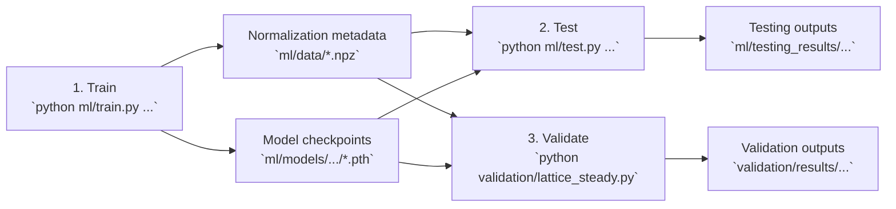

# Generative Monte Carlo

This folder contains a generative Monte Carlo workflow for neutron transport problems. The codebase has three main parts:

- `physics/`: Monte Carlo data generation for 1D, 2D, 3D, and time-dependent transport problems.
- `ml/`: conditional flow matching training and inference code, plus saved models, normalization metadata, and output plots.
- `validation/`: lattice-style validation scripts that compare the generative model against reference Monte Carlo simulations.

## 🚦 Workflow



## 📁 Folder Layout

- `physics/`: low-level Monte Carlo samplers and transport kernels.
- `ml/train.py`: generates simulation data, computes normalization metadata, trains the model, and saves checkpoints.
- `ml/test.py`: loads a saved model and normalization metadata, generates inference samples, and writes plots and metrics.
- `ml/data/`: saved normalization metadata such as `norm_params_2d_boundary.npz` and `norm_params_2d_internal.npz`.
- `ml/models/`: saved checkpoints such as `best_model.pth` and `trained_model_final.pth`.
- `ml/training_results/`: loss curves and loss histories from training.
- `ml/testing_results/`: plots and error summaries from testing.
- `validation/`: larger benchmark scripts, including `lattice_steady.py`.

## ▶️ Running Training

Run training from this folder:

```bash
python ml/train.py --data_dim 2d --source_type boundary --sampling random --num_epochs 50 --num_neutrons 100000
```

This command will:

- generate Monte Carlo training data on the fly,
- compute and save normalization metadata,
- train a conditional flow matching model,
- save best and final checkpoints,
- save loss curves and CSV/NumPy loss histories.

For the example above, the main outputs are:

- normalization metadata: `ml/data/norm_params_2d_boundary.npz`
- best checkpoint: `ml/models/2d_boundary/best_model.pth`
- final checkpoint: `ml/models/2d_boundary/trained_model_final.pth`
- training curves and histories: `ml/training_results/2d_boundary/`

Important detail: the training script uses `.npy` as a base path internally, but the normalization metadata is actually written as `.npz`. So when training says it is saving `norm_params_2d_boundary.npy`, the file you should expect on disk is `ml/data/norm_params_2d_boundary.npz`.

If you train with non-default settings, filenames can gain suffixes:

- non-default sampling adds `_<sampling>`, for example `best_model_qmc.pth` and `norm_params_2d_boundary_qmc.npz`
- non-default scheduler adds `_<scheduler>` to model filenames, for example `best_model_cosine.pth`
- if both are non-default, the model suffix becomes `_<scheduler>_<sampling>`

## 🧪 Running Testing

Run testing from this folder:

```bash
python ml/test.py --data_dim 2d --batch_size 30000 --source_type internal
```

For that example, `ml/test.py` will look for:

- model directory: `ml/models/2d_internal/`
- normalization metadata: `ml/data/norm_params_2d_internal.npz`

Testing writes plots and metric summaries to:

- `ml/testing_results/cfm_test_2d_internal_condOT_train-random_infer-random/`

If the model was trained with a non-default sampling strategy, pass it back to the test script so it loads the matching normalization file and checkpoint:

```bash
python ml/test.py --data_dim 2d --source_type internal --train_sampling qmc
```

Useful testing flags:

- `--train_sampling`: selects which training-time normalization/checkpoint suffix to load
- `--infer_sampling`: controls how inference conditions/noise are sampled during testing
- `--scheduler`: should match the scheduler used during training if it was not the default `condOT`
- `--batch_size`: number of inference samples for evaluation

## ✅ Running Validation

Run the lattice steady-state validation from this folder:

```bash
python validation/lattice_steady.py
```

This script uses the 2D trained models and normalization metadata already referenced in the file:

- boundary model: `ml/models/2d_boundary/`
- internal model: `ml/models/2d_internal/`
- boundary normalization base: `ml/data/norm_params_2d_boundary.npy`
- internal normalization base: `ml/data/norm_params_2d_internal.npy`

Those normalization base paths resolve to the saved `.npz` metadata files in `ml/data/`.

Validation outputs are written under:

- `validation/results/`

For `lattice_steady.py`, the current results directory is:

- `validation/results/lattice_2d_16/`

## 📝 Notes

- Run all commands from the root of this folder, not from inside `ml/` or `validation/`.
- Training and testing support several `data_dim` values, including `1d`, `2d`, `3d`, `1d_timedep`, `2d_timedep`, `3d_timedep`, `2d_triangle_timedep`, and `2d_quad_timedep`.
- The example commands above use the default scheduler `condOT` and default training sampling `random`, so they produce the unsuffixed filenames already present in this folder.

## ⚡ Electron Transport Notes

Electron training data comes from `ElectronTransport/ElectronMC.py` (3D directions, 2D position, projected onto the x-y plane).

- Generate data with training inputs that include an out-of-plane component (`w_max_angle_deg`), so `r_in = sqrt(u² + v²)` spans `[cos(w_max_angle), 1]`. The hidden `w` is recoverable from `r` (`w² = 1 - r²`), and the model already conditions on `(phi, r)`.
- Scattering in the MC is memoryless (depends on energy and step only), which is required for cell-to-cell chaining to be consistent with a continuous MC track. Highland's log factor is frozen at `L_ref` (default: the training box size).
- Train: `python ml/train.py --data_dim 2d_electron --electron_npz <file.npz>`
- When chaining with `validation/macro_chaining_plot.py`, pass `--cell_size` equal to the training box (cm) and use `--ode_steps` of 50 or more (the default of 10 can narrow sampled distributions).

## 🚪 Exit-Class Classifier

`ml/exit_classifier.py` learns *which* face a particle leaves through (or whether it stops inside the cell), so the flow only has to model the continuous state. Its input is the flow's own conditioning vector, so it works for any `data_type`.

- Class convention (`ml/cell_topology.py`): faces first, then interior outcomes. 2D polygons use CCW edges (square/canonical quad: 0 bottom, 1 right, 2 top, 3 left); triangle, box and tetra topologies are built in. Use `topology.with_interior("absorbed", "census")` for time-dependent models, and `valid_class_mask` to share one model between triangles and quads.
- Train: `python ml/exit_classifier.py --data_dim 2d_electron --electron_npz <file.npz> [--norm_params ml/data/norm_params_2d_electron_boundary.npy]`. Pass `--norm_params` to share the flow's normalization. Writes the checkpoint plus `exit_classifier_check_*.png` (predicted vs MC class fractions per bin, with z-scores).
- Chain: `python validation/Macro_field.py ... --exit_classifier ml/models/2d_electron_boundary/exit_classifier.pth`. The face is sampled from the classifier, and the (not face-conditioned) flow is redrawn until it agrees.
- New data dims: add a branch to `_load_problem` in `ml/exit_classifier.py` that returns an integer `exit_class` column.

### Face-Conditioned Electron Flow

`--data_dim 2d_electron_face` trains a flow on exiting particles only. Its conditioning is the `2d_electron` conditioning plus a one-hot exit face. Its target is `(s, psi, r, f_out, path)`: position along the face, exit angle from the outward normal (always outgoing), in-plane magnitude, energy fraction and path length. At inference, sample the class from the exit classifier and run this flow only for the exits.

- Train: `python ml/train.py --data_dim 2d_electron_face --electron_npz <file.npz> --run_tag _analog_cu`. `--run_tag` suffixes the model, results and norm-param paths so the defaults are not overwritten.
- Compare against held-out MC: `python validation/electron_cell_compare.py --test_npz ... --baseline_ckpt ... --face_ckpt ... --classifier ... --ref_npz <independent MC>` (full example in the script docstring).

### Chaining Electron Cell Models

- `validation/chain_core.py` holds the cell-to-cell loop (numpy only). Every cell model is a kernel `kernel(y_c, u_c, v_c, w, E, step) -> {cls, x, y, u, v, w, E_out}` in the canonical left-face frame. `validation/gmc_kernels.py` has the baseline flow, flow + classifier and classifier + face-flow kernels.
- `validation/Macro_field.py` (old flags still work): `--checkpoint` for the baseline flow, add `--exit_classifier` to sample the face from the classifier, or use `--face_ckpt --face_norm --exit_classifier` for the face-conditioned model. `--norm_params` selects non-default flow norm params.
- To compare against analog MC on the same grid:
  1. `../ElectronTransport/.venv/bin/python validation/mc_chain.py --out validation/results/chain_analog_cu/mc_ref.npz` (needs the ElectronTransport venv). This writes the source, the full-grid MC dose and the MC-chained dose (the analog MC used as the cell kernel, i.e. the best any GMC with the primary-only / local-deposit structure can do).
  2. Run it again with `--seed 456` for the MC-vs-MC noise floor.
  3. `python validation/electron_chain_compare.py --mc_ref ... --noise_ref ... --baseline_ckpt ... --face_ckpt ... --classifier ...`
- `ml/train.py --energy_encoding log_loss` (`2d_electron_face` only) trains on log10 of the energy-loss fraction instead of probit(E_out fraction). It is an option, not the default: in the analog Cu test it did not remove the high-E deposit bias, which comes from the flow under-filling the heavy tail of the loss distribution.
