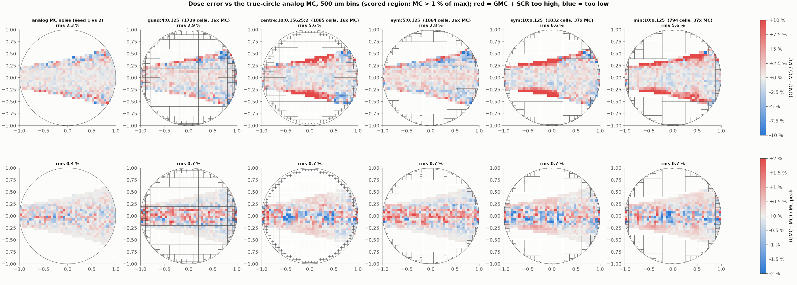
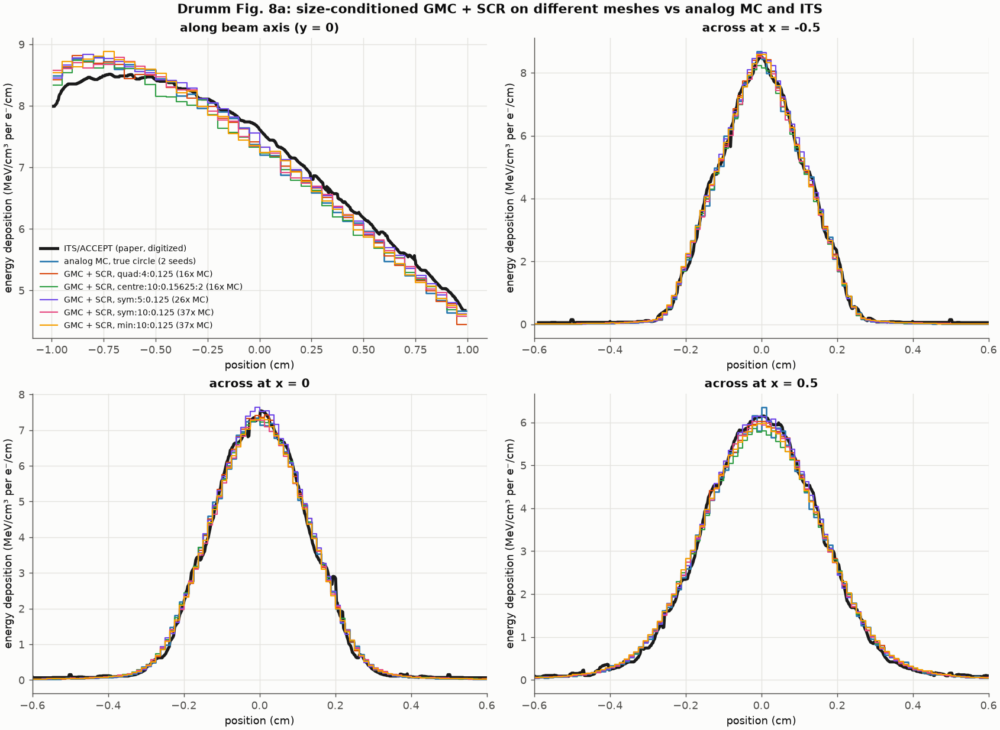

# Size-conditioned water GMC + SCR, and fast meshes for the Drumm cylinder

Work of 2026-11-22. Commits `5a62c3e` (ElectronTransport, data generator), `e5cffb2`, `d9df4d8`, `50415c7` (GMC) and
the commit that adds this document.

## Summary

- One water model set now covers **square cells of any side from 100 µm to 1 cm**: the cell side L is a continuous
  input, like the energy. A mesh no longer needs a separate model per cell size.
- On the Drumm water-cylinder benchmark (20 MeV beam, 2 cm cylinder), chained GMC + sub-cell reconstruction (SCR) on
  the fastest meshes runs **36.6× faster than analog MC**. Its whole-map bias is 2.0–2.3 % on 125 µm bins and about
  1.1 % on 0.5 mm bins.
- Two bugs found on the way were fixed:
  1. the exit flow inherited a noisy scattering-width table, which made the beam wings depend on cell size;
  2. the local photon energy was placed with the electron deposit shape, which caused a dip at the entry of 1 cm cells.

| mesh | cells (water) | water transits / primary | ms / primary | speed-up vs MC | map bias, 125 µm | map bias, 0.5 mm | beam-edge energy (\|y\| 2.5–4 mm) |
|---|---|---|---|---|---|---|---|
| uniform:1 (1 mm squares) | 400 (316) | 25.5 | 0.356 | 11.9× | 3.0 % | 0.8 % | — |
| quad:4:0.125 | 1729 (953) | 17.2 | 0.257 | 16.4× | 2.2 % | 1.0 % | 0.996 |
| centre:10:0.15625:2 | 1885 (1297) | 16.3 | 0.266 | 15.9× | 2.4 % | 1.2 % | 1.045 |
| sym:5:0.125 | 1064 (464) | 8.0 | 0.160 | 26.5× | 2.2 % | 1.1 % | 0.985 |
| sym:10:0.125 | 1032 (432) | 5.5 | 0.116 | 36.5× | **2.05 %** | 1.1 % | 1.048 |
| **min:10:0.125** | **794 (378)** | 5.5 | 0.116 | **36.6×** | 2.3 % | 1.1 % | 1.042 |

Notes on the table:
- All runs use the `_sx2` GMC, the v2 SCR kernel, K8 sampling (`--K_min 8 --K_scale 0.25`) and photon energy placed on
  the transit chord.
- Each run is 500k primaries × 2 seeds.
- The reference is the analog MC on the true circle: 4.23 ms per primary, two 500k seeds.
- "Map bias" is the whole-map relative bias with noise removed (`noise_split`). Scored bins are inside the circle with
  MC > 1 % of its maximum. The analog MC's own noise on the 125 µm map is 5.1 %.
- The last column is GMC/MC energy in the beam-edge band |y| 2.5–4 mm for x < 5 mm. MC noise there is 0.4 %.





How to choose a mesh:
- **Fastest:** `min:10:0.125` or `sym:10:0.125`. They match MC in the beam core within 0.1 %. The beam edge inside
  their 8 mm and 1 cm cells is 4–5 % too high in energy, which is under 1 % of the peak dose. See the open issues.
- **Fastest with clean edges:** `sym:5:0.125` (water cells ≤ 5 mm). Its wings match MC at the noise level.

## 1. Training data: one generator for all cell sizes

`ElectronTransport/generate_size_sweep.py` writes resumable 500k-primary files (`part_XXXX.npz` + `_subcell.npz`).
Each file is 50 inner batches of 10k primaries, and each batch uses one cell side:
- L is log-uniform in 100 µm – 1 cm, stratified per file;
- energy is log-uniform in 1 keV – 30 MeV;
- entry directions cover the half-space (`v_spread 1`, `w_max_angle 90°`);
- physics: ELSEPA elastic scattering, ESTAR stopping, secondary threshold 10.

The sub-cell dose grid is n = max(64, L / 10 µm) bins per side. Cells ≥ 0.64 mm therefore resolve 10 µm, and a
100 µm cell resolves 1.6 µm.

Data sets:
- training: `sweep_water_100um-1cm_30MeV_42`, 40 files = 20M primaries, about 124 s per file;
- test: `sweep_water_100um-1cm_30MeV_7`, 2 files.

Generation and training both work file by file, so either can be stopped and resumed (`manifest.json`, the
`state.pth` of the trainers, an `<out>/STOP` file).

## 2. Models

### GMC: `ml/models/size_gmc_water_100um-1cm_30MeV_sx2`
- Trained with `ml/size_stream.py gmc`, one visit per file: 6 sweeps, 240 visits, 2.6 h.
- The models are the same as before (joint exit classifier, plus flow-matching exit, daughter, photon and stop flows).
  The conditioning gains `log L` and `log10(L / R_CSDA(E))`.
- The single-size code path is bit-identical to before.

### SCR kernel: `ml/models/size_scr_water_100um-1cm_30MeV_v2`
- Trained with `ml/size_stream.py scr`: 320k steps over 3 sweeps, lr 5e-4, `--seg_weight size` (equal weight per log-L
  interval).
- `--min_spread_cell 5e-4` sets a dequantization floor in cell units. Without it, the 1000 × 1000-bin images of 1 cm
  cells caused loss spikes (v1).

### Per-size checks (test file, 5 log-L bands)
Results are in `validation/results/size_gmc/cell_sx2` and `.../scr`, from `validation/size_cell_compare.py`.
- **GMC:**
  - boundary dose GMC/MC is 0.999–1.003 in every band;
  - classifier |z| ≤ 1.8;
  - exit energy 1.000;
  - as good as the dedicated one-size 100 µm and 1 mm models on their own test sets.
- **SCR:** the noise-removed bias of the depth and lateral profiles is ≤ 0.9 % in every band.

## 3. Meshes

Mesh specs are given with `validation/drumm_quadtree.py run --mesh <spec>`. Every square-cell mesh is handled by
`validation/chain_quadtree.QuadMesh`:
- cells are squares of any size whose corners lie on an `h` lattice;
- point location uses an index grid, so cells need **no quadtree alignment and no power-of-two sides**;
- the chain is bit-identical to `chain_secondaries` on a uniform mesh.

| spec | construction |
|---|---|
| `uniform:<L>` | uniform squares |
| `quad:<L_max>:<h>` | L_max tiling; cells cut by the circle are split down to h |
| `centre:<L_c>:<h>[:<grade>]` | one L_c square on the axis; L_c / 2 squares halved toward the surface |
| `sym:<L_max>:<h>` | fewest-cells greedy square tiling, mirror-symmetric about the beam axis |
| `min:<L_max>:<h>` | the same without symmetry, best of 26 tie-break rules (`minsym:` keeps the symmetry) |

`sym` and `min` both come from `tile_mesh`:
- The surface is the **same h staircase as `quad:<..>:h`**: a lattice cell is water if its centre is inside the
  circle, and every square is all water or all vacuum.
- Squares are placed largest first, up to L_max for water (the model range ends at 1 cm) and unlimited for vacuum.
  Whatever is left becomes h cells.
- The "contact" tie-break prefers the candidate with the most border contact with filled, other-material or outside
  cells. It cut the count from 1032 to 806, and randomized ties brought it to 794.
- Dropping the mirror symmetry does not lower the count (also 794): the staircase forces the small cells.
- A pass that merges cells exactly filling a homogeneous square found nothing left to merge.

Of the 794 cells, 510 are 125 µm cells, 230 water and 280 vacuum. Speed depends on water transits per primary rather
than total cell count, and the beam axis crosses only four water cells.

## 4. Fix 1: beam-wing bias that depended on cell size (`_sx` → `_sx2`)

**Symptom.** The beam wings were wrong by an amount that depended on cell size:
- 1 mm cells: +3 to +10 %;
- 2–4 mm cells: −2 to −6 %.

**Ruling out the chain.** `validation/drumm_analog_chain.py` runs the same mesh chain with an exact analog-MC cell
kernel (`chain_quadtree.MCSizeKernel`). Exact by the Markov property, it reproduces the true-circle MC, so the chain
bookkeeping was right and the error had to be in the GMC.

**Cause.**
- The scaled boundary exit flow (`exit_B`) predicts the exit position in units of a per-transit scattering width
  σ(E, L).
- That table was measured on 4 files with 8 L bins. Its rms is dominated by the tails, so it was noisy: ±5–7 % at
  20 MeV.
- `exit_B` inherited the noise. `validation/scatter_width_scan.py` measured it on an MC scan of 13 cell sizes:
  - +5 % at 1 mm;
  - −5 to −10 % at 2–4 mm and at 10 mm.
- Single-transit checks on the training data can only constrain this to ±2–5 %, which is why they missed it.

**Fix.**
- `smooth_scatter_table` rebuilds the table from all 40 files and 16 L bins with count-weighted local-linear Gaussian
  smoothing of log σ. Its nodes sit on the range ends; `_sx` had clamped beyond 8.7 mm and was −6.6 % at 1 cm.
- The table is stored as a separate exit-only table (`spec.sigx_*`), and only `exit_B` was retrained (27 min):
  `size_stream gmc --init_from ... --train_only exit_B --smooth_exit_sigma --spec_files 40`.

**Result.**
- The 20 MeV width matches MC within about 3 % from 0.8 mm to 1 cm.
- Wing rms: uniform:1 7.9 % → 0.9 %; quad:4:0.125 1.8 % → 1.4 %.
- The per-size cell checks did not change.

## 5. Fix 2: dip at the entry of 1 cm cells (photon placement)

**Symptom.** With a 1 cm cell on the axis, the dose was −3.6 % low in its first 1.5 mm and slightly high just upstream.

**Diagnosis.** The tests ruled out each candidate in turn:
1. The 1 cm cell's total energy matched MC within 0.06 %.
2. `validation/scr_probe.py mc --entries` replays the entries an analog chain logged into the cell, through MC, in the
   training-data format. That gives exact sub-cell images for the real entry mix.
   - The SCR kernel on those exact MC transits matched within ±1.5 %.
   - `scr_probe.py gmc` (GMC transits plus SCR for the same entries) matched within about ±2 % at every depth.
3. The entries the GMC chain delivers to the cell match the analog chain's in count, energy, position and angle.
4. **The map without photon energy (esc) had no dip** (0.996 / 1.004).

**Cause.**
- In the paper's convention, photon energy is deposited in the emitting transit. That is about 15 % of the dose.
- The tally spread that energy with the *electron* deposit shape, which builds up about 12 % across a 1 cm cell.
- Bremsstrahlung is emitted evenly along a fast electron's track, and the MC reference puts it there.

**Fix.**
- `scr_tally_quadtree(chord=...)` places the photon energy of every exiting transit uniformly along its entry → exit
  chord.
- This is the default: `drumm_quadtree run --photon_place chord`.
- On exact MC transits, chord placement reproduces the true emission profile.

**Result.** The dip went to about −1.5 % (noise ±0.9 %), and the map bias of every mesh improved by 0.1–0.2 points.

## 6. Resolution of the SCR

- The reconstruction samples continuous positions, so any tally grid can be requested.
- Real detail is limited by the training images:
  - 10 µm in cells ≥ 0.64 mm, and L/64 below that;
  - the flow's finest spline bin is 10⁻³ L, which is 10 µm at 1 cm.
- The Drumm comparisons tally on 125 µm. Nothing finer has been checked against MC.

## 7. Open issues

1. **Beam edge too broad inside cells ≥ 8 mm.**
   - Measured: +4–5 % energy at |y| 2.5–4 mm (red bands in the error maps); under 1 % of the peak dose.
   - In a standalone 1 cm cell with exact entries, GMC + SCR overfills 3–4 mm off-axis by 6–13 %. The SCR alone on
     exact MC transits does not, so the cause is the GMC's transit outputs at L ≈ 1 cm, the edge of the trained range.
   - The photon chords of the ~1 % far-tail exits add to it.
   - Meshes with water cells ≤ 5 mm do not show it.
2. **First 0.1 mm of a 1 cm cell.** The SCR's first 0.1 mm bin is about 4 % low (on exact transits). This is
   negligible on 125 µm tallies.
3. **Vacuum cells.** About half the cells of `min`/`sym` are vacuum staircase cells. They are cheap but count toward
   the cell total.
4. **Batch size.** `--batch 250k` hits the CUDA display watchdog; 100k is the default.

## 8. Tools added

| tool | what it does |
|---|---|
| `validation/chain_quadtree.py` | Chain on non-conforming square meshes. `MCSizeKernel` (exact analog cell kernel). SCR tally with `extra` and `chord` channels. |
| `validation/drumm_quadtree.py` | `run` / `compare` on any mesh spec vs the true-circle MC and ITS. Figures: `fig8a_meshes.png`, `meshes_dose_maps.png`, `speed_vs_bias.png`, `error_maps.png`. |
| `validation/drumm_analog_chain.py` | Exact analog chain on a mesh (full transit log). `compare`, `flux`, `scr` diagnostics. `scr` is *not* a like-for-like kernel test. |
| `validation/scr_probe.py` | MC images in the training format for one cell and a chosen or logged entry mix. Modes: `eval` (SCR on MC transits), `gmc` (GMC + SCR). |
| `validation/scatter_width_scan.py` | Per-transit exit-position width, GMC vs MC, across cell sizes. |
| `validation/size_cell_compare.py` | Per-size-band cell checks of the GMC and SCR. |
| `ml/size_stream.py` | Resumable file-by-file training; `--init_from` / `--train_only` / `--smooth_exit_sigma`. |
| `ml/gmc_calib.py` | Daughter-count calibration (a diagnostic; it did not affect the wings). |

## 9. Reproduce

```bash
# data (ElectronTransport venv; the defaults are the settings above), resumable: logs_size/gen.sh
python generate_size_sweep.py --out_dir sweep_water_100um-1cm_30MeV_42 --seed 42 --n_files 40
python generate_size_sweep.py --out_dir sweep_water_100um-1cm_30MeV_7 --seed 7 --n_files 2
# training (GMC repo): logs_size/train_gmc.sh, train_scr.sh, train_gmc_sx2.sh
# Drumm runs and comparison
.venv/bin/python validation/drumm_quadtree.py run --mesh min:10:0.125 --K_min 8 --K_scale 0.25
.venv/bin/python validation/drumm_quadtree.py compare --runs validation/results/drumm_size/*_chord.npz
```
