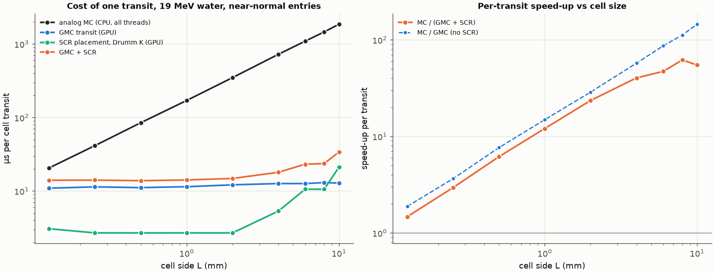
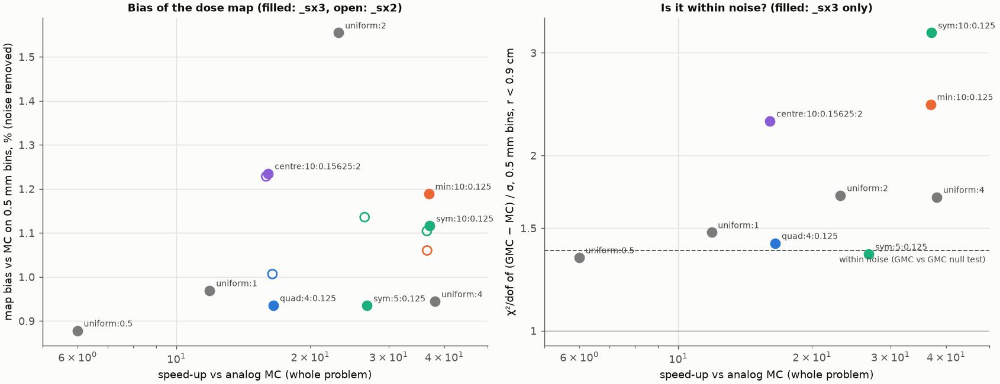
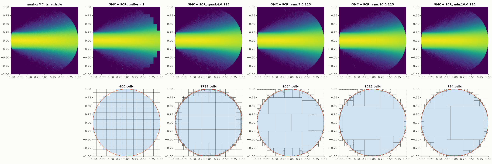
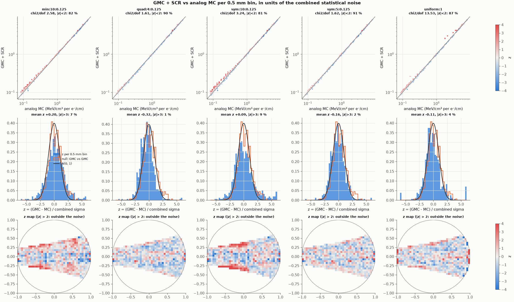
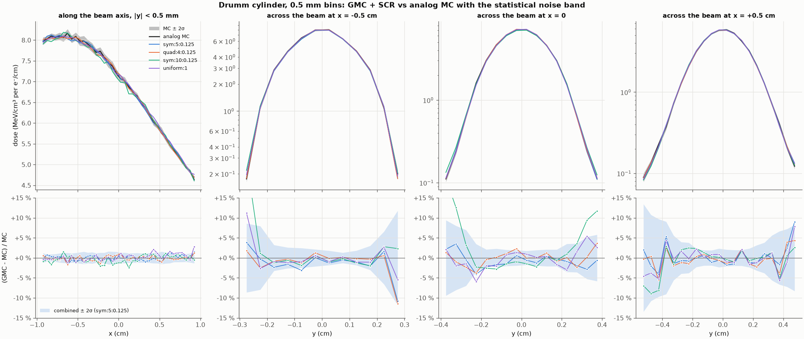

# Size-conditioned water GMC + SCR: cost vs cell size, speed vs accuracy, and is it within noise?

Work of 2026-11-23. It follows [`size_conditioned_gmc.md`](size_conditioned_gmc.md) (models, meshes and the two fixes
of 2026-11-22). It adds four things:
1. a targeted fine-tune of the GMC, `_sx3`;
2. timings per cell transit vs cell side;
3. a speed/accuracy comparison over all meshes;
4. a statistical test of whether GMC + SCR agrees with analog MC to within the Monte Carlo noise.

## Summary

- **Cost per transit.** Analog MC grows linearly with the cell side, about 185 µs per mm of water at 19 MeV. The GMC
  transit is almost flat at 11–13 µs. Per transit, GMC + SCR is:
  - 1.5× faster than MC at 125 µm, so cells below ~100 µm gain nothing;
  - 12× faster at 1 mm;
  - 40–60× faster at 4–10 mm.

  From about 6 mm the SCR sampling costs as much as the GMC, and at 1 cm it dominates.
- **Whole problem** (Drumm cylinder, 500k primaries × 2 seeds, vs the true-circle analog MC at 4.23 ms per primary):
  - the fewest-cells meshes (sym:10, min:10) run **37×** faster than MC;
  - sym:5 runs **27×** faster;
  - quad:4 and centre run about 16× faster.

  The noise-removed bias of the dose map on 0.5 mm bins is 0.9–1.2 % for every non-uniform mesh.
- **Within noise?** The test is z = (GMC − MC) / σ per 0.5 mm bin. Two independent GMC runs of the same mesh (a null
  test) give χ²/dof = 1.32–1.37, not 1, because each bin's variance is estimated from only 2 seeds. So **≈ 1.35 is the
  "within noise" baseline.** Away from the circle edge (r < 0.9 cm):
  - **sym:5 (1.35) and uniform:0.5 (1.34) are within noise**;
  - quad:4 (1.41) and uniform:1 (1.47) are close;
  - meshes with **1 cm cells on the beam are not** (centre 2.29, min:10 2.45, sym:10 3.25). Their residual is a
    1–2 % energy excess at the beam edge, |y| ≈ 2–3 mm, in the first half of the cylinder.

  The uniform meshes fail badly near the circle edge (χ²/dof 4.7–21 over the whole circle). That is the staircase
  geometry, not the model.
- **Targeted fine-tune `_sx3`.** Training continued on 5M new primaries (L 3–10 mm, E 5–30 MeV, half near-normal),
  mixed with old data. χ²/dof improved on all five meshes tested: sym:10 4.17 → 3.24, min:10 2.99 → 2.58,
  centre 2.62 → 2.33, sym:5 2.00 → 1.62, quad:4 1.66 → 1.61. The cost is a small global shift: total deposited
  energy went from +0.2…+0.6 % (`_sx2`) to −0.2…−0.3 % (`_sx3`). It also added a −1.8 % beam-edge deficit on quad:4.
- **Recommended setting:** sym:5:0.125 with `_sx3`: 27× faster than MC and within noise away from the circle edge.
  min:10 / sym:10 are 37× faster, but with a visible beam-edge excess.

## 1. Targeted GMC data and fine-tune (`_sx2` → `_sx3`)

The meshes with ~1 cm cells on the beam overfilled the beam edge. A standalone probe of a 1 cm cell, using the exact
entries the analog MC logged into it, put the GMC 6–13 % high at 3–4 mm off axis, while SCR on MC transits was fine.
So the error was in the GMC at large L, a corner of the training range that the broad data covers thinly. Its L is
log-uniform over 100 µm–1 cm and its E log-uniform over 1 keV–30 MeV.

| | |
|---|---|
| data | `../ElectronTransport/sweep_water_3-10mm_5-30MeV_fwd_43`: 10 files × 500k primaries |
| L range | 3–10 mm, log-uniform |
| E range | 5–30 MeV |
| directions | half near-normal (polar angle \|N(0, 10°)\|), half the usual isotropic-inward |
| validation file | `_fwd_9` |
| sub-cell images | none (`--no_subcell`): GMC-only data, ~10 min per file |
| mix | `ml/mix_dirs.py` → `mix_water_fwd10_old10`: the 10 new files round-robin with 10 of the 40 broad files, so the rest of the (E, L) range is not forgotten |
| fine-tune | `ml/size_stream.py gmc --init_from _sx2 --finetune --stop --sweeps 3 --clf_passes 6 --flow_passes 24 --small_passes 24 --clf_lr 5e-4 --flow_lr 3e-4` |
| training time | 60 visits, ~12 min |
| output | `ml/models/size_gmc_water_100um-1cm_30MeV_sx3` |

**Checks:**
- **Validation loss on the targeted file:** small gains, e.g. exit_B 0.5726 → 0.5707, photon 0.9951 → 0.9934.
- **Single 1 cm cell, logged analog entries** (`scr_probe.py gmc`):

  | | `_sx2` | `_sx3` |
  |---|---|---|
  | in-cell dose, centre cell | +0.74 % | +0.32 % |
  | in-cell dose, sym:10 cell | +0.66 % | +0.35 % |
  | beam edge 3–4 mm, centre cell | +4…+8 % | +1…+6 % |
  | beam edge 3–4 mm, sym:10 cell | +4…+12 % | +11…+14 % |

  The sym:10-cell band at 3–4 mm is not improved.
- **Far-exit scattering widths** (`scatter_width_scan.py`, 20 MeV, 0.5–10 mm): mostly unchanged, within ±3 %. At
  1.2–2.4 mm `_sx3` is 4–5 % narrow, against −4 % at 1.2 mm and −2 % elsewhere for `_sx2`. This is a slight
  regression in a range the targeted data did not cover.
- **Per-size test file** (`size_cell_compare.py`, 5 log-L bands): boundary dose GMC/MC 0.9965–1.0047, class
  max |z| ≤ 2.15. This is the same quality as `_sx2`.

## 2. Cost of one cell transit vs cell side

`validation/timing_vs_size.py` uses the same Drumm-like entries for every L: near-normal, 0.1 rad spread, entry point
uniform on the face, 19 MeV. It was run on a quiet machine (all other jobs paused).

- **Analog MC:** `MCSizeKernel`, ElectronTransport, all CPU threads, 20k transits per size.
- **GMC:** `_sx3` through MirrorY, 100k transits per size, including the interior transits of the daughters it emits.
- **SCR:** the Drumm sampling setting, K = max(8, 0.25 × auto(L / 125 µm)).



| L (mm) | analog MC (µs) | GMC (µs) | SCR (µs, K) | GMC + SCR (µs) | speed-up |
|---|---|---|---|---|---|
| 0.125 | 20.6 | 10.9 | 3.1 (8) | 14.0 | 1.5× |
| 0.25 | 41.4 | 11.4 | 2.7 (8) | 14.1 | 2.9× |
| 0.5 | 84.9 | 11.1 | 2.7 (8) | 13.8 | 6.1× |
| 1 | 170 | 11.4 | 2.7 (8) | 14.1 | 12.1× |
| 2 | 348 | 12.1 | 2.7 (8) | 14.8 | 23.5× |
| 4 | 723 | 12.6 | 5.3 (16) | 17.9 | 40.3× |
| 6 | 1092 | 12.6 | 10.6 (32) | 23.2 | 47.1× |
| 8 | 1460 | 13.0 | 10.6 (32) | 23.6 | 61.9× |
| 10 | 1856 | 12.8 | 21.1 (64) | 33.9 | 54.8× |

Reading the table:
- **MC** cost is proportional to the path length: about 185 µs per mm.
- **GMC** cost barely depends on L: one network pass per transit, plus a few % more daughters at large L. Per-transit
  cost alone would put the break-even at ~0.1 mm.
- **SCR** cost grows with the number of samples K. K doubles each time n = L / 125 µm crosses a power of 2, so above
  6 mm the SCR costs as much as the GMC, and at 1 cm it dominates.

  K could stay at 8–16 for large cells: the tally noise is set by the number of transits, not samples. That is worth
  testing.
- **Whole problem vs per transit:** the whole-problem speed-up is lower than the per-transit one, e.g. 37× vs 55× for
  1 cm cells. The whole problem also pays for the vacuum and edge cells, the tally binning and the Python chain loop.

  Measured inside the Drumm chain, the GMC cost is 11–13 µs per water transit for every mesh (chain time / transits),
  the same as above.

## 3. Speed vs accuracy on the Drumm cylinder

All runs:
- **Setup:** 500k primaries × 2 seeds; `_sx3` GMC; v2 SCR kernel; K8 sampling (`--K_min 8 --K_scale 0.25`); photon
  energy on the transit chord.
- **Reference:** the true-circle analog MC, 2 × 500k primaries at 4.23 ms per primary.
- **Bias columns:** the rms of (GMC − MC) / MC over the cylinder, with the statistical part (GMC + MC) removed. The
  MC itself has 5.1 % noise on 125 µm bins and 1.3 % on 0.5 mm bins.

Columns of the main table:
- **χ²/dof** is from §4, computed over all bins and over r < 0.9 cm.
- **beam-edge z** is the mean z over the bins at |y| 2–3 mm in units of its own standard error, with the GMC/MC
  energy ratio there in brackets.

| mesh | cells (water) | water transits / primary | ms / primary | speed-up | bias 125 µm | bias 0.5 mm | deposited GMC/MC | χ²/dof all | χ²/dof r<0.9 | \|z\|<2, r<0.9 | beam-edge z (energy) |
|---|---|---|---|---|---|---|---|---|---|---|---|
| uniform:0.5 | 1600 (1264) | 50.8 | 0.706 | 6.0× | 3.56 % | 0.88 % | 1.0044 | 4.68 | **1.34** | 92 % | +5σ (1.012) |
| uniform:1 | 400 (316) | 25.5 | 0.356 | 11.9× | 2.93 % | 0.97 % | 0.9954 | 13.53 | 1.47 | 89 % | −3σ (0.989) |
| uniform:2 | 100 (80) | 12.9 | 0.183 | 23.2× | 2.53 % | 1.55 % | 0.9915 | 21.25 | 1.71 | 86 % | −8σ (0.981) |
| uniform:4 | 25 (21) | 6.4 | 0.111 | 38.1× | 2.04 % | 0.94 % | 0.9962 | 12.26 | 1.70 | 89 % | −5σ (0.988) |
| quad:4:0.125 | 1729 (953) | 17.2 | 0.256 | 16.5× | 2.16 % | 0.94 % | 0.9970 | 1.61 | 1.41 | 90 % | −10σ (0.982) |
| centre:10:0.15625:2 | 1885 (1297) | 16.3 | 0.263 | 16.1× | 2.33 % | 1.23 % | 0.9971 | 2.33 | 2.29 | 82 % | +4σ (1.004) |
| **sym:5:0.125** | 1064 (464) | 8.0 | 0.158 | **26.8×** | 2.18 % | **0.93 %** | 0.9979 | 1.62 | **1.35** | **92 %** | −4σ (0.993) |
| sym:10:0.125 | 1032 (432) | 5.5 | 0.114 | 37.1× | 2.16 % | 1.12 % | 0.9977 | 3.24 | 3.25 | 80 % | +10σ (1.010) |
| min:10:0.125 | 794 (378) | 5.5 | 0.115 | 36.9× | 2.28 % | 1.19 % | 0.9986 | 2.58 | 2.45 | 82 % | +11σ (1.014) |
| *null test (sym:5 vs sym:5, new seeds)* | | | | | | | | *1.32* | *1.37* | *92 %* | |

The same meshes with `_sx2` (all bins):

| mesh | ms / primary | bias 0.5 mm | deposited | χ²/dof | core z (energy) | edge z (energy) | wings z (energy) |
|---|---|---|---|---|---|---|---|
| quad:4:0.125 | 0.257 | 1.01 % | 1.0044 | 1.66 | +9σ (1.005) | −3σ (0.993) | −0σ (0.990) |
| centre:10:0.15625:2 | 0.266 | 1.23 % | 1.0015 | 2.62 | +2σ (1.000) | +8σ (1.011) | +11σ (1.015) |
| sym:5:0.125 | 0.160 | 1.14 % | 1.0059 | 2.00 | +13σ (1.007) | −3σ (0.996) | −2σ (0.985) |
| sym:10:0.125 | 0.116 | 1.10 % | 1.0024 | 4.17 | −1σ (0.999) | +15σ (1.015) | +12σ (1.015) |
| min:10:0.125 | 0.116 | 1.06 % | 1.0020 | 2.99 | −2σ (0.999) | +13σ (1.015) | +15σ (1.029) |



Dose density maps of the `_sx3` runs (top row; 125 µm bins, log scale over three decades below the MC peak) next
to the analog MC on the true circle, with each mesh underneath. At this scale every mesh reproduces the MC map; the
differences are at the percent level and are shown in the error maps and the noise test of section 4.



What the comparison shows:
- **Speed is set by the water transits per primary.**
  - The cost per water transit is about 14–20 µs for every mesh, including the tally.
  - The fewest-cells meshes need only 5.5 water transits per primary, against 17 for quad:4 and 51 for uniform:0.5.
  - uniform:4 is as fast as min:10, but its staircase changes the geometry. Its edge cells are 4 mm squares counted
    as either water or vacuum, so it misplaces the circle boundary by up to ~2 mm.
- **Cell size trades accuracy for speed in two separate ways.**
  - Large uniform cells get the circle edge wrong. That is a geometry error, and the fine-edge meshes (quad, sym, min,
    centre) remove it.
  - Large cells on the beam carry the remaining GMC error at L ≈ 1 cm, the beam-edge excess. sym:5 avoids it by
    capping the cell side at 5 mm and costs only 1.4× more than sym:10.
- **The 125 µm bias is a poorer guide than the 0.5 mm one.**
  - It mixes noise-removal error with sub-cell structure. uniform:0.5 has the best 0.5 mm bias but the worst 125 µm
    bias (3.6 %), probably a faint imprint of the 0.5 mm cell grid in the SCR placement (only 4 × 4 sub-cells per cell
    at K8). Not investigated.
  - For dose on 0.5 mm voxels, every non-uniform mesh is within 0.9–1.2 %.

## 4. Is GMC + SCR within the MC noise?

**Method** (`validation/drumm_noise_check.py`):
- For each 0.5 mm bin inside the circle with MC dose above 1 % of the maximum, compute d = GMC − MC (seed means) and
  σ² = var_GMC + var_MC.
- Each variance is the variance of the seed mean. It is estimated from the 2 seeds and smoothed over the 3 × 3
  neighbouring bins as a relative variance, so the smoothing does not mix dose levels.
- If GMC equals MC up to noise, z = d / σ is close to N(0, 1). Then χ²/dof is about 1, 95 % of bins have |z| < 2,
  and no region has a mean z far from 0.
- The region means are tested against their own standard error (core |y| < 2 mm, edge 2–3 mm, wings > 3 mm); the
  "±Nσ" values in the tables are those significances.

**Null test of the method.** `logs_size/null_run.sh` repeats sym:5 with `_sx3`, new chain seeds and new source seeds.
GMC vs GMC then gives χ²/dof **1.32** (all bins) / **1.37** (r < 0.9 cm), with 92 % of bins at |z| < 2 and 2 % at
|z| > 3.

This is the expected inflation from a variance estimated with few degrees of freedom. With ν effective degrees of
freedom, E[z²] = ν / (ν − 2), and the 3 × 3 smoothing of 1-degree-of-freedom estimates gives ν ≈ 8, so E[z²] ≈ 1.33.
**So a mesh "within noise" scores about 1.35, not 1.** The orange step histograms in the figure below show this null
distribution.



The figure has three rows:
- **Top:** GMC vs MC dose per bin, coloured by z.
- **Middle:** histogram of z against N(0, 1) and the null test.
- **Bottom:** z map. A blue/red band means GMC is systematically low/high there.



The profiles are on 0.5 mm bins: along the beam axis and across the beam at three depths, with the combined ±2σ
band.

Verdict per mesh (`_sx3`):

| mesh | within noise? | where it is not |
|---|---|---|
| sym:5:0.125 | **yes** away from the circle edge (1.35 vs null 1.37) | a few bins at the circle edge (r > 0.9 cm), where the 125 µm boundary cells meet the true circle (1.62 over all bins) |
| uniform:0.5 | **yes** away from the edge (1.34) | at the circle edge (staircase): 4.68 over all bins; a +0.5 % core excess (+7σ) |
| quad:4:0.125 | nearly (1.41) | beam edge −1.8 % energy (−10σ) |
| uniform:1 | nearly (1.47) | staircase at the circle edge (wings −7 %); 13.5 over all bins |
| uniform:2, uniform:4 | no (1.7) | staircase edge; beam edge ∓ 1–2 % |
| centre, min:10, sym:10 | **no** (2.3–3.3) | beam edge +1.0…+1.6 % energy (+10σ) in the 1 cm cells at x < 0, |y| ≈ 2–3 mm (red bands in the z maps); core −0.4 % (−7σ) |

**What "not within noise" means here.** The systematic offsets are small:
- 1–2 % of the energy in a region;
- under 1 % of the peak dose;
- the dose-map bias on 0.5 mm bins is about 1 %, below the 2.45 % per-bin noise of one 500k MC run.

They are only visible because the test pools hundreds of bins. For a dose engine they would matter only at a sharp
lateral beam edge resolved on sub-mm voxels.

## 5. Open issues

1. **Beam edge at L ≈ 1 cm.**
   - The targeted fine-tune helped (+15σ → +10σ) but did not remove it.
   - The probe shows the 3–4 mm lateral band of 1 cm cells is still 11–14 % high for entries with the sym:10 cell
     position.
   - Next things to try: more targeted data at 8–10 mm only, or a fine-tune weighted toward the far-exit lateral
     tails. Until then, cap the cell side at 5 mm on the beam (sym:5).
2. **Global −0.2…−0.3 % deposited-energy shift with `_sx3`** (`_sx2`: +0.2…+0.6 %). The near-normal targeted data
   moved the overall energy balance slightly. The core is −0.4 % (−7σ) on the 1 cm-cell meshes. A per-L energy-closure
   check on the targeted validation file is the next step.
3. **Cell-grid imprint at 125 µm with 0.5 mm uniform cells** (3.6 % fine-map bias). Probably SCR sub-cell structure at
   K8; check with K32 on uniform:0.5.
4. **SCR cost at large L** dominates above 4 mm. Capping K at 16 would raise the per-transit speed-up at 1 cm from 55×
   to about 100×. The noise impact needs a run.

## 6. Tools added

| file | what it does |
|---|---|
| `ElectronTransport/generate_size_sweep.py` | new `--no_subcell` (GMC-only files) and `--narrow_frac / --narrow_sigma_deg` (a share of near-normal entries) |
| `ElectronTransport/AnalogMC.py` | `run_simulation(..., direction_fn=)` hook for custom source directions |
| `ml/size_stream.py` | `--finetune` (with `--init_from`, start every model from the given run); GMC visits do not wait for sub-cell files |
| `ml/mix_dirs.py` | symlinked mixed data directory (round-robin over sources) + manifest |
| `validation/timing_vs_size.py` | per-transit cost vs L: `mc` (ElectronTransport venv), `gmc`, `plot` |
| `validation/drumm_noise_check.py` | per-bin z-test vs MC, regions, `--null` GMC-vs-GMC test, `--r_max` |
| `validation/drumm_profiles_noise.py` | profiles with the combined ±2σ band |
| `validation/drumm_speed_accuracy.py` | speed vs bias / χ²/dof figure |

## 7. Reproduce

```bash
# targeted data (ElectronTransport venv) + fine-tune + checks + Drumm runs: logs_size/gen_fwd.sh, logs_size/after_fwd.sh
# quiet-machine runs (uniform meshes, timing scan) and the null-test repeat: logs_size/writeup_runs.sh, null_run.sh
R=validation/results/drumm_size; W=$R/writeup
.venv/bin/python validation/timing_vs_size.py plot --mc $R/timing_mc.json --gmc $R/timing_gmc_sx3.json --png $W/timing_vs_size.png
.venv/bin/python validation/drumm_quadtree.py compare --runs $R/gmc_*_500k_K8_sx3_chord.npz $R/gmc_*_500k_K8_sx2_chord.npz --out_dir $W
NULL="--null $R/gmc_sym_5_0p125_500k_K8_sx3_chord.npz $R/gmc_sym_5_0p125_500k_K8_sx3_chord_s31.npz"
.venv/bin/python validation/drumm_noise_check.py --runs "$R/gmc_*_500k_K8_sx[23]_chord.npz" $NULL --out_dir $W/noise_all
.venv/bin/python validation/drumm_noise_check.py --r_max 0.9 --runs "$R/gmc_*_500k_K8_sx3_chord.npz" $NULL --out_dir $W/noise_r09
.venv/bin/python validation/drumm_speed_accuracy.py --summary $W/summary.json --noise $W/noise_r09/noise_check.json --png $W/speed_accuracy.png
```
