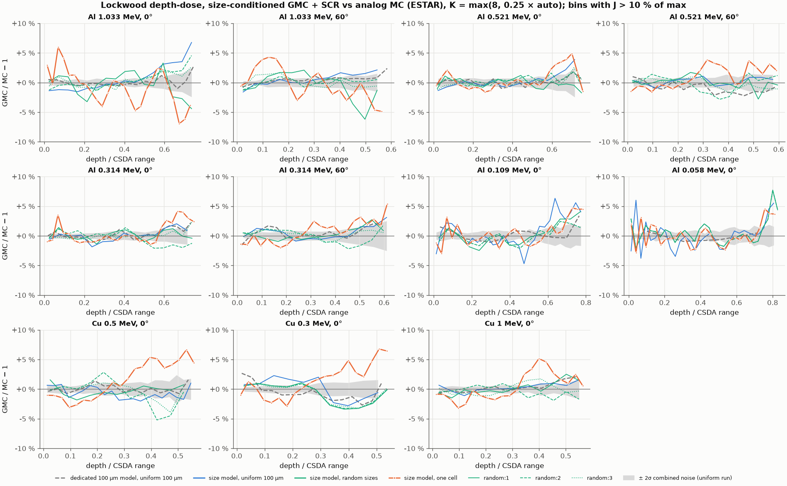
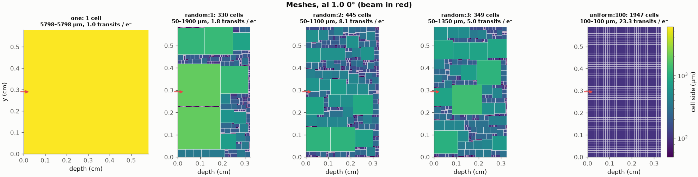
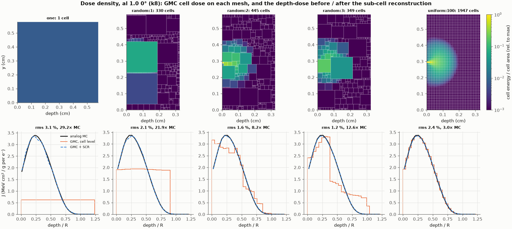
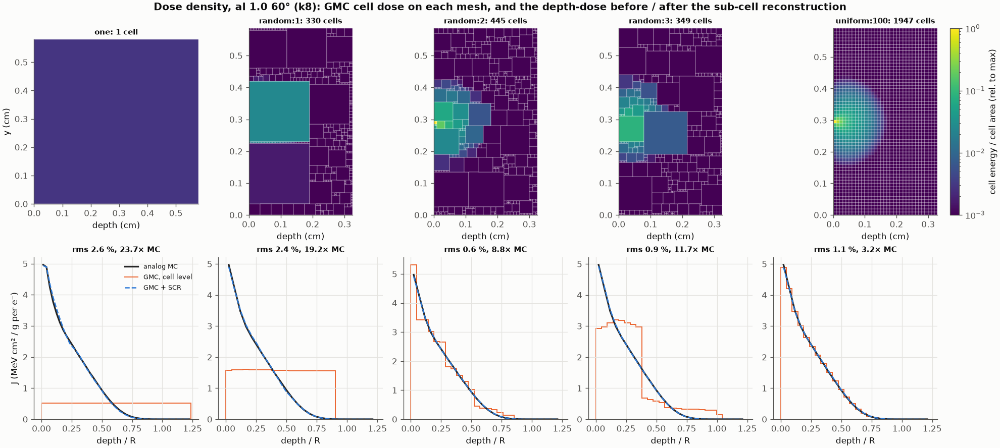
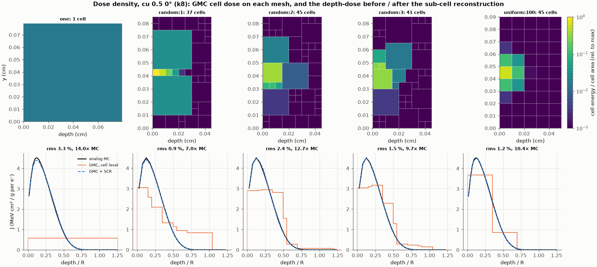
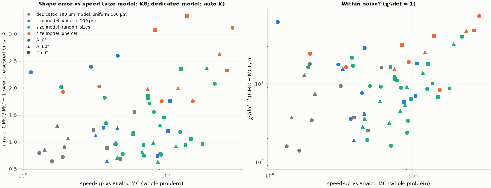
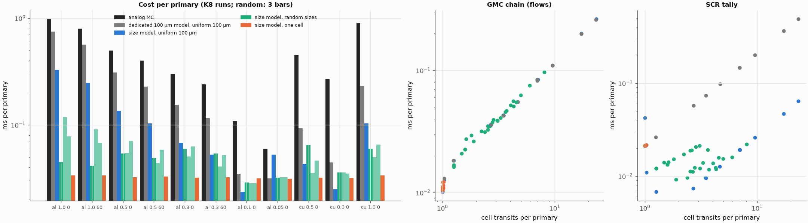

# Size-conditioned Al / Cu GMC + SCR on the Lockwood depth-dose: fewest cells and random cell sizes

Work of 2026-11-23. It applies the size-conditioned approach of [`size_conditioned_gmc.md`](size_conditioned_gmc.md)
and [`size_conditioned_gmc_speed_accuracy.md`](size_conditioned_gmc_speed_accuracy.md) (water, Drumm cylinder) to the
Lockwood / Sandia semi-infinite Al and Cu depth-dose cases. The work had four steps:
1. new Al and Cu training data with the cell side L as an input, 50 µm–6 mm;
2. retraining of the GMC and SCR on that data;
3. runs on the **fewest-cells mesh** (one cell for the whole problem), on **three random-size tilings**, and on the
   uniform 100 µm mesh;
4. comparison with analog MC and with the old dedicated 100 µm models of `lockwood_slab.py`.

## Summary

- **Totals are right everywhere.** On every mesh and every case, the deposited energy agrees with analog MC to within
  0.6 %.
- **Fewest cells (one cell, side 2.75 × the CSDA range):**
  - **12.1× median speed-up vs MC** (1.9× at 58 keV, 27–29× at 1 MeV);
  - the depth-dose **shape error is 1.8–3.3 % rms, not within noise** (χ²/dof 8–74);
  - errors are ±4–6 % ripples (Al 1 MeV), a 4–7 % deficit at 0.7 R (Al 1 MeV), and a deep excess rising to +6 %
    (Cu 0.3 and 0.5 MeV).

  It gives the right totals and the rough depth-dose, not benchmark accuracy.
- **Random cell sizes (50 µm lattice, log-uniform sides up to R):**
  - **7.5× median speed-up**, 0.6–2.4 % rms (median 1.17 %);
  - best on Al 0.3–0.5 MeV: random:3 reaches χ²/dof 1.6–1.9, which is within or close to noise. Cu 1 MeV is within
    1.1 % at 14–18×;
  - accuracy follows the size of the **cell the beam enters** (§4). An entry cell of 0.1–0.5 R is good; ≥ R is as
    bad as the one-cell mesh.
- **Size model on the uniform 100 µm mesh:**
  - median 1.3 % rms, against 0.9 % for the old dedicated 100 µm model on the same mesh;
  - it is worst at Al 1 MeV: +3–7 % in the tail, which is 23 transits of exit-bias accumulation.

  Water showed the same broad-model penalty before its targeted fine-tune (`_sx3`). With K8 the size model is
  2.3× faster (median) than the dedicated model, at the same chain cost per transit. Cu 1 MeV is the exception:
  there the size model is more accurate than the dedicated one (0.74 vs 0.88 % rms).
- **K8 sampling** (K = max(8, 0.25 × auto), the Drumm setting) gives the same accuracy as the default auto K. The
  rms is unchanged to 0.02 %. It makes the one-cell mesh 3× cheaper, because the SCR tally is about 90 % of its
  cost at auto K.
- **Cost per transit is ~11 µs**, the same as water and the old models. The one-cell tally adds a fixed
  ~21 µs per primary at K8. Below ~0.3 MeV the analog MC costs only 0.06–0.3 ms per primary, so no
  mesh gains more than 2–10× there.
- **Low-energy cases (Al 58 / 109 keV, Cu 0.3 MeV)** have CSDA ranges of 25–140 µm. That is at or below the model's
  50 µm minimum, so every mesh is 1–3 cells. Every mesh, the old dedicated model included, has χ²/dof 9–60 there.



## 1. Data and training

| | Al | Cu |
|---|---|---|
| cells | squares, L log-uniform 50 µm–6 mm | same |
| energies | 1 keV–1.5 MeV, log-uniform | same |
| sub-cell bins | n = max(64, L / 10 µm) | same |
| training data | 40 files × 500k primaries (seed 42), 9.2 GB | 40 files × 500k (seed 42), 7.0 GB |
| validation data | 2 files (seed 7) | 2 files (seed 7) |
| generation time | ~2 min per file (82 min) | ~1.2 min per file (47 min) |

The data was made with `generate_size_sweep.py` (ElectronTransport), ESTAR stopping and ELSEPA elastic scattering,
with the same physics as the ESTAR MC reference.

Training (`ml/size_stream.py`) used two lanes on the 16 GB GPU, GMC and SCR side by side, Al and then Cu:
- **GMC:** 240 file visits (6 sweeps), `--stop --smooth_exit_sigma --spec_files 12`, so the smooth σ(E, L) exit
  table (the `_sx2` fix) is on from the start. It took 92 min (Al) and 97 min (Cu).
- **SCR:** an RQ-spline kernel trained for 320k steps (120 visits). It took 142 min (Al, sharing the GPU) and 95 min
  (Cu).

Models: `ml/models/size_{gmc,scr}_{al,cu}_50um-6mm_1.5MeV`.

**Per-size check on held-out data** (`eval_gmc_{al,cu}.log`). In every cell-size band from 100 µm to 10 mm:

| | boundary-entry dose / MC | exit energy / MC | classifier z |
|---|---|---|---|
| Al | 0.988–1.007 | within 1.2 % | ≤ 2.05 |
| Cu | 0.996–1.012 | within 1.7 % | ≤ 2.21 |

Interior-start rows have only a few hundred transits per band and are noisy.

## 2. Meshes

All meshes use `validation/lockwood_quadtree.py`:
- **The box** holds the material, at least 1.4 R deep and 2.5 R high (R = 1.1 × the CSDA range).
- **The beam** enters mid-height of the left face, at 0° or 60°.
- **Escapes:** anything leaving the box is lost, and photons escape.
- **The tally:** the SCR deposition is summed over y into J(depth).

| mesh | what it is |
|---|---|
| `one` | **fewest cells**: one square of side 2.5 R (clipped to 50 µm–6 mm). The whole depth-dose comes from the SCR of one transit |
| `random:<seed>` | random tiling of a 50 µm lattice: at each free lattice point a square of side k × 50 µm, k log-uniform in [1, R / 50 µm] (≤ 6 mm), shrunk to fit |
| `uniform:100` | uniform 100 µm squares (the baseline; same geometry as the old dedicated model) |
| dedicated 100 µm model | the earlier `lockwood_slab.py` runs with the Al/Cu 100 µm ESTAR models (`*_200k_n20_estar.npz`) |



Cells, side range and cell transits per primary:

| case | one | random:1 | random:2 | random:3 | uniform:100 |
|---|---|---|---|---|---|
| Al 58 keV | 1 (68 µm, 1.0) | 3 (50 µm, 1.0) | 3 (50 µm, 1.0) | 3 (50 µm, 1.0) | 1 (100 µm, 1.0) |
| Al 109 keV | 1 (207 µm, 1.0) | 12 (50–100 µm, 1.3) | 12 (50–100 µm, 1.3) | 12 (50–100 µm, 1.3) | 6 (1.0) |
| Al 0.314 MeV 0° | 1 (1.15 mm, 1.0) | 43 (50–400 µm, 3.1) | 48 (50–350 µm, 3.1) | 69 (50–300 µm, 4.3) | 91 (4.7) |
| Al 0.521 MeV 0° | 1 (2.38 mm, 1.0) | 100 (50–850 µm, 2.5) | 157 (50–550 µm, 3.3) | 136 (50–650 µm, 4.5) | 350 (9.6) |
| Al 1.033 MeV 0° | 1 (5.80 mm, 1.0) | 330 (50 µm–1.9 mm, 1.8) | 445 (50 µm–1.1 mm, 8.1) | 349 (50 µm–1.35 mm, 5.0) | 1947 (23.3) |
| Cu 0.3 MeV | 1 (384 µm, 1.0) | 17 (50–150 µm, 1.6) | 22 (50–150 µm, 1.6) | 19 (50–150 µm, 1.5) | 15 (1.3) |
| Cu 0.5 MeV | 1 (792 µm, 1.0) | 37 (50–300 µm, 3.6) | 45 (50–200 µm, 1.9) | 41 (50–200 µm, 2.7) | 45 (2.7) |
| Cu 1 MeV | 1 (1.92 mm, 1.0) | 85 (50–650 µm, 2.8) | 81 (50–500 µm, 2.8) | 85 (50–500 µm, 4.0) | 231 (7.0) |

The 60° cases use the same meshes, with fewer transits per primary. Cu 1 MeV has no Lockwood measurement (it is
marked `missing` in `load_cases`), but it has an ESTAR MC reference, so it was run with `--cases cu_1.0_0`.

Dose density on each mesh (K8 runs). Top row: the GMC cell dose density, cell energy ÷ cell area, log scale relative
to the largest cell (the beam enters at mid-height on the left). Bottom row: the depth-dose J against depth / R for
the analog MC, the GMC cell-level dose (each cell's energy spread evenly over its depth extent, i.e. no SCR) and
GMC + SCR (what is scored). The cell-level curve shows how little the coarse meshes resolve on their own; the SCR
recovers the MC shape from it, down to the single cell of `one`.







## 3. Speed and accuracy

Runs: 200k primaries × 2 seeds, 20 ODE steps, K8. The reference is the analog MC with ESTAR stopping (200k
primaries, seed 79). Scoring:
- depth bins of R / 25, scored where the MC J is above 10 % of its maximum;
- the noise σ combines the GMC 2-seed spread with the MC error;
- rms is that of GMC / MC − 1 over the scored bins;
- the speed-up is MC ms per primary ÷ GMC ms per primary (chain + tally, whole problem).

Each cell gives **speed-up · rms shape error · χ²/dof**:

| case | MC ms/e⁻ | one | random:1 | random:2 | random:3 | uniform:100 | dedicated 100 µm |
|---|---|---|---|---|---|---|---|
| Al 0.058 MeV 0° | 0.060 | 1.9× · 1.9 % · 24.2 | 1.9× · 2.0 % · 16.2 | 1.9× · 2.0 % · 16.2 | 1.9× · 2.0 % · 16.2 | 1.1× · 2.3 % · 61.4 | 1.9× · 0.7 % · 18.0 |
| Al 0.109 MeV 0° | 0.108 | 3.4× · 2.0 % · 16.2 | 3.7× · 1.8 % · 21.6 | 3.8× · 1.4 % · 17.0 | 3.8× · 1.4 % · 17.0 | 4.6× · 2.6 % · 28.7 | 3.1× · 1.2 % · 9.4 |
| Al 0.314 MeV 0° | 0.300 | 9.3× · 1.8 % · 18.9 | 5.0× · 0.8 % · 9.4 | 5.9× · 1.2 % · 9.1 | 4.8× · 0.7 % · **1.9** | 4.4× · 1.0 % · 7.6 | 2.0× · 0.9 % · 3.4 |
| Al 0.314 MeV 60° | 0.240 | 7.4× · 2.0 % · 15.3 | 4.5× · 1.0 % · 2.8 | 5.9× · 1.2 % · 6.0 | 4.6× · 0.7 % · 3.6 | 4.6× · 1.3 % · 4.2 | 2.1× · 1.1 % · 7.5 |
| Al 0.521 MeV 0° | 0.497 | 15.4× · 1.8 % · 8.3 | 9.2× · 0.8 % · 3.4 | 9.1× · 0.8 % · 2.4 | 7.0× · 0.7 % · **1.6** | 3.7× · 1.3 % · 3.6 | 1.6× · 0.6 % · 1.4 |
| Al 0.521 MeV 60° | 0.399 | 12.1× · 2.0 % · 25.1 | 8.1× · 1.0 % · 4.5 | 9.1× · 1.3 % · 9.1 | 6.8× · 0.8 % · 3.2 | 3.9× · 0.6 % · **1.9** | 1.7× · 1.3 % · 13.0 |
| Al 1.033 MeV 0° | 0.980 | 29.2× · 3.1 % · 73.5 | 21.9× · 2.1 % · 40.1 | 8.2× · 1.6 % · 8.9 | 12.6× · 1.2 % · 8.6 | 3.0× · 2.4 % · 17.7 | 1.3× · 0.8 % · 1.6 |
| Al 1.033 MeV 60° | 0.799 | 23.7× · 2.6 % · 47.8 | 19.2× · 2.4 % · 32.2 | 8.8× · 0.6 % · 5.3 | 11.7× · 0.9 % · 13.7 | 3.2× · 1.1 % · 15.5 | 1.4× · 0.9 % · 3.7 |
| Cu 0.3 MeV 0° | 0.269 | 8.4× · 3.1 % · 31.1 | 7.5× · 1.9 % · 12.1 | 7.5× · 1.8 % · 11.5 | 7.7× · 1.7 % · 11.0 | 10.7× · 1.8 % · 18.1 | 6.0× · 1.6 % · 16.1 |
| Cu 0.5 MeV 0° | 0.451 | 14.0× · 3.3 % · 40.9 | 7.0× · 0.9 % · 16.5 | 12.7× · 2.4 % · 17.9 | 9.7× · 1.5 % · 6.4 | 10.4× · 1.2 % · 7.0 | 4.8× · 0.7 % · 2.5 |
| Cu 1 MeV 0° | 0.900 | 26.8× · 2.3 % · 48.2 | 15.0× · 1.1 % · 6.8 | 18.0× · 1.0 % · 8.7 | 13.7× · 0.9 % · 10.1 | 8.7× · 0.7 % · 5.8 | 3.9× · 0.9 % · 3.7 |

The noise level (rms of σ / MC) is 0.4–0.6 % in every run. An rms error well above that is a model error.

Medians over the 11 cases:

| | median rms | max rms | median χ²/dof | median speed-up | max \|total − 1\| |
|---|---|---|---|---|---|
| dedicated 100 µm model, uniform 100 µm | 0.88 % | 1.55 % | 3.7 | 1.9× | 0.56 % |
| size model, uniform 100 µm | 1.26 % | 2.60 % | 7.6 | 4.4× | 0.60 % |
| size model, random (3 tilings) | 1.17 % | 2.36 % | 9.2 | 7.5× | 0.50 % |
| size model, one cell | 2.03 % | 3.33 % | 25.1 | 12.1× | 0.44 % |

**Note on the dedicated-model speed-up.** The dedicated model ran with its original settings (auto K). Its tally
costs 2–3× its chain, so its 1.9× speed-up understates it. At equal transits its chain cost equals the size model's
(e.g. 0.260 vs 0.263 ms per primary at Al 1 MeV). With K8 it would be about as fast as the size model on uniform:100.



### Auto K vs K8

| case, mesh | auto K: ms/e⁻ · rms · χ² | K8: ms/e⁻ · rms · χ² |
|---|---|---|
| Al 1 MeV 0°, one | 0.097 · 3.12 % · 93.7 | 0.034 · 3.11 % · 73.5 |
| Al 1 MeV 0°, uniform:100 | 0.511 · 2.40 % · 17.7 | 0.327 · 2.40 % · 17.7 |
| Al 0.3 MeV 0°, one | 0.096 · 1.74 % · 20.2 | 0.032 · 1.75 % · 18.9 |
| Al 0.3 MeV 0°, uniform:100 | 0.105 · 0.98 % · 8.4 | 0.068 · 0.96 % · 7.6 |
| Cu 0.5 MeV 0°, one | 0.096 · 3.32 % · 42.9 | 0.032 · 3.33 % · 40.9 |

Over the 50 runs done with both settings, the median rms per mesh family changes by ≤ 0.02 %. The first full set of runs used auto K by mistake: the K flags were added to `runs.sh` after bash had already read
it. Those runs are kept as `*_200k.npz` (auto K) and `ratio_grid_auto.png`. The K8 reruns are `*_200k_k8.npz`.

### Cost



- **Chain (GMC flows):** linear in transits, ~11 µs per transit plus a few µs per primary, for both the size model
  and the dedicated model. The size conditioning costs nothing at run time.
- **SCR tally at K8:** 7–65 µs per primary. Output bins are R / 40 wide whatever the cell size, so the one cell
  always holds ~110 depth bins. It therefore gets the same K and the same cost in every case: ~21 µs at K8 and
  ~85 µs at auto K.
- **Fewest-cells limit:** one transit and one tally make ~32 µs per primary. Against the MC cost (0.06–0.98 ms per
  primary), that limits the speed-up to 1.9× at 58 keV, ~10× at 0.3–0.5 MeV and ~25–30× at 1 MeV.

## 4. Where the error comes from

Across the 55 K8 runs the shape error depends on **the side of the cell the beam enters, in units of the CSDA range
R** (correlation of log(entry / R) with rms: 0.60):

| entry cell / R | runs | rms: range (median) | χ²/dof: range (median) |
|---|---|---|---|
| < 0.1 (100 µm at Al 1 MeV) | 4 | 0.6–2.4 % (1.34 %) | 5–18 (12.2) |
| 0.1–0.5 | 16 | **0.6–1.3 % (0.93 %)** | **1.6–17 (5.0)** |
| 0.5–1 | 13 | 0.8–2.4 % (1.15 %) | 2.8–40 (8.7) |
| ≥ 1 (one cell, and every mesh at Al < 0.2 MeV and Cu 0.3 MeV) | 22 | 1.4–3.3 % (2.01 %) | 8–74 (17.9) |

Two separate effects show up:

1. **One large cell (L ≳ R).** All of the depth-dose comes from the SCR kernel's placement of the deposition inside
   one transit. Its errors appear directly as structure in J(depth):
   - the ±5 % ripple at Al 1 MeV over 0–0.5 R;
   - the deficit at 0.7 R (Al 1 MeV);
   - the steady excess with depth for Cu 0.3 and 0.5 MeV, a single-cell kernel whose deposition reaches too deep.

   These cells lie inside the training range (Cu 384–792 µm, Al up to 5.8 mm), so this is model accuracy, not
   extrapolation. The SCR validation NLL was still falling slowly at 320k steps (Al −3.40, Cu −4.13).
2. **Many small cells (L ≪ R, Al 1 MeV at 100 µm: 23 transits).** The exit-flow bias accumulates along the chain
   and produces the +3–7 % tail at 0.6–0.75 R. This is the same mechanism as the old water dip
   (`project-gmc-chain-modulation`). The dedicated 100 µm model, trained only at L = 100 µm, has it under control
   (0.8 % rms). The broad 50 µm–6 mm model does not.

The best accuracy comes in between: random:3 and uniform:100 at 0.3–0.5 MeV have an entry cell of 0.1–0.5 R and 3–10
transits.

**Low-energy cases.** At Al 58 / 109 keV and Cu 0.3 MeV, R = 25–140 µm, so the 50 µm minimum cell is already ≳ R/3
and every mesh is 1–3 cells. Even the dedicated 100 µm model has χ²/dof 9–18 there. Reaching noise level would need
cells below 50 µm, but the MC is already cheap (0.06–0.27 ms per primary).

## 5. Verdict

| question | answer |
|---|---|
| Does the fewest-cells mesh work? | Totals: yes (≤ 0.4 %). Shape: 2–3 % rms with ±5 % local errors, not within noise. Speed-up 12.1× median, 27–29× at 1 MeV |
| Do random cell sizes work? | Yes, to 0.6–2.4 % rms (median 1.17 %) at 7.5× median speed-up. Within or near noise only when the entry cell is 0.1–0.5 R (random:3 at Al 0.3 / 0.5 MeV: χ²/dof 1.6–1.9). An entry cell ≳ R is as bad as one cell |
| Size model vs dedicated 100 µm model, same mesh | Dedicated is more accurate (0.9 vs 1.3 % median rms), except at Cu 1 MeV. Size model is ~2× faster at K8 (same chain cost) |
| Within noise overall? | No. The size models are 2–5× above the noise (noise 0.4–0.6 %). Unlike water after `_sx3`, there is no targeted Al/Cu fine-tune yet |

## 6. Open issues and next steps

- **Targeted Al/Cu fine-tune**, the water `_sx3` recipe: extra data and fine-tuning in the regimes that fail here.
  - Large cells near the entry energy, L ≈ 1–3 R at 0.3–1.5 MeV, for the one-cell kernel errors.
  - Small cells at high E/L, 50–200 µm at 0.5–1.5 MeV, for the chain accumulation.

  On water this cut the all-bins χ²/dof by 3–22 % (e.g. sym:5 2.00 → 1.62) and brought sym:5 within noise away
  from the circle edge.
- **Longer SCR training.** The validation NLL had not flattened at 320k steps.
- **Mesh rule:** put the beam entry in a cell of 0.1–0.5 R and let cells grow away from the beam. This is the water
  `sym` / `min` idea; a graded Lockwood mesh is the next mesh test.
- **Cells below 50 µm** would be needed for the < 0.2 MeV Al and the Cu 0.3 MeV cases. That is low priority, given
  the cheap MC there.

## 7. Tools added

- `validation/lockwood_quadtree.py`: size-conditioned Lockwood runs on `one` / `uniform:<µm>` / `random:<seed>`
  meshes. Resumable (`--force` to rerun), `--tag` for variants. `compare` scores runs vs the ESTAR MC through the
  shared `score_run`. `load_gmc` also reads the old `lockwood_slab.py` outputs.
- `validation/lockwood_size_writeup.py`: the figures of this document and `writeup/summary.json` (every run, both K
  settings).
- `logs_lockwood_size/{gen,train,runs,runs_k8}.sh`: data, two-lane training, auto-K runs, K8 runs.

## 8. Reproduce

```bash
# data (ElectronTransport venv), 40 + 2 files per material
logs_lockwood_size/gen.sh
# GMC + SCR training, Al then Cu, two lanes
logs_lockwood_size/train.sh
# runs: one / random:1-3 / uniform:100, K8 (all cases with a Lockwood measurement)
logs_lockwood_size/runs_k8.sh
# Cu 1 MeV (no measurement, MC reference only): the same command per mesh with --cases cu_1.0_0
.venv/bin/python validation/lockwood_quadtree.py run --cases cu_1.0_0 --mesh one --K_min 8 --K_scale 0.25 --tag _k8 \
    --model_cu ml/models/size_gmc_cu_50um-6mm_1.5MeV/secondary_gmc.pth --kernel_cu ml/models/size_scr_cu_50um-6mm_1.5MeV
# figures + summary
.venv/bin/python validation/lockwood_size_writeup.py --out_dir validation/results/lockwood_sandia/size/writeup
```
