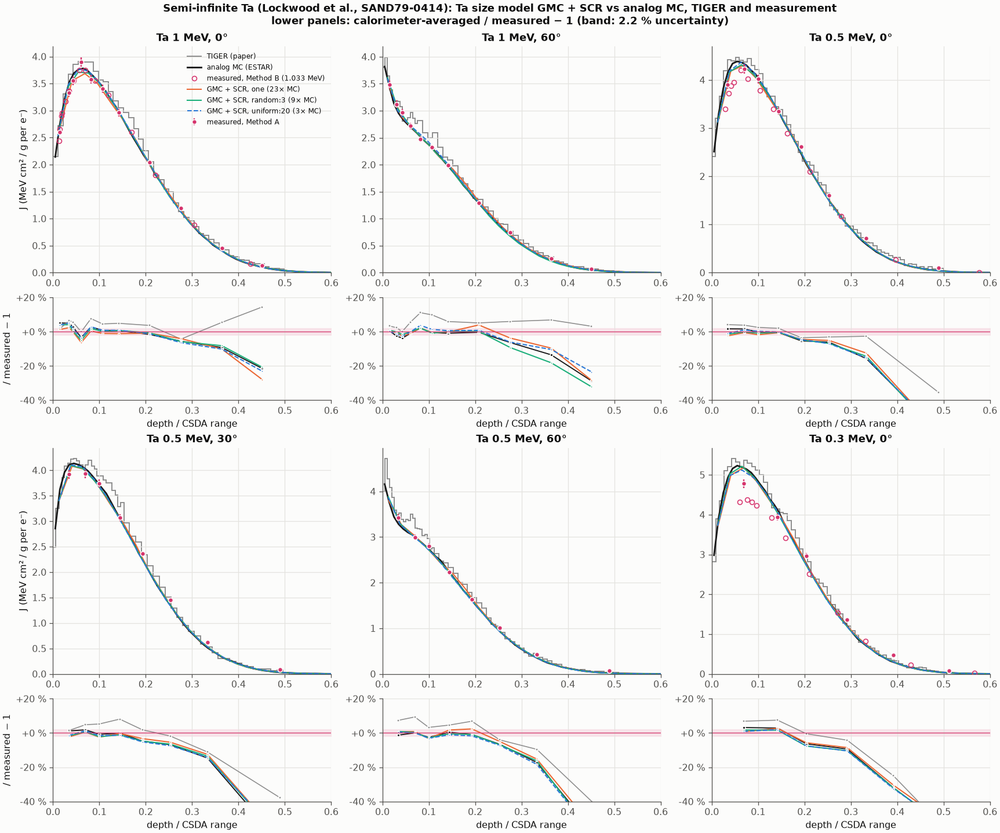
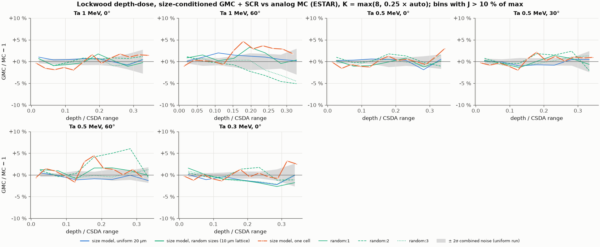
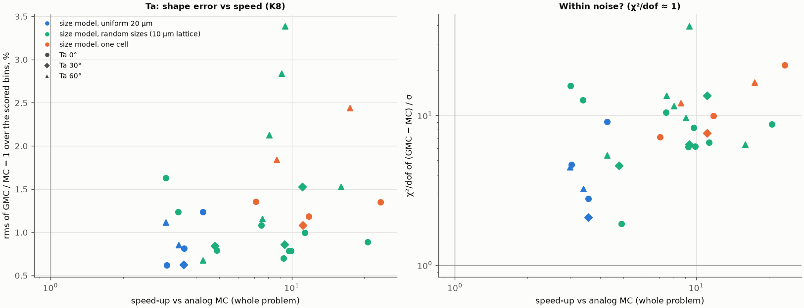
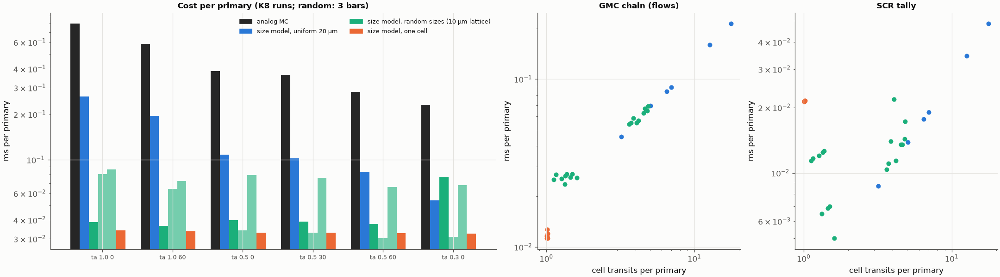
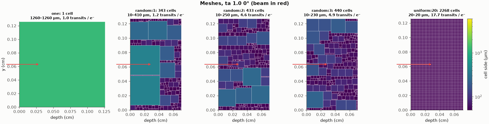
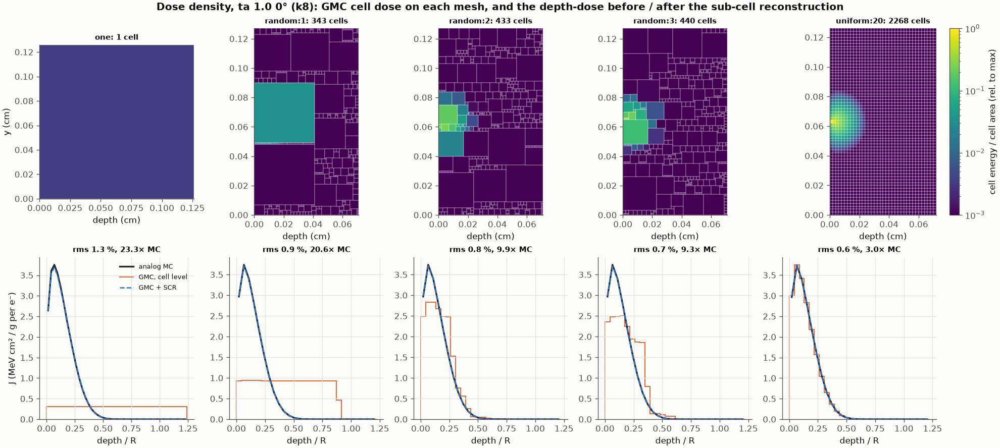

# Size-conditioned tantalum GMC + SCR (10 µm – 1 cm, ≤ 20 MeV) on the Lockwood Ta depth-dose

Work of 2026-11-23/24. This adds tantalum (Z = 73) to the transport code and trains a size-conditioned Ta GMC + SCR,
with the same recipe as the Al / Cu models in [`size_conditioned_lockwood.md`](size_conditioned_lockwood.md).
The models cover cells of 10 µm – 1 cm and electrons of 1 keV – 20 MeV. They are compared with the six
semi-infinite Ta cases of Lockwood et al. (SAND79-0414, §V.G):
- the analog MC that they were trained to reproduce;
- the measurements;
- the paper's TIGER calculations.

## Summary

- **Against its analog MC, the Ta model is more accurate than the Al / Cu size models on comparable meshes.**
  Medians over the 6 cases:

  | mesh | median rms | worst rms | χ²/dof | speed-up vs MC | totals | Al / Cu median rms |
  |---|---|---|---|---|---|---|
  | one cell | 1.35 % | 2.44 % | 11 | **11.4×** (7–23×) | within 1.2 % | 2.03 % |
  | random (10 µm lattice) | 1.04 % | 3.39 % | 8.5 | **9.2×** (3–21×) | within 1.5 % | 1.17 % |
  | uniform 20 µm | **0.83 %** | 1.23 % | 3.9 | 3.5× | within 1.1 % | 1.26 % |

- **Against the measurement, the model inherits the MC's physics.** On every mesh, the model's mean offset from the
  measurement is within ~1.5 % of the MC's own:
  - **1 MeV (0°, 60°):** the model is −0.2 to −1.9 % from the measurement, inside its 2.2 % uncertainty and closer
    than TIGER (+3.6 %, +5.5 %).
  - **0.5 MeV (0°, 30°, 60°):** −2 to −4 %, against TIGER's +0.5 to +2.6 %.
  - **0.3 MeV:** −8 to −10 %, against TIGER's −3 %. The 0.3 MeV data are rough: Methods A and B differ by ~10 %
    at the peak.
- **The analog MC under-penetrates in Ta.** It deposits 2–4 % less total energy than measured in every case, and
  is 4–7 % below TIGER. Past ~0.3 R its depth-dose falls below the measurement by 15–40 %, much faster than TIGER.
  This points to the Ta physics of the MC: too much elastic scattering or backscattered energy at high Z. It needs
  checking (§6) before the Ta model is trusted below 1 MeV.
- **New in the code:**
  - Ta as a material: EPICS2017 data, ELSEPA elastic tables for Z = 73, ICRU 37 / Sternheimer stopping parameters;
  - the Ta Lockwood tables, transcribed from the paper;
  - Ta support in the Lockwood mesh runs, with a 10 µm lattice.



## 1. Tantalum in the transport code (`../ElectronTransport`)

| item | source | check |
|---|---|---|
| electron, atomic, photon data | EPICS2017 (EEDL / EADL / EPDL) from the NNDC all-element tapes (`~/opt/epics2017/*.ALL`), extracted with `NIST_EPICS_convert.py --element Ta --from_tape_dir`, into `tantalum_mc_database.h5` | builds; library 1.2 s |
| elastic scattering | ELSEPA (DF density, Fermi nucleus, Furness-McCarthy exchange), Z = 73, 1 keV – 1 GeV, merged into `elsepa_elastic.h5` as `z073` | σ₁(1 MeV) is 6.8× that of Cu (≈ (73/29)² = 6.3) |
| collision stopping power | ICRU 37 / ESTAR form: I = 718 eV, Sternheimer density effect −C = 5.5262, X₀ = 0.2117, X₁ = 3.4805, a = 0.17798, m = 2.7623, δ₀ = 0.14 | CSDA range 0.1604 / 0.3251 / 0.7638 g/cm² at 0.3 / 0.5 / 1.0 MeV against the paper's 0.160 / 0.325 / 0.763 (≤ 0.2 %) |
| material | `NAMED_MATERIALS["Ta"]`, 16.654 g/cm³ | |

## 2. Lockwood Ta cases (`validation/results/lockwood_sandia/lockwood_tables.json`)

The paper's Tables V.G.1–6 were transcribed from the page images:

| key | E (MeV) | angle | measured (Method A) | also |
|---|---|---|---|---|
| `ta_1.0_0` | 1.0 | 0° | 11 points, total 0.648 MeV | Method B at 1.033 MeV, 15 points |
| `ta_1.0_60` | 1.0 | 60° | 11, 0.472 | |
| `ta_0.5_0` | 0.5 | 0° | 8, 0.316 | Method B at 0.521 MeV, 14 points |
| `ta_0.5_30` | 0.5 | 30° | 8, 0.295 | |
| `ta_0.5_60` | 0.5 | 60° | 8, 0.227 | |
| `ta_0.3_0` | 0.3 | 0° | 6, 0.184 | Method B at 0.314 MeV, 11 points |

Notes on the tables:
- The calorimeter is 1.655 × 10⁻² g/cm². The Method A uncertainty is 2.2 %, Method B's 1.2 %.
- Method B data were taken behind a 1.1 × 10⁻³ g/cm² Al shield. They are stored as `exp_b` and shown in the
  figure, but not scored.
- TIGER histograms are stored as upper bin edges, as for Al / Cu. The range implied by each TIGER table matches
  the tabulated CSDA range to within 0.8 %, which checks the transcription.

## 3. Training data and models

| | |
|---|---|
| data | `../ElectronTransport/sweep_ta_10um-1cm_20MeV_{42,7}`: 40 training + 2 test files × 500k primaries |
| cells | square, side L log-uniform 10 µm – 1 cm (0.017 – 16.7 g/cm²) |
| energies | 1 keV – 20 MeV, log-uniform |
| directions | 30 % near-normal (\|N(0, 10°)\|), 70 % isotropic-inward (`--narrow_frac 0.3`) |
| sub-cell images | n = max(64, L / 10 µm) bins per side |
| generation | ~6 min per file on 16 cores (20 MeV showers in large cells dominate); ~4.2 h |
| GMC | `ml/models/size_gmc_ta_10um-1cm_20MeV`: `size_stream.py gmc --stop --smooth_exit_sigma --spec_files 12`, 240 visits, 1.7 h |
| SCR | `ml/models/size_scr_ta_10um-1cm_20MeV`: `size_stream.py scr --steps 320000`, 120 visits, 2.0 h, best val NLL −2.867 |
| extra held-out set | `sweep_ta_10um-1cm_1.5MeV_7` (2 files, 1 keV – 1.5 MeV): made before the energy range was extended; kept as a Lockwood-range test |

**Sample density.** Over the extended L and E ranges, only about half of the samples fall in the Lockwood
region (≤ 1.5 MeV, ≤ 1.2 mm). So with 40 files the model has about half the Al / Cu sample density there. 80
files would have matched it; 40 was chosen for time.

**Held-out per-size checks** (`size_cell_compare.py`; GMC on boundary transits, SCR on 20k transits per band; the
bands start at 100 µm):

| test file | GMC dose / MC per band | worst band | SCR depth / lateral bias |
|---|---|---|---|
| 1 keV – 20 MeV | 0.998 – 1.016 | 251–631 µm: +1.6 %, class \|z\| 2.8 | ≤ 1.4 % / ≤ 1.2 %, at a noise of 1.2–1.4 % |
| 1 keV – 1.5 MeV | 0.990 – 1.010 | 0.6–1.6 mm: −1.0 %, exit energy +1.2 % | ≤ 1.3 % / up to 2.2 % (0.6–1.6 mm, noise 0.9 %) |

## 4. GMC + SCR vs the analog MC

Runs: 200k primaries × 2 seeds, 20 ODE steps, K8 (`--K_min 8 --K_scale 0.25`). The MC reference is
`lockwood_slab.py mc --stopping estar`: 200k primaries, seed 79, on an idle machine.
Meshes (`validation/lockwood_quadtree.py`, Ta cell range 10 µm – 1 cm):
- `one`: one cell of side 2.5 R, with R = 1.1 × CSDA range (264 µm – 1.26 mm);
- `random:1-3`: tilings of a 10 µm lattice;
- `uniform:20`: 20 µm squares, about the mass thickness of Al 100 µm.

Each entry is **speed-up · rms shape error · χ²/dof**:

| case | MC ms/e⁻ | one | random:1 | random:2 | random:3 | uniform:20 |
|---|---|---|---|---|---|---|
| 1.0 MeV 0° | 0.796 | 23.3× · 1.35 % · 21.6 | 20.6× · 0.89 % · 8.7 | 9.9× · 0.78 % · 6.2 | 9.3× · 0.70 % · 6.1 | 3.0× · 0.62 % · 4.7 |
| 1.0 MeV 60° | 0.584 | 17.4× · 2.44 % · 16.7 | 16.0× · 1.53 % · 6.4 | 9.1× · 2.84 % · 9.7 | 8.1× · 2.13 % · 11.6 | 3.0× · 1.11 % · 4.5 |
| 0.5 MeV 0° | 0.387 | 11.8× · 1.19 % · 9.9 | 9.7× · 0.78 % · 8.3 | 11.3× · 1.00 % · 6.6 | 4.9× · 0.79 % · **1.9** | 3.6× · 0.81 % · 2.8 |
| 0.5 MeV 30° | 0.364 | 11.1× · 1.08 % · 7.6 | 9.3× · 0.86 % · 6.4 | 11.1× · 1.52 % · 13.6 | 4.8× · 0.84 % · 4.6 | 3.6× · 0.63 % · **2.1** |
| 0.5 MeV 60° | 0.283 | 8.6× · 1.84 % · 12.1 | 7.5× · 1.16 % · 13.6 | 9.4× · 3.39 % · 39.4 | 4.3× · 0.68 % · 5.4 | 3.4× · 0.86 % · 3.2 |
| 0.3 MeV 0° | 0.231 | 7.1× · 1.35 % · 7.2 | 3.0× · 1.63 % · 15.7 | 7.5× · 1.08 % · 10.4 | 3.4× · 1.23 % · 12.6 | 4.3× · 1.23 % · 9.1 |

Cells (side range) and cell transits per primary:

| case | one | random:1 | random:2 | random:3 | uniform:20 |
|---|---|---|---|---|---|
| 1.0 MeV | 1 (1.26 mm, 1.0) | 343 (10–410 µm, 1.1–1.2) | 433 (10–250 µm, 3.6–4.6) | 440 (10–230 µm, 3.9–4.9) | 2268 (12.7–17.7) |
| 0.5 MeV | 1 (537 µm, 1.0) | 147 (10–180 µm, 1.3–1.4) | 158 (10–120 µm, 1.3–1.5) | 122 (10–150 µm, 3.7–4.8) | 432 (5.1–7.0) |
| 0.3 MeV | 1 (264 µm, 1.0) | 59 (10–100 µm, 4.1) | 70 (10–80 µm, 1.6) | 70 (10–70 µm, 4.2) | 120 (3.2) |





What the table shows:
- **Speed follows transits per primary**, as for Al / Cu (cost below).
  - The one-cell mesh costs about 0.033 ms per primary at every energy. That gives 23× at 1 MeV, where the MC is
    slowest, and 7× at 0.3 MeV.
  - Meshes whose beam-entry cell is large get ~1 transit per primary and nearly the one-cell speed: random:1 at
    1 MeV has 1.1–1.2 transits per primary and runs at 16–21×.
- **Accuracy** is best on the uniform mesh and on random tilings with small entry cells. The examples within or
  close to noise are 0.5 MeV 0° random:3 (χ²/dof 1.9) and 0.5 MeV 30° uniform (2.1).
- **The worst runs are 60° cases on random meshes:** 0.5 MeV random:2 at 3.4 % and 1.0 MeV random:2 at 2.8 %. In
  their ratio panels the model drifts by 3–6 % past 0.15 R. At 60° the beam enters obliquely, so the entry-cell
  geometry matters more.
- **The one-cell mesh** has a 1.1–2.4 % shape error. That is half the Al / Cu one-cell error (1.8–3.3 %), with
  χ²/dof 7–22.







## 5. Against the measurement and TIGER

The model and MC are averaged over each calorimeter, [d − t/2, d + t/2]. Scored points are those with
J > 10 % of the maximum. Entries are rms / mean of (model or calculation) / measured − 1, in %:

| case | measured total | MC total | TIGER total | MC | TIGER | GMC + SCR, all 5 meshes (mean) | MC vs TIGER (mean) |
|---|---|---|---|---|---|---|---|
| 1.0 MeV 0° | 0.648 | 0.635 | 0.670 | 4.4 / −0.3 | 4.9 / +3.6 | −0.6 … −1.9 | −6.5 |
| 1.0 MeV 60° | 0.472 | 0.462 | 0.495 | 2.7 / −1.4 | 6.4 / +5.5 | −0.2 … −1.9 | −6.6 |
| 0.5 MeV 0° | 0.316 | 0.304 | 0.317 | 6.7 / −3.5 | 3.2 / +0.5 | −3.7 … −4.4 | −5.2 |
| 0.5 MeV 30° | 0.295 | 0.285 | 0.298 | 6.4 / −3.4 | 6.0 / +1.2 | −3.6 … −4.2 | −4.4 |
| 0.5 MeV 60° | 0.227 | 0.220 | 0.235 | 7.0 / −4.0 | 6.8 / +2.6 | −2.2 … −4.4 | −6.1 |
| 0.3 MeV 0° | 0.184 | 0.180 | 0.189 | 15.3 / −8.3 | 12.2 / −3.0 | −8.2 … −9.7 | −5.6 |

What the comparison shows:
- **The model follows its MC.** For each case, the five meshes' mean offsets lie within ~1.5 % of the MC's own.
  The model adds little error against the measurement.
- **At 1 MeV the MC (and the model) match the measurement better than TIGER does.**
- **At ≤ 0.5 MeV, and in the deep tail at every energy, the MC is low.**
  - The lower panels of the figure show the MC falling below the measurement past ~0.25 R. It reaches −16 % at
    0.33 R for 0.5 MeV 0°, where TIGER is −3 %.
  - The MC's total deposited energy is 2–4 % low in every case.
  - Its number backscatter coefficient is η = 0.44 / 0.48 / 0.49 at 1 / 0.5 / 0.3 MeV (normal incidence).
- **Letting fluorescence deposit locally changes the totals by only ~0.5 %.** Photon transport is not the cause.

## 6. Open issues and next steps

- **Ta physics of the analog MC** (the main issue).
  - Check the MC's backscatter coefficients and backscattered-energy fractions against published Ta values
    (Tabata; Sandia SAND80-1968, which the Al albedo check already used).
  - Check its transmission through thin Ta foils against published data.
  - Candidates are the ELSEPA large-angle tables at Z = 73, the split ionisation deflection (κ = 3) at high Z,
    and the EEDL ionisation spectra for Ta.
  - Any fix changes the training data, so the Ta data and models would have to be regenerated.
- **More data in the Lockwood region:**
  - 40 more files (80 in all) would match the Al / Cu sample density at ≤ 1.5 MeV, ≤ 1.2 mm;
  - or a targeted fine-tune as in [`size_conditioned_targeted_finetune.md`](size_conditioned_targeted_finetune.md).
- **The 20 MeV / 1 cm range is checked only on the held-out file.** No benchmark exercises it yet. A thick-target
  Ta bremsstrahlung or depth-dose case at 10–20 MeV would.
- **Cells below 100 µm** are not in the per-size check bands. They are exercised only through the Lockwood
  meshes (10–100 µm cells).

## 7. Tools and files

| file | what |
|---|---|
| `../ElectronTransport/NIST_EPICS_convert.py` | `ELEMENTS["Ta"]` (EPICS2017, from the NNDC tapes) |
| `../ElectronTransport/material_data.py` | `NAMED_MATERIALS["Ta"]`, `STOPPING_REF_PARAMS["Ta"]` |
| `../ElectronTransport/{tantalum_mc_database.h5, elsepa_elastic.h5, 73-Ta-2017-*.endf}` | Ta data |
| `validation/results/lockwood_sandia/lockwood_tables.json` | Ta cases (Tables V.G.1–6) |
| `validation/lockwood_quadtree.py` | per-material cell range (`L_RANGE`), `--model_ta / --kernel_ta` |
| `validation/lockwood_ta_writeup.py` | the figures of this document and `writeup_ta/summary.json` |
| `validation/lockwood_size_writeup.py` | `--materials` (default Al Cu: the Al / Cu figures are unchanged) |
| `logs_ta/{gen,train,runs,eval}.sh` | data, training, Lockwood runs, held-out checks |

## 8. Reproduce

```
# Ta physics data (ElectronTransport): EPICS2017 tapes from https://www.nndc.bnl.gov/endf/epics/ENDF2017/
python NIST_EPICS_convert.py --element Ta --from_tape_dir ~/opt/epics2017
python ELSEPA_convert.py --Z 73 --chunks 12 --out elsepa_ta.h5   # then copy z073 into elsepa_elastic.h5
# MC references (idle machine; they set the speed-ups)
../ElectronTransport/.venv/bin/python validation/lockwood_slab.py mc --cases ta_1.0_0 ta_1.0_60 ta_0.5_0 ta_0.5_30 ta_0.5_60 ta_0.3_0 --stopping estar
# data, training, runs, held-out checks
logs_ta/gen.sh; logs_ta/train.sh; logs_ta/runs.sh; logs_ta/eval.sh
# figures + summary
.venv/bin/python validation/lockwood_ta_writeup.py
```
