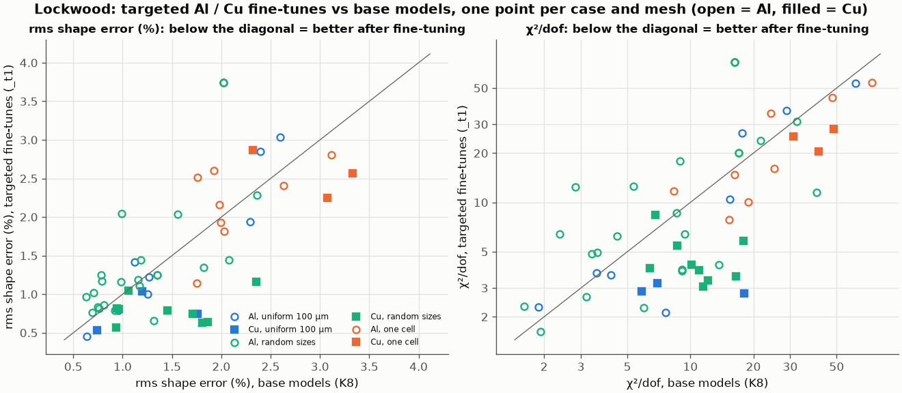
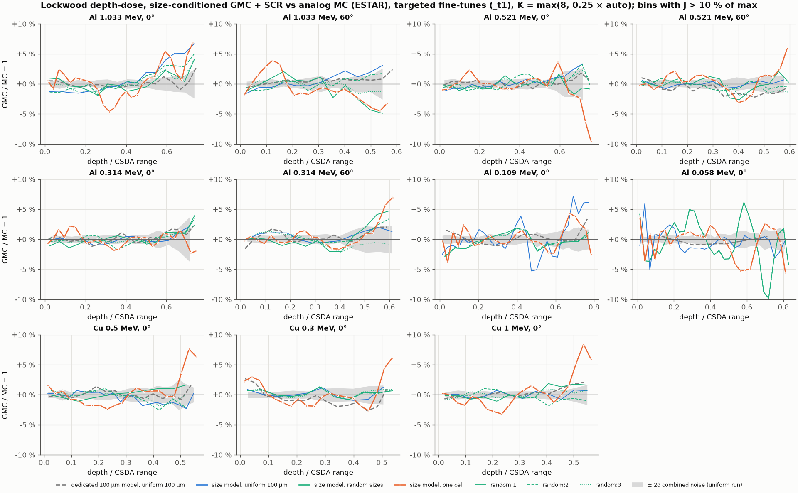
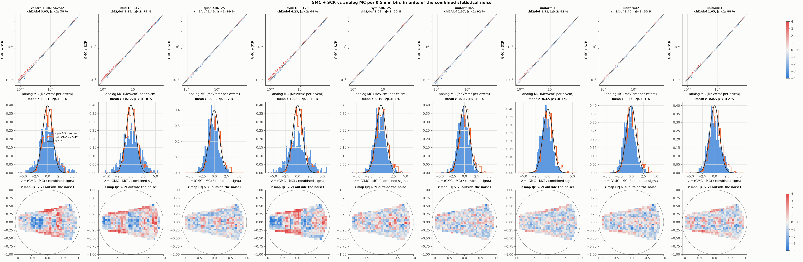
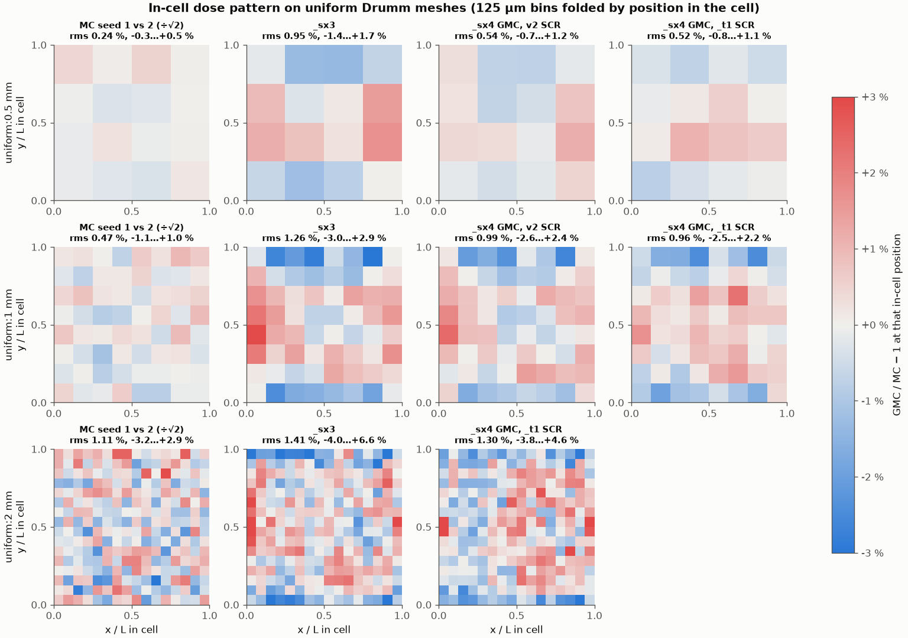

# Targeted fine-tunes of the size-conditioned GMC and SCR (Al, Cu, water)

Work of 2026-11-23. The write-ups [`size_conditioned_gmc_speed_accuracy.md`](size_conditioned_gmc_speed_accuracy.md)
(water, Drumm cylinder) and [`size_conditioned_lockwood.md`](size_conditioned_lockwood.md) (Al / Cu, Lockwood) found
several regimes where GMC + SCR is above the MC noise. This round adds targeted training data for each of them and fine-tunes
every model with the water `_sx3` recipe: the targeted files mixed 1:1 with broad files, with the best checkpoint
chosen on the broad held-out file. Each fine-tuned model is then compared with its base model on the same inputs.

## Summary

| model | targeted regime | verdict |
|---|---|---|
| Cu GMC + SCR `_t1` | 0.2–1.5 MeV, large cells, near-normal entries | **better: adopt.** Lockwood random meshes median rms 1.46 → 0.79 % (9/9 runs better), uniform 1.20 → 0.75 %, χ²/dof 11 → 4 |
| Al GMC + SCR `_t1` | same | **mixed: keep the base model.** χ²/dof lower (uniform 11.5 → 7.1), but median rms slightly higher (1.16 → 1.22 % random), and 58 keV (below the targeted range) worse: 2.0 → 3.7 % |
| water GMC `_sx4` | 1–4 mm and 6–10 mm cells, near-normal, 5–30 MeV | **mixed: keep `_sx3` as default.** Better on uniform ≥ 2 mm meshes and on the in-cell pattern; worse on the fast 1 cm-cell meshes (sym:10 χ²/dof 3.25 → 4.23) |
| water SCR `_t1` | 0.25–2 mm cells, 5–30 MeV | **no measurable effect.** Per-transit depth bias 0.66 → 0.51 % (within noise); Drumm in-cell pattern unchanged (0.54 → 0.52 % with `_sx4`) |

The main findings:
- **Targeted data helps where the base model was clearly short of data (Cu).** For Al and water, the same
  amount of data moves errors around more than it removes them.
- **The in-cell dose pattern on uniform water meshes is not a sampling or per-transit kernel error.**
  - On the Drumm meshes the error, averaged by position inside the cell, is 2–3 % low along the cell edges
    across the beam.
  - Measured as rms over the in-cell positions it is 0.95 % on 0.5 mm cells, against 0.24 % MC noise.
  - It does not change with K32 and does not change with a fine-tuned SCR kernel. The SCR kernel is within noise
    per transit on held-out data in that size range.
  - It drops by 40 % (0.95 → 0.54 %) when only the GMC changes (`_sx3` → `_sx4`).

  So it comes mainly from the GMC's exit positions and directions on small cells, not from the SCR.
- **Speed is unchanged** by fine-tuning: same networks, same transits per primary.

## 1. Data and training

All data: `../ElectronTransport/generate_size_sweep.py`, 500k primaries per file, `--narrow_frac 0.5` (half the
sources near-normal, polar angle |N(0, 10°)|, half isotropic-inward), ELSEPA + ESTAR physics. New seeds were chosen
apart from the existing ones by more than the thread count, so chunk RNG streams do not overlap.

| set | material | L | E | files (train + held-out) | sub-cell images | used by |
|---|---|---|---|---|---|---|
| `sweep_al_tgt_0.2-1.5MeV_{44,8}` | Al | 50 µm–6 mm | 0.2–1.5 MeV | 10 + 1 | yes | Al GMC + SCR `_t1` |
| `sweep_cu_tgt_0.2-1.5MeV_{44,8}` | Cu | 50 µm–3 mm | 0.2–1.5 MeV | 10 + 1 | yes | Cu GMC + SCR `_t1` |
| A: `sweep_water_6-10mm_10-30MeV_fwd_{45,10}` | water | 6–10 mm | 10–30 MeV | 6 + 1 | no | water GMC `_sx4` |
| B: `sweep_water_1-4mm_5-30MeV_fwd_{46,11}` | water | 1–4 mm | 5–30 MeV | 6 + 1 | no | water GMC `_sx4` |
| C: `sweep_water_0.25-2mm_5-30MeV_fwd_{70,90}` | water | 0.25–2 mm | 5–30 MeV | 8 + 1 | yes | water SCR `_t1` |

The water SCR set (C) was added after a K32 rerun of uniform:0.5 gave the same fine-map bias as K8 (3.55 vs
3.56 %). That ruled out SCR sampling noise as the cause of the in-cell pattern (§3.2).

Mixes (`ml/mix_dirs.py`, targeted and broad files interleaved):

| mix | content | fine-tune (`ml/size_stream.py`) | time |
|---|---|---|---|
| `mix_{al,cu}_tgt10_old10` | 10 targeted + 10 broad (every other `_42` file) | GMC: `--finetune --stop --sweeps 3 --clf_passes 6 --flow_passes 24 --small_passes 24 --clf_lr 5e-4 --flow_lr 3e-4`; SCR: `--init_from <base> --lr 2e-4 --steps 120000 --sweeps 3` | GMC 19 min, SCR 47–55 min |
| `mix_water_sx4` | A 6 + B 6 + the `_sx3` set `fwd_43` 10 + broad 22 = 44 files | GMC, from `_sx3`, same flags | 55 min |
| `mix_water_scr_tgt8_old8` | C 8 + broad 8 | SCR, from `v2`, `--lr 2e-4 --steps 96000 --sweeps 3` | 43 min |

`--init_from` for the SCR (fine-tune from an existing kernel; the EMA restarts from the loaded weights) is new in
`ml/size_stream.py`.

**Validation on the broad held-out files** (used for best-checkpoint selection):
- **Al/Cu SCR:** the loss dips in the first visits and recovers. The last (= best) checkpoint ends equal to the
  base: Al −3.39813 vs −3.39813, Cu −4.13382 vs −4.13371.
- **Water SCR:** ends slightly above the base, −3.4409 vs −3.4430 (lower is better).
- **GMC heads:** move by ≤ 2 % in loss, e.g. water exit_B 0.5716 → 0.5705.

The broad loss is therefore not where a gain would show. The per-regime checks below are.

## 2. Al and Cu

### 2.1 Per-size checks (`size_cell_compare.py`, 5 log-L bands, base → `_t1`)

**GMC, boundary transits**, GMC/MC deposited dose per band:

| file | Al | Cu |
|---|---|---|
| broad held-out | 0.988–1.007 → 0.995–1.011; 4–10 mm exit energy 0.988 → **0.978** | 0.996–1.012 → 0.995–1.010 |
| targeted held-out | 0.997–1.002 → 0.995–1.002 | 0.993–1.003 → 0.994–1.001; class \|z\| 1.56 → 1.15 at 0.6–1.6 mm |

**SCR**, on 20k transits per band:
- Depth and lateral biases are 0–1 % for base and `_t1` alike, at a per-band noise of ~1 %.
- The skill scores agree to 3 decimals.
- So the Al/Cu SCR fine-tunes changed nothing that this test resolves. The Lockwood differences below come
  from the GMC.

### 2.2 Lockwood depth-dose (K8, 200k × 2 seeds, all 11 cases × 5 meshes)

Medians over the cases, base (K8) → `_t1`:

| mesh family | material | median rms | max rms | median χ²/dof | runs better (rms) |
|---|---|---|---|---|---|
| one cell | Al (8) | 1.99 → 2.29 % | 3.11 → 2.80 % | 21.6 → 15.5 | 5/8 |
| one cell | Cu (3) | 3.07 → 2.57 % | 3.33 → 2.87 % | 40.9 → 25.2 | 2/3 |
| random | Al (24) | 1.16 → 1.22 % | 2.36 → 3.74 % | 9.0 → 7.5 | 8/24 |
| random | Cu (9) | **1.46 → 0.79 %** | 2.35 → 1.16 % | **11.0 → 4.0** | **9/9** |
| uniform:100 | Al (8) | 1.26 → 1.32 % | 2.60 → 3.04 % | 11.5 → 7.1 | 5/8 |
| uniform:100 | Cu (3) | **1.20 → 0.75 %** | 1.76 → 1.04 % | **7.0 → 2.9** | **3/3** |

Over all 11 cases: uniform 1.26 → 1.04 % (χ²/dof 7.6 → 3.6), random 1.17 → 1.11 % (9.1 → 5.8), one cell 2.03 →
2.41 % (25 → 20). The old dedicated 100 µm models give 0.88 % (3.7).





Per case (rms % and χ²/dof, base → `_t1`):
- **Cu 0.3 / 0.5 / 1 MeV:** random 0.6–1.2 % (was 0.9–2.4 %), uniform 0.5–1.0 % (was 0.7–1.8 %). At 0.3 and 1 MeV Cu
  now beats the old dedicated 100 µm models (1.55 % and 0.88 %) on every multi-cell mesh; at 0.5 MeV the dedicated
  model is still better (0.69 % vs 0.79–1.16 %). Cu 0.3 MeV random meshes have χ²/dof ≈ 3–4 (was 11–12).
- **Al 58 keV:** 2.0 → 3.7 % on the random meshes (χ²/dof 16 → 72). This case is 3 cells of 50 µm and lies below
  the 0.2 MeV lower end of the targeted data. The fine-tune shifted the GMC at the lowest E and L.
- **Al 0.3–1 MeV:** split. Some runs improved, e.g. al_1.0_0 random:1 2.1 → 1.4 % (40 → 12) and al_0.3_0 uniform
  1.0 → 0.8 % (8 → 2). Others got worse, e.g. al_0.3_60 random:1 1.0 → 2.0 % and al_1.0_0 uniform 2.4 → 2.8 %.

**Speed:** unchanged, median 12.0× (one), 7.4× (random), 4.4× (uniform).
- The first `_t1` runs of one / random:1 / random:2 overlapped training. They were rerun on an idle machine
  (`_k8_t1q`, which replaces them in the tables) and match the base timings to 1–2 %.
- Two random:3 Al 1 MeV runs also overlapped training. Their speed-ups (5.3× and 9.1× vs 12.6× and 11.7×) are
  timing artefacts, not model changes.

## 3. Water

### 3.1 GMC `_sx4` (targeted 1–4 mm and 6–10 mm data) vs `_sx3`

**Single 1 cm cell, analog entries logged by MC** (`scr_probe.py gmc`):

| | `_sx3` | `_sx4` |
|---|---|---|
| in-cell dose, centre cell | +0.32 % | +0.20 % |
| in-cell dose, sym:10 cell | +0.35 % | +0.32 % |
| beam edge 3–4 mm, centre cell | +1…+6 % | −0.5…+8 % |
| beam edge 3–4 mm, sym:10 cell | +11…+14 % | −2…+15 % |

The beam-edge band of the sym:10 cell is still the worst spot. The 6–10 mm data did not fix it.

**Far-exit scattering widths, 20 MeV** (`scatter_width_scan.py`, position-residual width GMC/MC, ±2 %): the 1.2–2.4 mm
dip that `_sx3` introduced is about halved.

| L (mm) | 0.5 | 0.8 | 1.0 | 1.2 | 1.5 | 1.8 | 2.0 | 2.4 | 3 | 4 | 10 |
|---|---|---|---|---|---|---|---|---|---|---|---|
| `_sx3` | 1.006 | 0.987 | 1.013 | 0.951 | 0.988 | 0.948 | 0.989 | 0.962 | 0.968 | 0.977 | 0.990 |
| `_sx4` | 1.030 | 1.016 | 1.004 | 0.966 | 0.993 | 0.973 | 0.988 | 0.979 | 0.964 | 0.969 | 0.992 |

**Per-size test file** (`size_cell_compare.py`): boundary dose GMC/MC 0.9965–1.0047 → **1.0001–1.0030**, class
max |z| 2.15 → 1.76.

**Drumm cylinder** (500k × 2 seeds, K8, chord photons; `_sx4` GMC with the `_t1` SCR kernel vs `_sx3` with `v2`).
Noise test per 0.5 mm bin, r < 0.9 cm (`drumm_noise_check.py`; null test sym:5 vs sym:5 gives χ²/dof 1.37):

| mesh | χ²/dof `_sx3` → `_sx4t1` | \|z\| < 2 | edge z (energy) | wings z (energy) | 0.5 mm bias | speed-up |
|---|---|---|---|---|---|---|
| sym:5:0.125 | 1.35 → 1.63 | 92 → 90 % | −4σ → −3σ (0.996) | −0σ → −4σ (0.985) | 0.93 → 1.19 % | 26.9× |
| quad:4:0.125 | 1.41 → 1.49 | 90 → 89 % | −10σ → −8σ (0.984) | −2σ → −4σ (0.983) | 0.94 → 1.02 % | 16.6× |
| sym:10:0.125 | 3.25 → **4.23** | 80 → 68 % | +11σ → +10σ (1.011) | +6σ → +3σ (1.000) | 1.12 → 1.81 % | 37.3× |
| min:10:0.125 | 2.45 → **3.15** | 82 → 74 % | +12σ → +8σ (1.009) | +11σ → +9σ (1.020) | 1.19 → 1.68 % | 37.2× |
| centre:10:0.15625:2 | 2.29 → **3.05** | 82 → 78 % | +4σ → +4σ (1.006) | +9σ → +9σ (1.011) | 1.23 → 1.62 % | 16.2× |
| uniform:0.5 | 1.34 → 1.37 | 92 → 92 % | +4σ → −3σ (0.998) | +0σ → −6σ (0.972) | 0.88 → 1.12 % | 6.0× |
| uniform:1 | 1.47 → **1.31** | 89 → 92 % | −3σ → −6σ (0.985) | −1σ → −1σ (0.986) | 0.97 → 0.92 % | 12.0× |
| uniform:2 | 1.71 → **1.45** | 86 → 90 % | −8σ → −6σ (0.984) | −1σ → −2σ (0.984) | 1.55 → 1.45 % | 23.3× |
| uniform:4 | 1.70 → 1.65 | 89 → 88 % | −5σ → −3σ (0.989) | +7σ → +2σ (0.996) | 0.94 → 1.18 % | 38.1× |



**Where `_sx4` helps and where it hurts:**
- **Better:** uniform 1–4 mm (χ²/dof −0.05 to −0.26; the core offset shrinks from −10σ to −6σ on uniform:2 and from −7σ to −1σ on uniform:4), the
  scattering widths and the per-size file.
- **Worse:** the meshes with 1 cm cells on the beam (sym:10, min:10, centre), where χ²/dof rises by 0.7–1.0.
  - The beam-edge offset of min:10 is smaller (+12σ → +8σ), but the core and spread are worse.
  - Those meshes are the fastest ones (37×), so `_sx3` stays the default.
  - Folding 6–10 mm data into one model with the 1–4 mm data and a larger broad share diluted the `_sx3` gains at
    1 cm.

### 3.2 In-cell pattern and the water SCR `_t1`

`validation/drumm_fold.py` folds the 125 µm GMC/MC map by position inside the cell. MC noise is the same fold of
seed 1 vs seed 2, divided by √2.

| mesh | MC noise | `_sx3` (v2 SCR) | `_sx4` GMC, v2 SCR | `_sx4` GMC, `_t1` SCR |
|---|---|---|---|---|
| uniform:0.5 (4 × 4) | 0.24 % | 0.95 % (−1.4…+1.7) | 0.54 % (−0.7…+1.2) | 0.52 % (−0.8…+1.1) |
| uniform:1 (8 × 8) | 0.47 % | 1.26 % (−3.0…+2.9) | 0.99 % (−2.6…+2.4) | 0.96 % (−2.5…+2.2) |
| uniform:2 (16 × 16) | 1.11 % | 1.41 % (−4.0…+6.6) | — | 1.30 % (−3.8…+4.6) |



What the fold shows:
- **The pattern is mostly across the beam.** The dose is 2–3 % low in the rows of 125 µm bins along the cell
  faces at y = 0 and y = L, and 1–2 % high in the middle rows.
- **Changing only the GMC removes 40 % of it** (0.95 → 0.54 % on 0.5 mm cells). Changing only the SCR kernel
  removes ≤ 4 %.
- **The SCR kernel is within noise per transit on held-out data in this size range.** The test file is C's
  held-out seed 90, 20k transits per band, `v2` → `_t1`:

  | cells | depth bias | lateral bias |
  |---|---|---|
  | 0.25–0.6 mm | 0.66 → 0.51 % | 0 → 0 % |
  | 0.6–1.6 mm | 0.33 → 0.19 % | 0 → 0 % |
  | 1.6–4 mm | 0.55 → 0.63 % | 0.47 → 0.39 % |

  The per-band noise is 0.6–0.75 %.

So the remaining pattern comes from the inputs the SCR receives on a real mesh, not from the kernel's placement on
single transits. The likely sources are the GMC exit position and direction distribution near the faces, or the
correlation between successive transits, which the per-transit test does not see. §5 lists the next test.

## 4. Which models to use

| material | GMC | SCR |
|---|---|---|
| Cu | `size_gmc_cu_50um-6mm_1.5MeV_t1` | `size_scr_cu_50um-6mm_1.5MeV_t1` (≡ base within the tests) |
| Al | `size_gmc_al_50um-6mm_1.5MeV` (base) | `size_scr_al_50um-6mm_1.5MeV` (base) |
| water, fast meshes (sym/min/centre with 1 cm cells) | `size_gmc_water_100um-1cm_30MeV_sx3` | `size_scr_water_100um-1cm_30MeV_v2` |
| water, uniform 1–4 mm meshes | `_sx4` is somewhat better (χ²/dof −0.05…−0.26) | `v2` or `_t1` (no measurable difference) |

## 5. Open issues and next steps

- **In-cell pattern (water, ≤ 1 mm cells).**
  - Run the SCR tally on logged analog MC transits through a uniform:1 mesh. If the pattern goes away, the GMC
    exit distribution is the cause; if it stays, it comes from transit-to-transit correlation in the tally.
  - The per-transit evaluation cannot tell these apart.
- **Al:**
  - The targeted 0.2–1.5 MeV data did not give a net gain, and it hurt 58 keV.
  - Next would be data at 50–200 keV with L near the 50 µm floor, or extending the model below 50 µm. The low-energy
    cases are 1–3 cells of 50 µm.
- **Water 1 cm cells:** `_sx4` lost the `_sx3` gain.
  - Option 1: pick the checkpoint on a 1 cm-targeted held-out file instead of the broad one.
  - Option 2: train a separate model for large cells with a small broad share.
- **Checkpoint selection:**
  - All fine-tunes here chose the best checkpoint on the broad held-out file. For the Al/Cu SCR this returned a
    kernel equal to the base on that file.
  - A mixed held-out file (targeted + broad) would let a fine-tune keep gains that cost nothing on the broad set.
- **Timing hygiene:** GPU evaluations must not overlap timed runs. The `_t1q` reruns replaced the overlapped runs.

## 6. Tools added

| file | what |
|---|---|
| `ml/size_stream.py scr --init_from` | fine-tune the SCR kernel from an existing kernel (EMA restarts from it) |
| `validation/drumm_fold.py` | in-cell fold of the 125 µm GMC/MC map on uniform meshes, with the MC seed-vs-seed noise reference |
| `validation/lockwood_size_writeup.py` | `t1` kset (`_k8_t1`, replaced by `_k8_t1q` where present), `ratio_grid_t1.png`, `t1_vs_k8.png` |
| `logs_tgt/*.sh` | data (`gen_metal.sh`, `gen_water.sh`, `gen_water_scr.sh`), training (`train_tgt.sh`, `train_water_scr.sh`), checks (`eval_tgt.sh`), idle-machine reruns (`lockwood_t1_quiet.sh`, `after_t1q.sh`) |

## 7. Reproduce

```
# data (ElectronTransport venv): logs_tgt/gen_metal.sh Al|Cu, gen_water.sh A|B, gen_water_scr.sh
# mixes + fine-tunes (two GPU lanes): logs_tgt/train_tgt.sh, then logs_tgt/train_water_scr.sh
# checks: logs_tgt/eval_tgt.sh (per-size, probes, width scan, Lockwood _k8_t1, Drumm _sx4 / _sx4t1)
# idle-machine Lockwood timing + water SCR per-transit check: logs_tgt/lockwood_t1_quiet.sh, logs_tgt/after_t1q.sh
R=validation/results/drumm_size
.venv/bin/python validation/drumm_quadtree.py compare --runs "$R/gmc_*_500k_K8_sx3_chord.npz" "$R/gmc_*_500k_K8_sx4*_chord.npz" --out_dir $R/tgt
.venv/bin/python validation/drumm_noise_check.py --r_max 0.9 --runs "$R/gmc_*_500k_K8_sx4t1_chord.npz" \
    --null $R/gmc_sym_5_0p125_500k_K8_sx3_chord.npz $R/gmc_sym_5_0p125_500k_K8_sx3_chord_s31.npz --out_dir $R/tgt/noise_sx4t1
.venv/bin/python validation/drumm_fold.py
.venv/bin/python validation/lockwood_size_writeup.py --out_dir validation/results/lockwood_sandia/size/writeup
```
