# 20 MeV beam on an infinite water cylinder: analog MC, GMC and SCR-GMC vs ITS (Drumm et al. 2007)

Generated 2026-11-11/12. Benchmark: C. R. Drumm, W. C. Fan, L. Lorence, J. Liscum-Powell, "An Analysis of the
Extended-Transport Correction with Application to Electron Beam Transport", Nucl. Sci. Eng. 155, 355–366 (2007),
Sec. IV.A, Figs. 8a/8b (ITS/ACCEPT Monte Carlo, 3.2 billion histories). Script: `validation/drumm_cylinder.py`
(`mc`, `gmc`, `plot`); the paper's ITS curves were digitized from the PDF bitmaps (`validation/drumm_digitize.py` →
`drumm_water_cylinder/its_digitized.json`, uncertain to about one line width: ±0.05 in energy, ±0.005 in charge).

## Problem and how it maps onto our code

| | paper | here |
|---|---|---|
| geometry | water cylinder, Ø 2 cm, infinite along z | our 2D infinite-z geometry: the circle in x–y |
| beam | 20 MeV, +x, uniform in z, triangular in y, FWHM 0.25 cm | identical (the paper's sampling formula) |
| electron cutoff | 0.1 MeV | 1 keV (the GMC training cutoff) |
| photons | "not transported" | banked at birth; shown both ways (energy escapes / deposited where emitted) |
| units | MeV/cm³ and e⁻/cm³ per source e⁻ per cm of beam | tally per primary / voxel area (checked: 4 /cm peak fluence × 2.05 MeV cm²/g ≈ 8) |
| charge deposition | electrons stopped − electrons created | same; fine maps count only electrons born > 0.1 MeV (new stepper tally) |

Runs (500k primaries each, same source):
- **analog MC, true circle**: the circle on 31 µm voxels (vacuum outside), tallied on 125 µm bins.
- **analog MC, 1 mm staircase** (2 seeds): the geometry the GMC sees (20 × 20 cells of 1 mm, a cell is water if its centre is
  inside the circle, vacuum otherwise), tallied on 125 µm bins. Like-for-like reference and noise floor for the GMC.
- **GMC** on the staircase: new model `ml/models/secondary_gmc_water_1mm_30MeV` (the old water 1 mm model stops at
  10 MeV), a vacuum streaming kernel for the empty cells, 2 seeds, both photon conventions.
- **GMC + SCR**: new kernel `ml/models/subcell_kernel_water_1mm_30MeV`, 8 × 8 sub-cells (125 µm), Sobol K = 32.

## Results

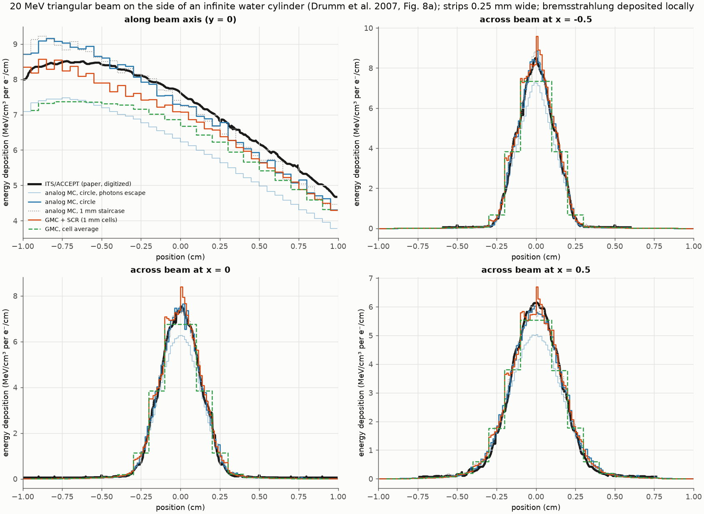
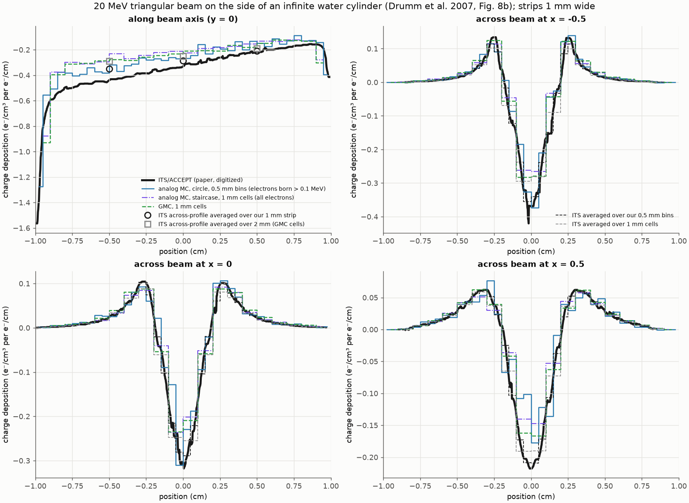
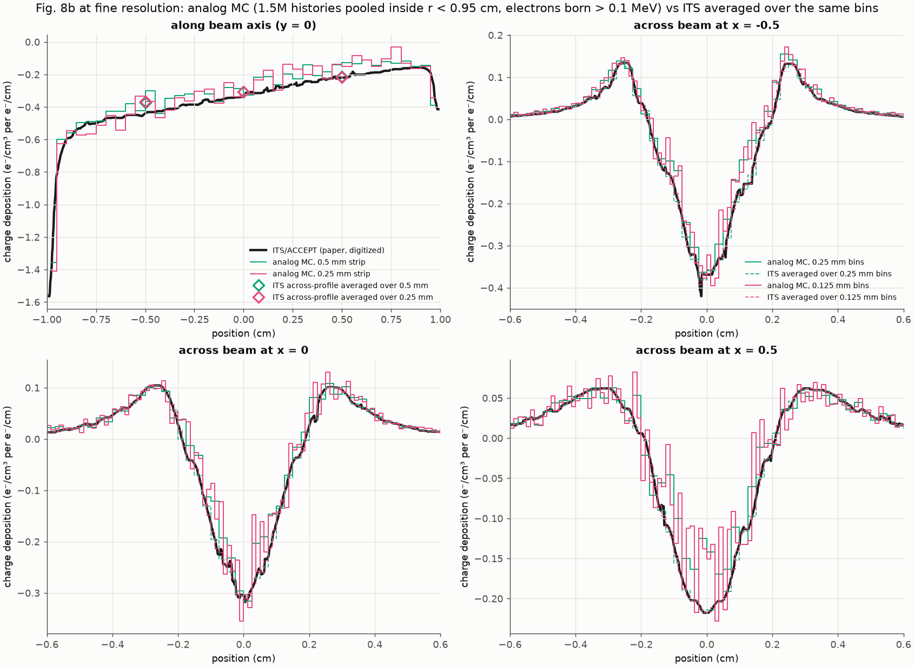

[Dose maps](drumm_water_cylinder/dose_maps.png). Numbers: `drumm_water_cylinder/metrics.json`.

**Analog MC vs ITS.**
- **Energy deposition depends on how bremsstrahlung is counted, and the paper does not say exactly.** Energy per cm
  of depth (lateral integral of the across-beam profiles): ITS 2.35 MeV/cm; ours 2.04–2.10 with photons escaping
  (−11 to −13 %), 2.41–2.43 with photon energy deposited where emitted (+3 to +4 %). Our photons-escape value is what
  the collision stopping power gives (ESTAR 2.05 MeV cm²/g at 20 MeV, plus obliquity), so ITS/CEPXS evidently keep
  most of the radiative loss locally ("no photon transport"). The figures use the local convention.
- In that convention the across-beam profiles match ITS in shape and height at all three depths (mean deviation in
  the core +2.6 %, +4.0 %, +6.6 % at x = −0.5, 0, 0.5; peaks 8.86 / 7.64 / 6.03 vs ITS 8.50 / 7.54 / 6.15).
  Along the axis our MC is steeper: about +8 % near entry, −9 % at the exit (mean −1.4 %). The cause is faster
  lateral broadening (see "Why ... differ" below).
- **Charge deposition** (electrons born > 0.1 MeV, 0.5 mm bins): matches ITS once ITS is averaged the same way (dashed
  steps and open markers in Fig. 8b). Across the beam, MC vs ITS-in-our-bins differ by 0.021–0.028 e⁻/cm³ rms against an
  MC noise of 0.017–0.019 per bin; the GMC's 1 mm cells vs ITS averaged over 1 mm cells differ by 0.011–0.015. Along
  the axis our 1 mm strip gives −0.350 / −0.270 / −0.139 at x = −0.5 / 0 / 0.5, ITS averaged over the same strip
  −0.349 / −0.285 / −0.209. Only x = +0.5 is off (see below).
- Geometry: true circle vs 1 mm staircase differ by 5.6 % rel-L2 on the 125 µm map (MC noise 1.3 %), mostly at the
  surfaces; the profiles in the figures are indistinguishable.

**GMC vs analog MC (1 mm staircase, like for like).** Error split of one run, relative L2 over voxels > 1 % of max:

| map | analog MC noise | GMC noise | GMC bias |
|---|---|---|---|
| 1 mm cells, photons local | 0.67 % | 0.60 % | **0.62 %** (at the noise floor) |
| 1 mm cells, photons escape | 0.20 % | 0.31 % | 1.73 % |
| 125 µm, GMC + SCR, photons escape | 0.94 % | 0.87 % | **3.3 %** |
| 125 µm, GMC flat in cells, photons escape | 0.94 % | 0.31 % | 15.7 % |
| 125 µm, GMC + SCR, photons local | 4.96 % | 1.32 % | 8.1 % |
| charge, 1 mm cells | 9.0 % | 9.7 % | 5.2 % (below noise) |

- **Energy closes.** Deposited fraction of E0, photons local: GMC 0.2370 / 0.2368, MC 0.2372. With photons escaping
  the GMC deposits 1.3 % more (0.2060 vs 0.2033) and emits correspondingly less photon energy (0.031 vs 0.034): the
  dose/photon split of the top-energy transits is off, the total is not (single cell: dose ratio 1.015 ± 0.009 in the
  12.7–30 MeV bin). Net charge per primary: GMC −0.072, MC −0.069.
- **SCR** turns the 15.7 % error of a flat-in-cell map into 3.3 % at 125 µm with MC-level noise; across-beam peaks
  within 0–4 %, rms widths within 1–3 %. Remaining bias: a 5 % dip on the axis strip at 4–8 mm depth. That strip
  (and x = ±0.5) lies on transport-cell faces, the kernel's weakest region.
- With photons local, the 125 µm comparison is dominated by where the photon energy goes: the MC puts it on the
  primary track (spiky, 5 % noise), the SCR kernel spreads it like collision dose, so the axis strip reads 6–8 % low
  in the first centimetre. Not a transport error, a consequence of emulating the paper's convention.
- **Cost** (500k primaries, CPU shared between runs, so ±30 %): analog MC 1561 s (3.1 ms/primary); GMC chain 375 s
  + SCR tally 143 s (25.8 water transits/primary, 11 µs tally per transit). 4.2× for the chain, 3.0× with the tally.

## Why the along-axis energy and the raw charge plots differ from ITS (diagnosed 2026-11-12)

**Energy along the axis** has two separate effects stacked:
1. *Level:* how bremsstrahlung energy is counted. It is ~15 % of the on-axis dose. ITS sits between our two conventions
   (local: +3 to +9 %; escaping: −11 to −13 %), closer to local deposition; the paper does not state its convention.
2. *Slope:* our beam broadens faster with depth. RMS width of the across-beam profiles vs ITS: +1 % / +5 % / +7 % at
   x = −0.5 / 0 / 0.5. Removing the triangle's own width (rms 0.102 cm), the scattering part is +12 / +17 / +14 %
   wider. The lateral integrals stay flat, so a wider beam means a lower axis value, and the gap grows with depth. This
   is the +8 % (entry) → −9 % (exit) trend.
   - Slab test (20 MeV pencil, plain water): our multiple-scattering θ0 (Gaussian fit to the central 98 %) is
     **4–5 % above Lynch–Dahl** at every thickness (28.5 vs 27.3 mrad at 1 mm; 106.6 vs 101.5 mrad at 10 mm). That
     accounts for roughly a third of the extra spread; the rest is open (part may be ITS's own multiple-scattering
     model).
   - GMC + SCR adds a separate ~5 % dip there: the y = 0 line lies on transport-cell faces, the kernel's weakest
     region.

**Charge** in the first version of Fig. 8b compared different things:
1. *Strip width (main cause):* the on-axis trough is ~1.5 mm wide. Our along-axis strip is 1 mm (needed for
   statistics), the GMC's is 2 mm (cells), while ITS resolves the line. ITS averaged over 1 mm is −0.349 / −0.285 /
   −0.209 instead of −0.44 / −0.33 / −0.22 on the line, and matches our MC at x = −0.5 and 0. Fig. 8b now overlays these
   strip-averaged ITS values.
2. *Statistics:* 500k histories vs ITS's 3.2 billion, and charge is a small difference of creations and stops.
   ±0.02 e⁻/cm³ per 0.5 mm bin across the beam, ±0.03 along the axis.
   - *Finer strips* (added 2026-11-12): [fine-resolution figure](drumm_water_cylinder/fig8b_charge_fine.png), made
     from the stored 125 µm MC maps. Resolved only across the trough (in y); along the axis the x-bins stay 0.5 mm, and
     across the beam the x-strip stays 1 mm. Inside r < 0.95 cm the circle and both staircase runs agree within noise
     (scatter 1.01–1.04× the expected noise, no mean offset), so they are pooled there (1.5M histories). ITS is averaged
     over the same bins. On-axis trough, ours / ITS:

     | strip | x = −0.5 | x = 0 | x = +0.5 |
     |---|---|---|---|
     | 1 mm (circle only) | −0.350 / −0.349 | −0.270 / −0.285 | −0.139 / −0.209 |
     | 0.5 mm (pooled) | −0.361 / −0.374 | −0.306 / −0.306 | −0.133 / −0.214 |
     | 0.25 mm (pooled) | −0.350 / −0.368 | −0.329 / −0.308 | −0.144 / −0.217 |

     Pooled noise of one strip value: about ±0.013 (0.5 mm) and ±0.024 (0.25 mm). Across-beam profiles vs ITS in the
     same bins: rms 0.019–0.023 at 0.25 mm (pooled noise per bin 0.016–0.024) and 0.025–0.030 at 0.125 mm (noise
     0.033–0.035). So at x = −0.5 and 0 the whole across profile matches ITS within noise at every resolution, and the
     shallower 1 mm curves were strip width. At x = +0.5 the profile also matches except the central ~0.5 mm, where ours
     stays at about −0.14 while ITS reaches −0.21 (about 6σ at 0.5 mm).
3. *Faster broadening (likely):* the remaining gap at x = +0.5 (−0.139 vs −0.209 at equal strip width) is the same physics as
   the energy slope.
4. *Not the cause:* the 1 keV cutoff. Counting all electrons vs only those born > 0.1 MeV changes the axis values by
   < 0.02, except in the first 2 mm.

## Analog vs condensed history: method or data?

**In principle the transport method should not matter here.** Condensed history (ITS) is an approximation to the
same Boltzmann equation that analog (event-by-event) MC samples exactly. Its multiple-scattering distributions
(Goudsmit–Saunderson) are built from the single-scattering cross section, and the result converges to the analog one as
the step size shrinks. For a thick, homogeneous, 20 MeV problem like this, condensed-history step and boundary artifacts
are typically ≤ 1–2 % on dose profiles. Differences of 5–15 % point to the **cross-section data**, not the method.

**Test.** The quantity that sets multiple scattering is the transport cross section 1/λ₁ = Σ_channels Σ_c ⟨1 − μ⟩_c.
We computed what our analog code actually samples: elastic ⟨1 − μ⟩ integrated exactly from the tabulated EEDL pdfs with
the sampler's log-E mixing between tables, the small-angle channel analytically, and ionization deflection by sampling.
We compared it with Molière screened-Rutherford theory with Z(Z + 1), the basis of the condensed-history
multiple-scattering models and of Lynch–Dahl.

| E (MeV) | 0.1–0.256 | 0.3 | 0.5 | 1 | 2 | 3 | 5 | 7 | 9 | 10–25 |
|---|---|---|---|---|---|---|---|---|---|---|
| Water: ours / Molière | 1.05–1.10 | 1.16 | 1.63 | 2.70 | 4.40 | 5.02 | 4.76 | 3.48 | 1.84 | 0.98–1.01 |
| Cu | 1.03–1.12 | 1.16 | 1.64 | 2.64 | 4.23 | 5.47 | 5.72 | 4.40 | 2.26 | 1.00–1.07 |
| Al | 1.01–1.06 | 1.13 | 1.58 | 2.44 | 3.71 | 4.23 | 4.09 | 3.08 | 1.71 | 0.98–1.01 |

- **At EEDL's tabulated energies our scattering is right.** At 0.256, 10 and 21.25 MeV the ratio is 0.98–1.05. That
  validates the data, the small-angle channel and the ionization deflection (the electron–electron term), so the
  20 MeV primaries here scatter as in ITS.
- **Between 0.3 and 9 MeV it is wrong by up to 5.7×, in every material.** The EEDL files tabulate the large-angle
  elastic angular distributions (MF26/MT525) only at 0.128, 0.256, 10, 21.25 MeV …, with **nothing between 0.256 and
  10 MeV**. This is in the raw ENDF files (EPICS2017 O, EPICS2023 Cu); our converter reproduces them faithfully. The
  sampler mixes the two bracketing tables with log-E weights. At 5 MeV about one large-angle collision in five takes
  its angle from the 256 keV distribution, which is ~40× broader, because the width scales like 1/(pβ)².
- **Impact on this benchmark.** The 16–20 MeV primaries are fine. Knock-on electrons of 0.3–9 MeV, which carry roughly
  10–20 % of the collision energy and set where charge is deposited, scatter several times too strongly. That is a
  plausible contributor to the extra lateral spread and to the charge differences; the size has to be measured after
  the fix.
- **Impact on everything else.** Every analog data set and GMC model with electrons between 0.3 and 9 MeV inherits it:
  Cu, Al and water, 1 keV–10 MeV and 30 MeV. GMC-vs-MC comparisons stay valid (both share the physics), but comparisons
  with experiment between 0.3 and 9 MeV would be off. Examples: Lockwood depth-dose at 0.3–1 MeV, and MeV backscatter.
- **The 4–5 % θ0 excess over Lynch–Dahl at 20 MeV is not explained by λ₁**, which matches Molière within ~1 % there.
  It is more likely the angular shape: at 20 MeV, 8 % of large-angle collisions use the 10 MeV table. Lynch–Dahl's own
  accuracy (a few % for low Z) may also contribute. A Goudsmit–Saunderson comparison will settle it.

**Fix options** (checked 2026-11-12 against the exact transport-cross-section calculation):
- *Rescaling the tables in momentum transfer* (keep t·p² fixed, the Born-approximation scaling of screening) only halves
  the error: still up to 2.4× at 2 MeV, and it makes 15 MeV worse (1.30). Reason: at the two ends of the gap EEDL
  departs from screened Rutherford in different ways. At 0.256 MeV the large-angle cross section is 2.0× screened
  Rutherford and ⟨1 − μ⟩ ≈ 0.5×; at 10 MeV both are ≈ 1.0. Those are non-Born effects (Dirac partial waves, αZ/β), and
  no simple rescaling of the 256 keV table reproduces the MeV shape: at 2 MeV the two rescaled tables disagree by 4×.
- **Recommended, real fix: dense elastic data from ELSEPA** (Dirac partial-wave analysis; the source PENELOPE uses, and
  Geant4's DPWA model ships ELSEPA tables in its G4EMLOW data). Replace EEDL MT525/MT526 angular data with tables on a
  dense energy grid (e.g. 10–20 per decade, 1 keV–100 MeV), keeping the analog sampler unchanged. This also improves
  keV elastic. Cost: a new parser/converter, H, O, Al and Cu tables, and re-validation.
- *Interim fix if ELSEPA is not available:* in the gap, sample the analytic Wentzel / screened-Rutherford shape at the
  actual energy, times a correction ratio R(u, E) = p_EEDL / p_SR measured at the two bracketing tables in a
  screening-reduced angle u, interpolated in log E (rejection sampling). It is exact at the tabulated energies and
  follows the analytic energy dependence in between. Midgap accuracy cannot be verified without reference data
  (expect tens of %, vs up to 5.7× now).
- Validation after either fix: the transport-cross-section ratio table (≈ 1 apart from known non-Born effects), slab θ0
  vs Lynch–Dahl / Goudsmit–Saunderson at 1–20 MeV, MeV backscatter coefficients (Tabata), Lockwood depth-dose. Then
  regenerate data, retrain, and rerun this benchmark.

## Physics models: our analog MC vs the paper's codes

The paper compares CEPTRE (deterministic Boltzmann-CSD, multigroup cross sections from CEPXS, its Eqs. 1–9) with ITS/
ACCEPT (condensed-history MC). The ITS physics below is from the ITS documentation; the paper only cites the code.

**Same equations:**
- The knock-on deflection angle: the paper's deterministic cosine μ₀ = √[T_p(T + 2) / (T(T_p + 2))] (reduced
  energies) is exactly our binary-collision formula cos²θ = T(E + 2mc²) / (E(T + 2mc²)). Both use free-electron Møller
  kinematics.
- The screened-Rutherford shape: the paper's elastic test kernel is the Wentzel/Molière form our small-angle channel uses.
- Energy and charge deposition definitions (its Eqs. 12–13): ours are the same quantities, counted per collision.

**Different:**

| | CEPTRE (deterministic) | ITS/ACCEPT (condensed history) | ours (analog) |
|---|---|---|---|
| Elastic angles | screened Rutherford, truncated to a forward δ-function plus 8 Legendre terms (ETC P7: exact first 9 moments) | Goudsmit–Saunderson multiple scattering per step (screened Rutherford + Mott correction) | every collision sampled: EEDL tables (μ < 0.999999) + Wentzel/Molière below 1.4 mrad |
| Small energy losses | continuous slowing down (restricted stopping power): no straggling, no deflection | continuous loss per step + sampled straggling (Landau / Blunck–Leisegang) | every ionization and excitation sampled; natural straggling; excitation = EEDL mean loss, no deflection |
| Large energy losses | Møller knock-ons with deterministic cosine (ETC → δ-function downscatter) | Møller knock-ons and bremsstrahlung above thresholds, explicit | every knock-on above 1 keV, plus EADL relaxation (Auger, fluorescence) |
| Discretization | 40 log energy groups, S12, 6400 elements | log energy grid of steps | none |
| Cutoff | 0.1 MeV | 0.1 MeV | 1 keV |
| Data | CEPXS (condensed-phase stopping powers with density effect) | ICRU-37-type stopping powers, Seltzer–Berger bremsstrahlung | EEDL/EADL free atoms, Bragg additivity |
| Geometry | 2D | 3D, 30 cm cylinder, middle 10 cm | 2D infinite z (exact for this problem) |

At 20 MeV the data differences are: our water collision stopping power is 1.3–1.8 % above ESTAR at 10–30 MeV (free
atoms have no density effect), and our radiative stopping power is 0–7 % below ESTAR.

**Known trade-offs:**
- *Analog (ours).*
  - Pros: no step-size artifacts and no multiple-scattering theory, so it is exact for its data. Interfaces and µm–nm
    cells are handled correctly, which is why the GMC uses it.
  - Cons: cost scales with the number of collisions (~100–300× ITS per history here). The data are applied literally:
    gaps or errors in single-collision data (as above) are not smoothed by any theory. No condensed-phase effects.
    Excitation with mean loss only under-straggles slightly at keV.
- *Condensed history (ITS).*
  - Pros: cheap per history, well tuned for thick MeV targets.
  - Cons: results depend on step size and boundary crossing; multiple-scattering theory assumes small energy loss per
    step; Landau straggling is poor for thin steps; it breaks down when cells approach the mean free path (the GMC's
    regime).
- *Deterministic Boltzmann-CSD (CEPTRE).*
  - Pros: no noise, the whole field in one solve, adjoint and sensitivity calculations come naturally.
  - Cons: memory (6 GB here), ray effects (hence the paper's extended first-collision source), energy groups, no
    straggling with continuous slowing down. Angular truncation: the paper's Figs. 3–6 show a standard Legendre
    expansion underestimates the high moments and ETC overestimates them; P7 is inadequate for the Møller
    deterministic-cosine kernel at μ̄ = 0.99, where P15 is needed.

## Timing

One machine: 16 CPU threads, RTX 5080. The MC and GMC runs overlapped and shared the CPU, so treat them as ±30 %.

| step | wall time | notes |
|---|---|---|
| training data, 10M primaries, 1 keV–30 MeV | 17.5 min | analog MC with segment and sub-cell recording |
| test data, 2M | 3.5 min | |
| GMC training | ~9 min | shared the GPU with the kernel training |
| SCR kernel training (40k steps) | 27 min | |
| analog MC, 1 mm staircase, 500k | 26 min (3.1 ms/primary) | ~50 ms of thread time per primary |
| analog MC, true circle, 500k | 25.5 min (3.1 ms/primary) | 31 µm voxels cost nothing extra |
| GMC chain, 500k | 6.3 min (0.75 ms/primary) | 25.8 water transits/primary, ~29 µs each |
| SCR tally, 500k | 2.4 min | ~11 µs per transit (Sobol, K = 32) |

- **GMC per run:** the chain is 4.2× faster than the MC, 3.0× with the SCR tally. The one-time cost is ~1 h (data and
  training).
- **The paper** (32-processor 2.2 GHz cluster): CEPTRE took 38 min and 6 GB. ACCEPT took 3.2 billion histories in
  670 min, ≈ 0.4 ms of core time per history. Ours is ≈ 50 ms of thread time per history. Allowing for newer hardware,
  analog transport to 1 keV costs ~100–300× more per history than condensed history with a 0.1 MeV cutoff: each
  20 MeV primary makes ~170 knock-ons above 1 keV in 2 cm.

## Phase A: physics fixes and the analog MC rerun (2026-11-15)

Two changes to the analog physics (ElectronTransport; both are now the default of `material_data.build_library`, and
`elastic="eedl", ionization_deflection="binary"` reproduces the previous code bit for bit):

1. **Elastic scattering from ELSEPA** (Dirac partial waves; Salvat, Jablonski, Powell, CPC 165 (2005) 157), built in
   `~/opt/elsepa`. `ELSEPA_convert.py` → `elsepa_elastic.h5` (H, O, Al, Cu; 1 keV–1 GeV, 20 energies per decade).
   Cross sections, large-angle tables and small-angle tables (in t = 1 − μ) all come from it. Above 1 GeV the 1 GeV
   table is rescaled at fixed momentum transfer; below 1 keV EEDL stays. EEDL also has a second gap (~70 MeV → 100
   GeV): the 80–100 GeV Cu data sets scatter ≥ 44 % too much in σ₁.
2. **Ionization deflection: close/distant split.** Binary (free-electron) kinematics for *every* ionization made the
   atomic-electron share of multiple scattering ~2.5× too strong in variance. Now a collision is close with probability
   Møller/EEDL at that energy transfer (binary kinematics), otherwise distant (Bethe dipole region, PENELOPE GOS
   style: recoil energy ~ 1/[Q(1+Q/2mc²)] from Q₋ to ΔE, or transverse with no deflection). Energy losses below
   κ × binding (κ = 3, the shell resonance energy) are always distant. Energies and secondaries are unchanged.

**Validation** (`ElectronTransport/elastic_validation.py`; results in `ElectronTransport/validation_elastic/`):

- σ₁ as the stepper samples it / ELSEPA σ₁: **1.000–1.003** at 1 keV–1 GeV for H, O, Al, Cu (EEDL: 0.97–1.12 at keV,
  1.7–6.0 at 0.5–7 MeV, 1.24–1.44 at 1 GeV).
- Thin slabs (x/X0 = 10⁻³), projected θ0 from a Gaussian fit to the central 98 %:

  | | water 2 / 5 / 10 / 20 MeV | Cu 2 / 5 / 10 / 20 MeV |
  |---|---|---|
  | elastic-only MC / exact Goudsmit–Saunderson (ELSEPA) | 1.005 / 1.001 / 0.999 / 0.995 | 1.002 / 1.002 / 1.003 / 0.995 |
  | elastic GS / Lynch–Dahl (Z² only) | 0.991 / 0.989 / 0.989 / 0.988 | 1.000 / 0.990 / 0.986 / 0.983 |
  | full MC / Lynch–Dahl, old binary deflection | 1.106 / 1.096 / 1.093 / 1.097 | 1.027 / 1.023 / 1.016 / 1.014 |
  | full MC / Lynch–Dahl, split κ = 3 | 1.027 / 1.024 / – / 1.009 | 1.006 / 0.992 / – / 0.991 |

  In the 0.3–9 MeV gap the EEDL elastic data alone gave θ0/LD = 2.3–2.6 (water and Cu, 2–5 MeV).
- Cost: 4.1 ms/primary on this problem (old physics 3.06): +35 %. A 2.2× slowdown from numba call overhead (tables
  passed to non-inlined helpers) was found after the run below and fixed with `inline="always"`.

**This benchmark, analog MC on the true circle, 500k, old vs new physics** (`validation/drumm_physics_compare.py`,
[figure](drumm_water_cylinder/physics_compare.png), `physics_compare.json`; run `mc_circle_n8_500k_s123_elsepa_split3`):

| vs ITS | old (EEDL, binary) | new (ELSEPA, split) |
|---|---|---|
| along-axis energy, mean / entry (−0.9…−0.6) / exit (0.6…0.9) | −1.4 % / +6.7 % / −6.8 % | +0.5 % / +4.5 % / −2.0 % |
| rms width across the beam (baseline-subtracted, \|y\| < 0.4) at x = −0.5 / 0 / 0.5 | +2.7 / +5.3 / +7.7 % | +1.8 / +3.7 / +4.7 % |
| lateral integral, brems local (ITS 2.35 / 2.35 / 2.34 MeV/cm) | 2.41 / 2.43 / 2.43 | 2.40 / 2.40 / 2.41 |
| along-axis charge, mean (MC − ITS) / rms, 1 mm strip, −0.8 < x < 0.9 | +0.076 / 0.082 | +0.034 / 0.051 |
| on-axis charge trough at x = +0.5, 1 mm strip (ITS averaged the same: −0.209) | −0.132 | −0.197 |

- **The depth trend is mostly gone.** The axis slope (+7 % → −7 %) is now +4.5 % → −2 %, and the beam's excess width
  at 1.5 cm depth fell from +7.7 % to +4.7 %. The x = +0.5 charge gap is closed.
- Note on widths: the digitized ITS curves sit on a ~0.05–0.07 baseline that inflated ITS's plain rms width; the
  numbers above subtract it (the diagnosis section's +1/+5/+7 % used the plain rms).
- **Bremsstrahlung convention settled.** Lateral integrals: ours, photons local, +1.7 to +3.1 % over ITS; photons
  escaping −11 to −15 %. Our free-atom collision stopping power is ~1.6 % above ESTAR (no density effect); with that
  removed the local convention lands within ~1 % of ITS. So ITS's "no photon transport" deposits the bremsstrahlung
  energy locally. Keep the local convention for this comparison.
- **What is left:**
  - Width still +2–5 %, growing with depth. Our water θ0 is still +1–3 % over Lynch–Dahl, and ITS's own
    multiple-scattering model is a few % uncertain too.
  - Entry +4.5 % on the axis. Hypothesis to check in the paper: ITS's tally zone width averaging the triangle's apex
    near the entry, where the profile is still sharp.
  - Charge at x = −0.5 and 0: our trough is deeper than ITS's across-beam curve averaged over our strips (−0.46 vs
    −0.35 at 1 mm, x = −0.5). It does match ITS's own along-axis curve there (≈ −0.45), so ITS's two curves disagree
    at this resolution. This is single-run noise (±0.015 at 1 mm, ±0.03–0.04 at 0.25–0.5 mm) plus unknown ITS zoning.
    More histories are needed before reading more into it.
- Not yet included: the density-effect correction to the collision stopping power, which would remove most of the
  +2 % level offset.

## Phase B: new-physics water data and models (2026-11-15)

- **Data:** `analog_water_1mm_1keV-30MeV_log_{10M_42,2M_7}_elsepa{.npz,_subcell.npz}` (ELSEPA + split κ = 3). This
  time the 10M sub-cell file was written too.
- **GMC:** `ml/models/secondary_gmc_water_1mm_30MeV_elsepa`, 14.5 min. Boundary rows now get the y-mirror copy
  (D4 element k = 6: y → 1 − y, v → −v; `BOUNDARY_SYM` in `ml/secondary_gmc.py`).
- **SCR kernel:** `ml/models/subcell_kernel_water_1mm_30MeV_elsepa`, 29 min, trained on the 10M set.

**Drift check (Drumm circle, 200k primaries, no `MirrorY`).** Beam centroid at x = −0.75 / −0.35 / 0.05 / 0.45 / 0.75:

| run | centroid (µm) |
|---|---|
| new GMC | −1.6 / −4.4 / +3.7 / +10.4 / +14.6 |
| old GMC without the wrapper | ≈ −90 µm at exit |
| old GMC + `MirrorY` | −0.9 … +3.7 |
| MC | +1.5 … +5.1 |

The training fix removes the drift; +15 µm at exit is about 2σ at 200k. Other numbers from this run:
- net charge −0.0882 per primary (new analog MC: −0.0878);
- deposited fraction 0.2027 (new analog MC: 0.2003);
- 0.72 ms/primary.

**Cell-level check (`validation/results/secondary_cell_water_1mm_30MeV_elsepa`).** All on the held-out 2M set.
- Boundary transits:
  - total dose 1.006, every energy bin within 1.2 %;
  - exit-class \|z\| ≤ 1.9;
  - exit-angle W1 at 30 keV–1 MeV / 1–10 MeV is 0.10° / 0.09°, half the old model's 0.24° / 0.18°.
- Interior transits (54k): total dose 0.981; worst class \|z\| is 2.4 (absorbed); daughter energy 0.71 of MC, which
  was 0.82 for the old model. These are sparse rows; watch them in the chain.

**Kernel evaluation (`.../eval_analog_water_1mm_1keV-30MeV_log_2M_7_elsepa`).** `subcell_kernel.py eval` now has a
10–100 MeV band; before, 30 MeV data crashed it.
- Brier skill at 4 × 4 per band:
  | 1–10 keV | 10–100 keV | 0.1–1 MeV | 1–10 MeV | 10–30 MeV |
  |---|---|---|---|---|
  | 0.998 | 0.969 | 0.60 | 0.77 | 0.81 |
- Entry-aligned boundary aggregates are at the noise floor for depth profiles in every band.
- Lateral profiles have small biases:
  - 1–10 keV: ≈ 4 % in L2, from sub-bin placement at the entry; this is negligible for dose.
  - 0.1–1 MeV transmitted and absorbed: ≈ 3–5 %.
  - 10–30 MeV pooled: ≈ 2 %.

## Phase C: SCR charge (2026-11-15/16)

Charge deposition = electrons stopped − electrons created. The chain now places it on the sub-cell grid:
- **Stops.** A "stop" flow in the GMC checkpoint gives where absorbed electrons stop (`secondary_gmc.py --only stop`).
  On held-out data, depth and lateral spread match the MC within 0.5 % per band, and within 0.002–0.01 cell for
  stop-depth quartiles at every entry energy × direction bin.
- **Births.** −1 at every relevant daughter's birth point. The chain carries each electron's birth energy (`Eb`) so
  the 0.1 MeV threshold tally of the paper can be reproduced.
- **Irrelevant secondaries.** These are born and stopped inside a cell, so the GMC never simulates them. Dropped,
  they leave a ±0.05 e/primary saw-tooth with a 1 mm period: upstream bins lose births and downstream bins lose stops.
  - Data: the generator stores their birth/stop pairs (`q_pairs`, born above 0.05 MeV).
  - Exactness: stops + relevant births + pairs reproduce the analog MC's 32 × 32 charge tally exactly (0 bins differ).
  - Model: `ml/charge_kernel.py` = Poisson rate + flow over (birth, stop), on the SCR kernel's transit features.
  - Held out: pair counts within 1.5 % per band; depth-profile χ²/bin 0.8–1.2.
- **Bug found on the way.** `LocalPhotons` put dose + photon energy into the kernels' conditioning, which inflated
  the charge rate 1.75×. The kernels now condition on `dose_cond`, the model's own dose. This also affected the SCR
  dose kernel in all earlier photons-local runs.

## Phase D: benchmark rerun with the new physics and models (2026-11-16)

Folder `drumm_water_cylinder/phaseD/`:
- `gmc_vs_mc.png`: like for like, both on the 1 mm staircase, photons escape, threshold charge. The MC line is the
  mean of 2 staircase seeds, with a ±2 sd band.
- `fig8a_energy.png` and `fig8b_charge.png`: vs ITS, photons local.
- `metrics.json`.

All runs are 500k primaries; the GMC uses 2 seeds.

**GMC + SCR vs analog MC (like for like):**

| quantity | result |
|---|---|
| cell energy (1 mm) | bias 0.8 % (MC noise 0.2 %); deposited fraction 0.2028 vs 0.2014 |
| fine energy (125 µm), whole map | bias 2.8 % vs MC noise 0.9 %; flat cells would give 15.8 % |
| energy profiles | relL2 3.0 % along the axis, 2.3–4.6 % across; 3 % low on the axis at x = −0.75 … 0 |
| charge profiles (0.5 mm bins) | rms z 1.0–1.7, i.e. within noise |
| charge map (0.5 mm bins) | bias 0.14 vs single-run MC noise 0.15 |
| net charge per primary | −0.0878 (MC) vs −0.0878 / −0.0883 (GMC); threshold tally −0.0809 vs −0.0805 |

The remaining energy error is the SCR kernel's lateral placement. The kernel evaluation shows 2–5 % lateral bias,
and here the beam profile inside a 1 mm cell is sharply peaked. Transport is not the cause: cell averages agree.

**vs ITS:**
- New-physics analog MC (circle) on the axis: mean +0.5 %, |rel| 2.5 % over the core.
- Across the beam the MC is still +3–4 % on average. The 0.25 mm strips also make the MC peak sharper than ITS.
- GMC + SCR follows ITS in all across-beam energy panels and in all four charge panels. The saw-tooth of the first
  runs is gone.

## Phase E: the on-axis GMC + SCR dip is a GMC chaining artifact, not the SCR kernel (2026-11-16)

**Symptom.** Like for like (photons escape), GMC + SCR reads 3–5 % low on the y = 0 strip at x = −0.75 … 0.
Cell energies agree to 0.8 %.

**Diagnosis, in order:**
1. **The SCR kernel is fine.** `validation/scr_edge_diag.py` (held-out 2M set, 300k transits above 1 MeV, K = 1024)
   compares the dose the kernel puts in 31 µm and 125 µm strips along every face with the truth. All ratios are within
   about 1 %, including entries right at a face and beam-like transits.
2. **The error is a fixed pattern in cell coordinates.** In the Drumm maps, GMC + SCR / MC by 125 µm sub-row is the same
   in every cell around the axis: [0.95, 0.98, 1.02, 1.02, 1.04, 1.05, 1.01, 0.99]. It is the same whether the dose
   rises, falls or peaks across the cell. The y = 0 strip is the edge row of both axis cells, so it reads low.
3. **It comes from the GMC chain.** `validation/flat_beam_chain.py` sends a uniform 20 MeV beam into a 10 × 12-cell water
   slab. The truth is exactly flat inside every cell; the analog chain (`MCCellKernel`) is flat within noise. The GMC
   chain builds the same pattern in the entry positions, growing over cells 2–7 to 4.6 % rms, then decaying as the beam
   spreads in angle. It is absent in cell 1, which has exact source entries.
4. **Cause.** Re-sampled on the analog chain's own 2.7M left-entry states, the GMC's mean exit position and direction
   depend slightly on the entry point y0. The exit direction is pulled toward y ≈ 0.65 by about ±1e-3 (up to 11σ).
   Lateral exits near the bottom face are 2.8 % too frequent.
   - These errors are about 1 % of the 0.075-cell spread of a single transit.
   - A 20 MeV electron keeps its position within the cell for many cells, so they add up coherently.
   - A pull of 1e-3 against a diffusion of 0.075² per cell gives a ±5 % modulation, as observed.
5. **What did not help:**
   - ray-relative exit targets alone (`--exit_rel`);
   - log-distance-to-face inputs (`--edge_feats`): fixes the classifier's lateral-exit excess, not the exit flow;
   - face distance in units of σ(E) (`--scale_feats`);
   - 200 instead of 50 ODE steps.

   The flow's error changes shape from one training run to the next. So it is a precision floor of the network, not a
   missing input.
6. **What helped: per-energy target scaling (`--exit_scaled`).** The exit flow used to standardize targets over
   1 keV–30 MeV. A 20 MeV through-going exit was then only about 0.07 (angle) of the global sd wide, and the network's
   error floor was 1–2 % of that width. Through-going exits are now encoded relative to the entry ray and divided by
   the scattering width σ(E), measured from the training data. This gives about 20× more resolution at 20 MeV; the other
   exit faces keep the absolute encoding. Longer training (60 epochs) and inference symmetrization (`--mirror`) add to it.

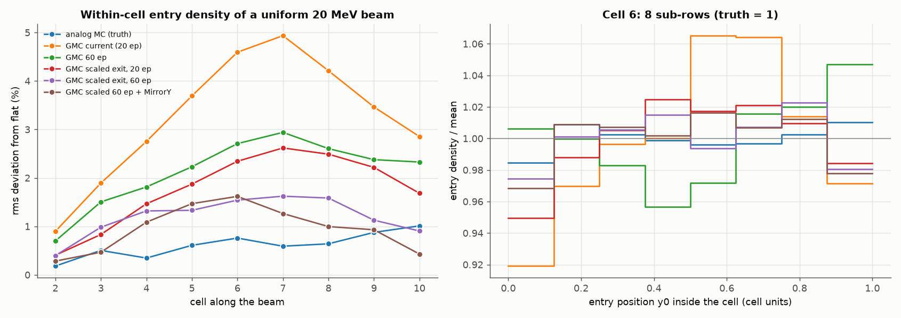

Flat-beam within-cell rms (truth: analog chain 0.4–0.9 %, counting noise):

| model (`ml/models/secondary_gmc_water_1mm_30MeV_elsepa*`) | cell 6 | cell 8 | cell 10 | one-transit dv χ²/bin |
|---|---|---|---|---|
| current (absolute, 20 epochs) | 4.6 % | 4.2 % | 2.9 % | 35 |
| `_ep60` (absolute, 60 epochs) | 2.7 % | 2.6 % | 2.3 % | 17 |
| `_xs` (scaled, 20 epochs) | 2.3 % | 2.5 % | 1.7 % | 32 |
| `_xs60` (scaled, 60 epochs) | 1.5 % | 1.6 % | 0.9 % | 6.2 |
| `_xs60` + MirrorY | 1.6 % | 1.0 % | 0.4 % | — |

The `_rel`, `_edge` and `_scale` variants were 5.6, 6.0 and 6.1 % at cell 6, all worse than the current model.

What remains in `_xs60` sits in the two face rows (about 2–3 % low). The likely source is the classifier's lateral-exit
excess near the faces, which `--edge_feats` fixed. The combined model (`--edge_feats --exit_scaled --flow_epochs 60`)
was started but stopped unfinished.

**Drumm rerun with `_xs60` + MirrorY** (GMC + SCR only, against the existing MC staircase references): see
`drumm_water_cylinder/phaseE/dip_compare.png` and `.json` (`validation/drumm_dip_compare.py`).

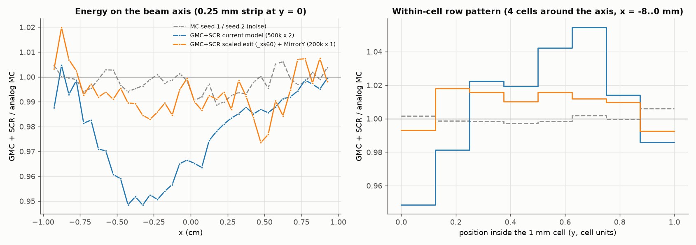

Like-for-like comparison, photons escape, against the 2-seed MC staircase mean:

| | current model (500k × 2) | `_xs60` + MirrorY (200k × 1) | MC seed vs seed |
|---|---|---|---|
| within-cell row pattern rms | 3.2 % | 0.9 % | 0.3 % |
| axis strip mean / min (x = −0.95 … 0.95) | 0.977 / 0.948 | 0.993 / 0.974 | 0.998 / 0.989 |
| axis strip rms deviation | 2.8 % | 1.1 % | 0.5 % |
| fine-map relL2 (125 µm) | 3.0 % | 1.9 % (includes the noise of one 200k run) | 1.3 % |
| cell relL2 (1 mm) | 0.9 % | 0.9 % | 0.3 % |

The dip is cut by about 3×. The remaining row pattern, [0.99, 1.02, 1.02, 1.01, 1.02, 1.01, 1.01, 0.99], is the
face-row deficit the edge-feature classifier should remove. The 200k single-seed run was a time-limited check: the
full 500k × 2-seed rerun, both photon conventions, and the `plot` figures vs ITS are still to do. The MC references
were not rerun.

Commands:
```bash
R=validation/results/drumm_water_cylinder/flat_beam; TR=../ElectronTransport/analog_water_1mm_1keV-30MeV_log_10M_42_elsepa.npz
(cd ../ElectronTransport && .venv/bin/python ../GMC/validation/flat_beam_chain.py mc --out ../GMC/$R/flat_mc_300k.npz)  # 10 min
# model: copy the current checkpoint, retrain only the boundary exit flow (20 min)
python ml/secondary_gmc.py train --train_npz $TR --out ml/models/secondary_gmc_water_1mm_30MeV_elsepa_xs60 \
    --only exit_B --exit_scaled --flow_epochs 60
python validation/flat_beam_chain.py gmc --model ml/models/secondary_gmc_water_1mm_30MeV_elsepa_xs60/secondary_gmc.pth \
    --mirror --out $R/flat_gmc_xs60_mirror_300k.npz                                                                  # 2 min
python validation/flat_beam_chain.py compare --runs $R/flat_mc_300k.npz $R/flat_gmc_xs60_mirror_300k.npz \
    --transit_model ml/models/secondary_gmc_water_1mm_30MeV_elsepa_xs60/secondary_gmc.pth
python validation/scr_edge_diag.py --model ml/models/subcell_kernel_water_1mm_30MeV_elsepa \
    --test_npz ../ElectronTransport/analog_water_1mm_1keV-30MeV_log_2M_7_elsepa.npz
```

## Phase F: doubled training, Drumm figures remade, accuracy / cost sweep (2026-11-16)

**New models** (all with doubled training):
- **GMC** `ml/models/secondary_gmc_water_1mm_30MeV_elsepa_x2`: full retrain with `--edge_feats --exit_scaled`. Every
  epoch count is doubled relative to the 60-epoch `_xs60` exit flow and the defaults: classifiers 30, exit and stop
  flows 120, daughter and photon flows 120. Training took 96 min (on a shared GPU).
- **SCR kernel** `ml/models/subcell_kernel_water_1mm_30MeV_elsepa_x2`: 80k steps instead of 40k (83 min).
  Validation NLL is −3.2818 vs −3.2743.
- **Inference:** MirrorY is on.
- **Loss convergence:** the exit_B validation loss is 0.5936 at 120 epochs vs 0.5941 at 60, so it has nearly
  converged. The chained beam still improves clearly (below).

### Model and label glossary (used in all Phase E / F figures and tables)

**What a GMC checkpoint contains.** Each `secondary_gmc.pth` holds seven sub-models. "B" is a boundary transit, an
electron entering through a cell face; "I" is an interior transit, a relevant secondary born inside the cell.

| sub-model | role |
|---|---|
| `clf_B`, `clf_I` | **Exit classifier.** Samples the exit class: which face the electron leaves through, or absorbed. It also samples the number of relevant daughters and the photon flag. |
| `exit_B`, `exit_I` | **Exit flow** (conditional flow matching, ODE-sampled). Given the class, samples the exit position, direction and energy, and the dose. |
| `daughter` | Starting states of the relevant secondaries. |
| `photon` | Bremsstrahlung energy that leaves the cell. |
| `stop` | Stop point of absorbed electrons (charge tally). |

`exit_B` carries the beam. The Phase E dip came from about 1e-3 errors in it adding up coherently over about 20
cells, so most sweep variants retrain only `exit_B`.

The two training fixes from Phase E:
- **`--exit_scaled`** (affects `exit_B`): through-going exits are encoded relative to the straight-line continuation
  of the entry ray and divided by the measured scattering width σ(E). That gives about 20× more target resolution at
  20 MeV than standardizing over 1 keV–30 MeV.
- **`--edge_feats`** (affects `clf_B` and `exit_B`): the boundary models also see the log distance of the entry point
  to the two side faces. This removes the classifier's 2.8 % excess of side exits near the faces.

**GMC model names** (`ml/models/secondary_gmc_water_1mm_30MeV_elsepa<suffix>`):

| label in plots | suffix | contents |
|---|---|---|
| **Phase D** | *(none)* | Original new-physics model (Phase B). Classifiers 15 epochs, flows 20, daughter / photon 60. Absolute exit encoding, no edge features. |
| **xs60** | `_xs60` | Phase D checkpoint with only `exit_B` retrained: e**x**it_**s**caled, **60** epochs. `clf_B` and all other sub-models are still Phase D's (no edge features). |
| **x2** | `_x2` | Full retrain of all seven sub-models with both fixes (`--edge_feats --exit_scaled`) and every epoch count **doubled (×2)**: classifiers 30, `exit_B` / `exit_I` / `stop` 120, `daughter` / `photon` 120. |

So **x2 vs xs60** differs in three ways:
1. x2 has edge features in `clf_B` and `exit_B`;
2. its `exit_B` trained 120 epochs instead of 60;
3. every other sub-model was retrained at double length instead of reused from Phase D.

**Sweep variants** (`_x2_<name>`). Each is the x2 checkpoint with only `exit_B` retrained, still with
`--edge_feats --exit_scaled`; the data variants also retrain `clf_B`. All other sub-models are x2's.

| label | change from x2 | compare with |
|---|---|---|
| `ep10`, `ep30`, `ep60` | `exit_B` trained 10 / 30 / 60 epochs | x2 (= 120 epochs) |
| `h128d4`, `h512d6` | `exit_B` width × residual depth 128 × 4 / 512 × 6, 30 epochs | `ep30` (= 256 × 6, 30 epochs) |
| `data1M`, `data3M` | `clf_B` + `exit_B` trained on the first 1M / 3M of the 10M training primaries, at the same number of optimizer steps as `ep30` (300 / 100 epochs) | `ep30` (= 10M) |

**Inference-only labels** (the same x2 checkpoint, nothing retrained):

| label | meaning |
|---|---|
| `x2`, `x2 + M` | x2 with MirrorY on (the default in every Phase F run) |
| `x2_nomirror`, `x2 no M` | x2 without MirrorY |
| `ode10`, `ode20`, `ode100` | x2 sampled with 10 / 20 / 100 midpoint ODE steps per flow sample (default 50) |

**MirrorY ("+M")** is an inference wrapper, not a model. A random half of the transits is evaluated on the y-mirrored
state (y → 1 − y, v → −v) and the outputs are mirrored back. Any odd (left/right) model bias cancels exactly, at no
extra model calls. It was required before the boundary rows got y-mirror augmentation in training (Phase B); x2 no
longer needs it.

**SCR kernel names** (`ml/models/subcell_kernel_water_1mm_30MeV_elsepa<suffix>`). The kernel places each transit's
dose inside its 1 mm cell to fill the 125 µm map. In the sweep every kernel is tallied on the same x2 chains, so
differences between kernels are free of chain noise.

| tally label | suffix | contents |
|---|---|---|
| `k80k` | `_x2` | 80k training steps (the doubled kernel), 8 coupling layers × 256 hidden (2.0M parameters), K = 32. Default in all Phase F figures. |
| `k40k` | *(none)* | Phase B / D kernel: 40k steps, same architecture |
| `k20k`, `k10k` | `_s20k`, `_s10k` | 20k / 10k steps |
| `k20k_small` | `_s20k_small` | 20k steps, 4 coupling layers × 128 hidden (0.31M parameters) |
| `k20k_data2M` | `_s20k_data2M` | 20k steps, trained on the first 2M of the 10M training primaries (`--max_segments 2000000`) |
| `K8`, `K16`, `K64`, `K128` | `_x2` | The 80k kernel with 8 / 16 / 64 / 128 Sobol samples per transit (default K = 32) |

Lowercase `k…` is the kernel's training steps; uppercase `K…` is samples per transit at run time.

**Which map each figure scores:**
- "**GMC**" (`panels_gmc_cell`, `error_vs_time_cell`) is the 1 mm cell map: transport alone.
- "**GMC + SCR**" (`panels_gmc_fine`, `panels_scr`, `error_vs_time_fine`) is the 125 µm map: transport plus the kernel.
- The **flat-beam** figure is the Phase E test (uniform 20 MeV beam in a slab, within-cell entry density; truth flat).

**Earlier Phase E experiments**, not used in the Phase F figures (all in `ml/models/`):
- `_ep60`: absolute encoding, 60 epochs.
- `_xs`: scaled encoding, 20 epochs.
- `_rel`: ray-relative exits.
- `_edge`: edge features alone.
- `_scale`: σ-scaled features.
- `_exs60`: edge features + scaled, stopped after 11 epochs, unfinished.

### Drumm Figs. 8a / 8b with the new models

Folder `drumm_water_cylinder/phaseF/`. Runs are 500k × 2 seeds, both photon conventions, against the same MC
references as Phase D.

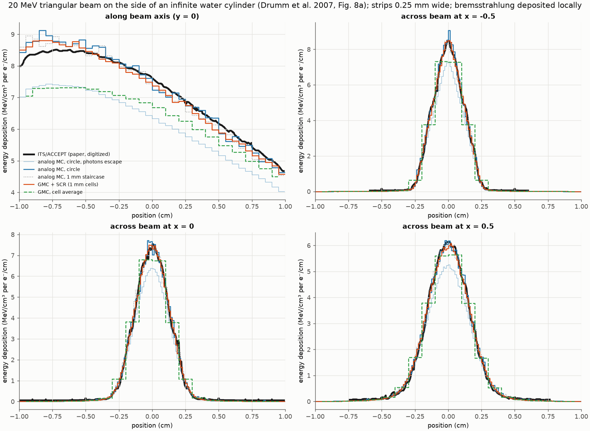
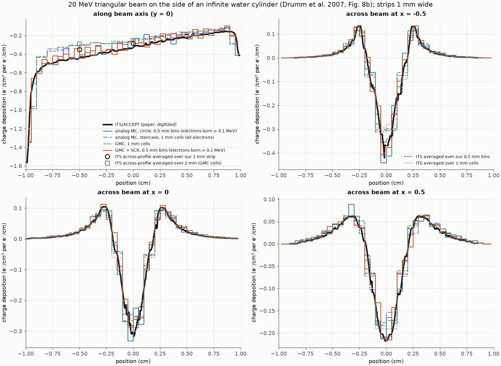
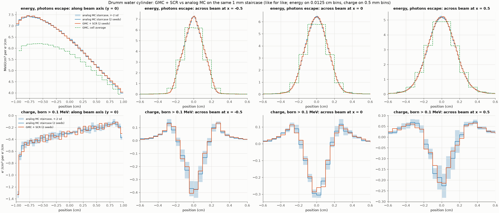

Dose maps (photons local, log scale): analog MC on the true circle and on the staircase, GMC + SCR (one seed,
125 µm) and the GMC cell averages. The Nov 12 version is linked under "Results" above.

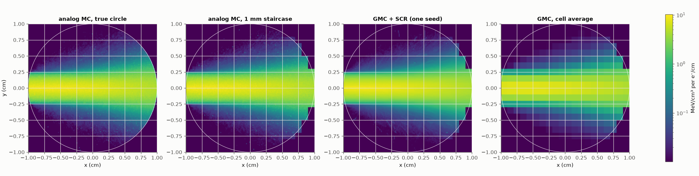

Like for like (1 mm staircase), GMC + SCR vs analog MC; `metrics.json` in each folder:

| | Phase D | **Phase F** | analog MC noise (one run) |
|---|---|---|---|
| fine map 125 µm bias, photons escape | 2.8 % | **0.64 %** | 0.9 % |
| fine map 125 µm bias, photons local | 2.9 % | **0.94 %** | 5.0 % |
| cell map 1 mm bias, photons escape | 0.84 % | **0.29 %** | 0.22 % |
| energy along the axis (relL2) | 3.0 % | **0.45 %** | 0.23 % |
| energy across the beam at x = −0.5 / 0 / 0.5 (relL2) | 4.6 / 3.6 / 2.3 % | **1.0 / 1.2 / 1.2 %** | 0.6 / 0.5 / 0.7 % |
| charge profiles, rms z | 1.0–1.7 | **0.7–1.6** | 1 = noise |
| along-axis energy, GMC + SCR vs MC staircase, photons local (mean) | −2.9 % | **−0.14 %** | |
| deposited fraction of E0, photons escape | 0.2028 | **0.2014** | 0.2014 |

The on-axis dip is gone (`phaseF/dip_compare.png`, against the 2-seed MC staircase mean):

| | within-cell row rms | axis strip mean / min | axis rms | fine relL2 | cell relL2 |
|---|---|---|---|---|---|
| Phase D model | 3.2 % | 0.977 / 0.948 | 2.8 % | 3.0 % | 0.9 % |
| `_xs60` + MirrorY | 0.9 % | 0.993 / 0.974 | 1.1 % | 1.9 % | 0.9 % |
| **`_x2` + MirrorY** | **0.23 %** | **1.001 / 0.995** | **0.47 %** | **1.08 %** | **0.39 %** |
| MC seed vs seed | 0.26 % | 0.998 / 0.989 | 0.47 % | 1.28 % | 0.32 % |

The GMC and MC runs here share the source sample (src_seed 2007), as do the two MC seeds. That source noise cancels in
these differences, so the relL2 values are slightly flattered, and equally on both sides.

vs ITS: GMC + SCR follows ITS as closely as the analog MC does, in every panel of both figures. The remaining
differences from ITS are the analog MC's own differences (see Phase A).

### Accuracy / cost sweep

Script: `validation/drumm_sweep.py`. Folder: `drumm_water_cylinder/sweep/`, with `sweep_metrics.json`, the figures
and `groups.json`.

**Problem.** The Drumm problem: 1 mm staircase, photons escape.

**Runs.** Each configuration is 200k primaries × 2 seeds, each seed with its own source sample. The SCR-side
variables (kernel, K) are tallied on the same chains, so their differences are well resolved.

**Reference.** 4 analog MC staircase runs of 500k each (2M total). Two new seeds use their own source samples
(src_seed 2008, 2009); source sampling is 11 % of the per-run MC variance.

**Error split.** For each map, rel. L2 = sqrt(bias² + noise² · N0/N):
- noise comes from the seed spread;
- bias is the quadrature remainder after both noise terms;
- 1-sigma ranges come from scoring each seed separately. That measures the bias × noise cross term, which is large
  because one 20 MeV track crosses the whole map.

The cell-map biases below about 0.4 % are not resolved.

**Timing.** Timing runs were made alone on the machine (16 threads, RTX 5080). Analog MC: **3.96 ms/primary**
(clean 50k run).

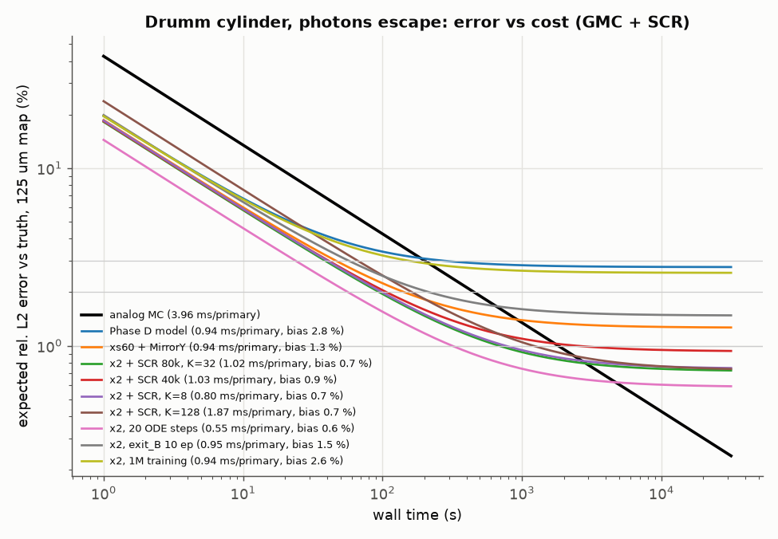

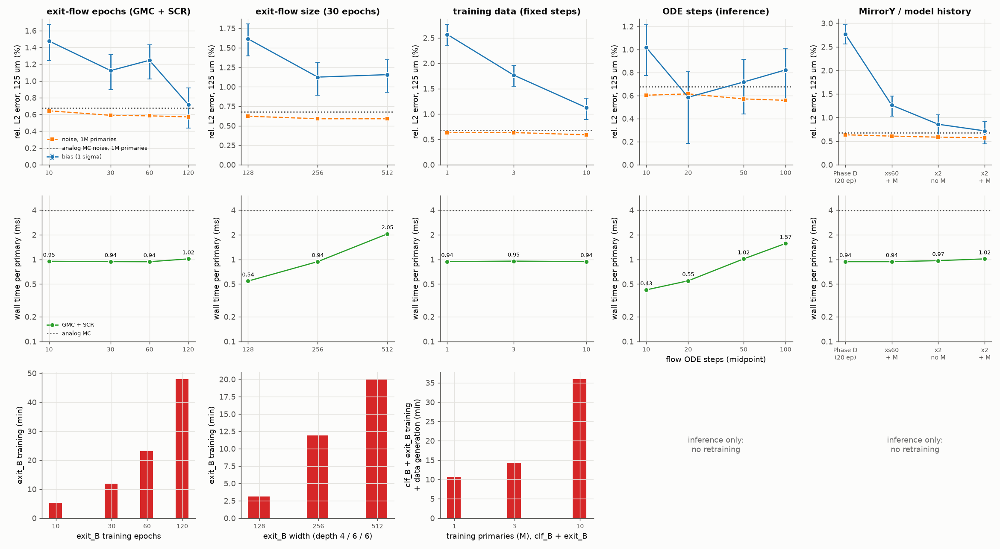

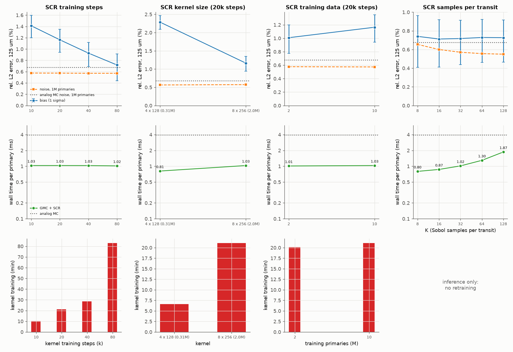

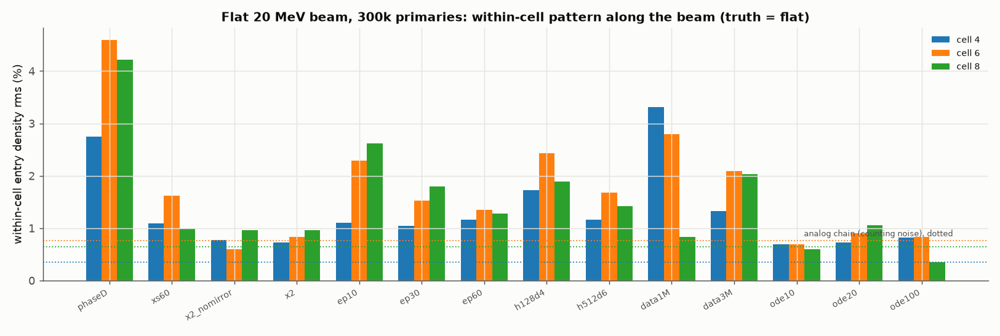

Also: `panels_gmc_cell.png` and `error_vs_time_cell.png` (the GMC alone on 1 mm cells).

What the variants are:
- **GMC variants** retrain only the boundary exit flow (exit_B) on top of `_x2`; all other sub-models are shared.
  The data-size variants retrain clf_B too.
- **Training data size** is a fixed optimizer-step budget (30 epochs at 10M): the first 1M or 3M primaries of the
  10M set.
- **SCR variants** use the `_x2` chain.

Main numbers. Speed-up = analog MC time / GMC time to reach the same expected error on the 125 µm map:

| variable | setting | GMC + SCR ms/primary | fine bias (1σ range) | flat-beam rms cell 6 / 8 | speed-up at 2 % / 3 % |
|---|---|---|---|---|---|
| reference | `_x2` + MirrorY, 50 ODE steps, SCR 80k, K = 32 | 1.02 | 0.72 % (0.44–0.91) | 0.83 / 0.96 % | 4.8 / 5.2 |
| exit_B epochs | 10 / 30 / 60 / 120 | 0.95 / 0.94 / 0.94 / 1.02 | 1.48 / 1.12 / 1.25 / 0.72 % | 2.3 / 1.5 / 1.35 / 0.83 % | 2.1 / 3.8 / 3.5 / 4.8 at 2 % |
| exit_B size (30 ep) | 128×4 / 256×6 / 512×6 | 0.54 / 0.94 / 2.05 | 1.61 / 1.12 / 1.16 % | 2.4 / 1.5 / 1.7 % | 3.0 / 3.8 / 1.7 at 2 % |
| training data (fixed steps) | 1M / 3M / 10M | 0.94 / 0.95 / 0.94 | 2.57 / 1.77 / 1.12 % | 2.8 / 2.1 / 1.5 % | 0 / 1.0 / 3.8 at 2 % |
| ODE steps (inference) | 10 / 20 / 50 / 100 | 0.43 / 0.55 / 1.02 / 1.57 | 1.02 / 0.59 / 0.72 / 0.82 % | 0.7 / 0.9 / 0.8 / 0.8 % | 8.7 / **8.0** / 4.8 / 3.1 at 2 % |
| MirrorY | off / on | 0.97 / 1.02 | 0.86 / 0.72 % | 0.6 / 0.8 % | 4.5 / 4.8 at 2 % |
| SCR training steps | 10k / 20k / 40k / 80k | 1.03 | 1.41 / 1.16 / 0.93 / 0.72 % | — | 2.7 / 3.5 / 4.2 / 4.8 at 2 % |
| SCR size (20k steps) | 4×128 (0.31M) / 8×256 (2.0M) | 0.81 / 1.03 | 2.29 / 1.16 % | — | 0 / 3.5 at 2 % |
| SCR data (20k steps) | 2M / 10M | 1.01 / 1.03 | 1.01 / 1.16 % | — | 4.0 / 3.5 at 2 % |
| SCR samples K | 8 / 16 / 32 / 64 / 128 | 0.80 / 0.87 / 1.02 / 1.30 / 1.87 | 0.71–0.74 % (all) | — | 4.6 / **5.1** / 4.8 / 3.9 / 2.8 at 2 % |
| model history | Phase D / `_xs60`+M / `_x2`+M | 0.94 / 0.94 / 1.02 | 2.77 / 1.26 / 0.72 % | 4.6 / 1.6 / 0.8 % | 0 / 3.2 / 4.8 at 2 % |

What it shows:
- **Training data is the strongest lever.** At equal steps, 1M and 3M primaries leave 2.6 % and 1.8 % fine bias and a
  2–3 % flat-beam pattern. The validation loss does not show this: the 1M model has the lowest validation NLL
  (0.583, on its own subset). Validation loss is not a usable proxy for chained accuracy.
- **Epochs keep helping well past loss convergence.** The flat-beam pattern goes 2.3 → 1.5 → 1.35 → 0.8 % (noise
  floor 0.76 %) from 10 to 120 epochs, while the validation loss moves only 0.5959 → 0.5936. The 120-epoch exit flow
  is the first at the noise floor.
- **Model size:** 256×6 is the sweet spot. 128×4 is 1.7× faster in the chain but measurably worse. 512×6 is no better
  and 2.6× slower.
- **ODE steps are the cheapest win.** 20 midpoint steps are as accurate as 50 or 100: fine bias 0.59 % (0.18–0.81),
  flat beam at the floor. The chain gets 2.6× cheaper: 0.28 vs 0.72 ms/primary, and GMC + SCR 0.55 ms/primary =
  7.2× faster than the MC per primary. 10 steps is probably slightly worse on cells (0.70 % vs ≤ 0.5 %).
  **Recommended default: 20 steps.**
- **MirrorY is now optional.** The boundary y-mirror augmentation in training does its job: without it, the flat beam
  is at the floor and the fine bias is the same within errors. It costs only 5 %, so it stays on as insurance.
- **SCR steps matter.** The bias drops monotonically from 1.41 % at 10k steps to 0.72 % at 80k on identical chains,
  so this difference is well resolved. The kernel is limited by steps, not data: 2M segments at 20k steps match 10M.
  The small 4×128 kernel (0.31M parameters) is clearly too small (2.3 %).
- **SCR K only trades noise for time** (the bias is identical). K = 16 is the most efficient at 8 × 8 sub-cells.
- **Charge.** Cell-level charge is too noisy at 400k primaries to resolve any bias (per-run noise about 20 % per cell
  at 100k). It is assessed in the paper figures instead.

**One-time cost.** Generating the 10M training data takes 17.5 min. On the shared GPU, training takes 96 min for the
GMC and 83 min for the SCR kernel (training alone would be shorter).
- Against the analog MC at 3.96 ms/primary, GMC + SCR saves about 3 ms per primary (about 3.5 ms at 20 ODE steps).
  The one-time 3.3 h breaks even after about 4M primaries of this problem.
- A 2 % (fine-map) MC answer needs about 115k primaries (7.6 min of MC; GMC + SCR about 1.5 min). A 1 % answer needs
  460k primaries (30 min of MC). GMC + SCR needs about 11.5 min at 50 ODE steps, or 5.3 min at 20: near its bias
  floor it needs more primaries than the MC.
- Below about 0.8 % the GMC's bias floor makes the analog MC the better choice for this problem.

**Single-cell held-out check** of `_x2` on the 2M test set (`validation/results/secondary_cell_water_1mm_30MeV_elsepa_x2/`):

| transits | dose ratio GMC / MC | daughters GMC / MC | class max abs z | P(relevant) max abs z |
|---|---|---|---|---|
| boundary | 1.0024 (Phase D model: 1.006) | 13160 / 13259 | 1.76 | 2.19 |
| interior | 0.986 (Phase D model: 0.98) | 484 / 486 | 2.53 | 1.27 |

The longer training does not degrade low energies.

## Next session

0. ~~Finish the dip fix~~: done in Phase F (edge features + scaled exits + 120-epoch exit flow).
   - ~~Make 20 ODE steps the default~~: done 2026-11-17 in `SecondaryGMC` and the validation scripts (the charge
     kernel keeps 50). Single-cell held-out check of `_x2` at 20 steps: boundary dose ratio 1.0004 (1.0024 at 50),
     interior 0.983 (0.986), classifier outputs identical. Check it for the 100 µm models during their retrain.
   - Use the Phase F recipe for the Cu / Al / water retrains: `--edge_feats --exit_scaled`, 120-epoch exit flows,
     ≥ 10M primaries, SCR ≥ 80k steps. The SCR kernel may still improve past 80k.

1. Retrain the 100 µm Cu / Al / water GMCs (and kernels) on the regenerated `_elsepa` sets. Re-check the Cu/Al
   chains for drift.
2. ~~SCR lateral bias at high energy~~: not the kernel. It was the GMC chaining artifact of Phase E. The kernel's own
   2–5 % entry-aligned lateral bias is still worth a look, but it is not the cause of the dip.
3. More histories for the fine charge comparison vs ITS (≥ 2M).
4. Optional physics:
   - density-effect correction (Sternheimer) for condensed-phase stopping power;
   - MeV backscatter vs Tabata, once the Ito/Andreo/Tabata 1993 constants are obtainable (the Osaka repository
     returned 503 on 2026-11-15).

## Mirror symmetry bug found here (fixed at inference, needs a training fix)

The first GMC runs drifted sideways: the beam centroid moved to −90 µm by the exit (MC: within ±2 µm), growing
quadratically with depth, which made cells below the axis up to 8 % high and above it up to 12 % low (cell rel-L2
2.6 %). Cause: a constant mean exit-direction bias of about −6e-4 in v per 1 mm transit, under 2 % of the 20 MeV
angular spread per cell, accumulated over ~20 cells. `secondary_gmc.classifier_data` / the flow data augment only
**interior** rows with D4 copies; boundary (entry) rows are not mirror-augmented, so the entry models are only
approximately y-symmetric.

Fix used here: `MirrorY` in `drumm_cylinder.py` (`--mirror`) calls the model on the y-mirrored state (y → 1 − y,
v → −v) for a random half of the transits and mirrors the outputs, daughters and exit class back. Exact in
expectation, no cost. Centroid drift → within ±6 µm, cell bias 2.6 % → 0.6 %. All numbers above use it.
**Done 2026-11-15:** boundary rows are now y-mirror augmented in `ml/secondary_gmc.py` (see Phase B); the new
model needs no `MirrorY`. The 100 µm Cu/Al chains used broad 2-cell beams and may hide the same drift; worth re-checking.

## Caveats

- The SCR kernel was trained on the 2M (seed 7) sub-cell set: the 10M sub-cell file was not written (the regenerating
  process was stopped for low memory), so there is no held-out kernel evaluation. The GMC itself was trained on the
  10M set and checked on the 2M set (`secondary_cell_water_1mm_30MeV/`: entry dose 1.004, daughters 12886 vs 12905).
- The first 10M training file had a single corrupted byte (zip CRC and segments SHA-1 failed; regenerated with the
  same seed, the rewrite differs from it in exactly one byte). Possibly a hardware/memory event; worth watching.
- Cutoff 1 keV vs the paper's 0.1 MeV: irrelevant for energy at these bins; for charge, emulated with the birth
  threshold. GMC charge is only available per transport cell (absorption positions are not modelled).

## Reproduce

Current pipeline (Phases B–D, new physics). The Nov 12 figures at the top of this page used the pre-2026-11-15 data
(`--elastic eedl`), models without the `_elsepa` suffix, and `--mirror`.

Run the 10M generations **one at a time**: they peak at 19 GB (water 1 mm, 32 bins) and 25.5 GB (Al 100 µm, 64 bins).

```bash
# ElectronTransport venv: training / test data (1 keV - 30 MeV, 1 mm water, 32 x 32 sub-cell images + charge pairs)
for s in "10000000 42 10M" "2000000 7 2M"; do set -- $s
  (cd ../ElectronTransport && .venv/bin/python generate_analog_batches.py --N $1 --seed $2 \
      --out analog_water_1mm_1keV-30MeV_log_$3_$2_elsepa_q --E_low 1e-3 --E_high 30 --box 1e-1 --log_energy \
      --photons_irrelevant --simulated_only --batch_size 250000 --material Water --subcell_bins 32)
done
# (on disk the GMC and SCR kernel were trained on the identical *_elsepa files, made before the charge pairs were
#  added; same seeds give the same segments, checked by segments_sha1)
ET=../ElectronTransport; TR=$ET/analog_water_1mm_1keV-30MeV_log_10M_42_elsepa_q.npz
TE=$ET/analog_water_1mm_1keV-30MeV_log_2M_7_elsepa_q.npz
# GMC venv: models (GMC 14.5 min, stop flow 3 min, SCR kernel 29 min, charge kernel 1.5 min on the RTX 5080)
python ml/secondary_gmc.py train --train_npz $TR --out ml/models/secondary_gmc_water_1mm_30MeV_elsepa
python ml/secondary_gmc.py train --train_npz $TR --out ml/models/secondary_gmc_water_1mm_30MeV_elsepa --only stop
python ml/subcell_kernel.py train --train_npz $TR --out ml/models/subcell_kernel_water_1mm_30MeV_elsepa --batch 32768
python ml/charge_kernel.py train --train_npz $TR --out ml/models/charge_kernel_water_1mm_30MeV_elsepa
# held-out checks
python validation/secondary_cell_compare.py --test_npz $TE \
    --model ml/models/secondary_gmc_water_1mm_30MeV_elsepa/secondary_gmc.pth \
    --out_dir validation/results/secondary_cell_water_1mm_30MeV_elsepa
python ml/subcell_kernel.py eval --model ml/models/subcell_kernel_water_1mm_30MeV_elsepa --test_npz $TE
python ml/charge_kernel.py eval --model ml/models/charge_kernel_water_1mm_30MeV_elsepa --test_npz $TE
# analog MC references (ElectronTransport venv, 35-65 min each, 0.5 GB); `mc` chdirs: give absolute --out paths
D=$PWD/validation/results/drumm_water_cylinder
for r in "stair 123" "stair 1123" "circle 123"; do set -- $r
  ../ElectronTransport/.venv/bin/python validation/drumm_cylinder.py mc --geom $1 --seed $2 --N 500000 \
      --out $D/mc_$1_n8_500k_s$2_elsepa_split3.npz
done
# GMC + SCR + SCR charge (~27 min per convention, 2 seeds, 3 GB RAM / 9.5 GB GPU)
M=ml/models/secondary_gmc_water_1mm_30MeV_elsepa/secondary_gmc.pth; K=ml/models/subcell_kernel_water_1mm_30MeV_elsepa
CK=ml/models/charge_kernel_water_1mm_30MeV_elsepa
python validation/drumm_cylinder.py gmc --model $M --kernel $K --charge_kernel $CK --N 500000 --n_seeds 2 \
    --local_photons --out $D/gmc_n8_500k_elsepa_localph.npz
python validation/drumm_cylinder.py gmc --model $M --kernel $K --charge_kernel $CK --N 500000 --n_seeds 2 \
    --out $D/gmc_n8_500k_elsepa.npz
python validation/drumm_cylinder.py plot --circle $D/mc_circle_n8_500k_s123_elsepa_split3.npz \
    --stair $D/mc_stair_n8_500k_s123_elsepa_split3.npz --stair_noise $D/mc_stair_n8_500k_s1123_elsepa_split3.npz \
    --gmc $D/gmc_n8_500k_elsepa.npz --gmc_lp $D/gmc_n8_500k_elsepa_localph.npz --out_dir $D/phaseD
# Phase A physics comparison (analog MC only)
python validation/drumm_physics_compare.py --runs $D/mc_circle_n8_500k_s123.npz:"EEDL, binary" \
    $D/mc_circle_n8_500k_s123_elsepa_split3.npz:"ELSEPA, split"
```

**ODE steps:** every result on this page was made with 50 ODE steps, the default at the time. Since 2026-11-17 the
default is 20, so add `--ode_steps 50` to reproduce them exactly (the Phase F commands below include it).

Phase F (doubled training, sweep, paper figures). The exact queues that ran are in
`drumm_water_cylinder/sweep/scripts/` (`queue_gmc.sh` / `queue_scr.sh` sweep variants, `queue_eval.sh` runs). Run the
evaluation alone: it measures timings.

```bash
ET=../ElectronTransport; TR=$ET/analog_water_1mm_1keV-30MeV_log_10M_42_elsepa.npz; D=$PWD/validation/results/drumm_water_cylinder
M=ml/models/secondary_gmc_water_1mm_30MeV_elsepa; K=ml/models/subcell_kernel_water_1mm_30MeV_elsepa
python ml/secondary_gmc.py train --train_npz $TR --out ${M}_x2 --edge_feats --exit_scaled \
    --clf_epochs 30 --flow_epochs 120 --small_epochs 120 --stop                                  # 96 min (shared GPU)
python ml/subcell_kernel.py train --train_npz $TR --out ${K}_x2 --batch 32768 --steps 80000          # 83 min
# two more MC references with their own source samples (ElectronTransport venv, ~37 min each)
for r in "2123 2008" "3123 2009"; do set -- $r
  $ET/.venv/bin/python validation/drumm_cylinder.py mc --geom stair --seed $1 --src_seed $2 --N 500000 \
      --out $D/mc_stair_n8_500k_s$1_src$2_elsepa_split3.npz; done
# paper figures (both photon conventions, ~16 min each)
for c in "" "--local_photons"; do
  python validation/drumm_cylinder.py gmc --model ${M}_x2/secondary_gmc.pth --kernel ${K}_x2 \
      --charge_kernel ml/models/charge_kernel_water_1mm_30MeV_elsepa --N 500000 --n_seeds 2 --mirror --ode_steps 50 $c \
      --out $D/phaseF/gmc_n8_500k_x2_mirror${c:+_localph}.npz; done
python validation/drumm_cylinder.py plot --circle $D/mc_circle_n8_500k_s123_elsepa_split3.npz \
    --stair $D/mc_stair_n8_500k_s123_elsepa_split3.npz --stair_noise $D/mc_stair_n8_500k_s1123_elsepa_split3.npz \
    --gmc $D/phaseF/gmc_n8_500k_x2_mirror.npz --gmc_lp $D/phaseF/gmc_n8_500k_x2_mirror_localph.npz --out_dir $D/phaseF
python validation/drumm_dip_compare.py --gmc "Phase D=gmc_n8_500k_elsepa.npz" \
    "xs60+M=gmc_n8_200k_elsepa_xs60_mirror.npz" "x2+M=phaseF/gmc_n8_500k_x2_mirror.npz" --out $D/phaseF/dip_compare.png
# sweep: one run per GMC configuration (200k x 2 seeds), SCR variants tallied on the same chains, e.g.
python validation/drumm_sweep.py run --label x2 --model ${M}_x2/secondary_gmc.pth --mirror --ode_steps 50 \
    --tally k80k=${K}_x2:32 --tally K16=${K}_x2:16 --out $D/sweep/runs/x2.npz
python validation/drumm_sweep.py analyze --runs "$D/sweep/runs/[!m]*.npz" --mc $D/mc_stair_n8_500k_s*_elsepa_split3.npz \
    --mc_ms 3.96 --groups $D/sweep/groups.json --out_dir $D/sweep \
    --flat mc=$D/flat_beam/flat_mc_300k.npz x2=$D/sweep/flat/x2.npz   # (+ the other flat-beam runs)
```
