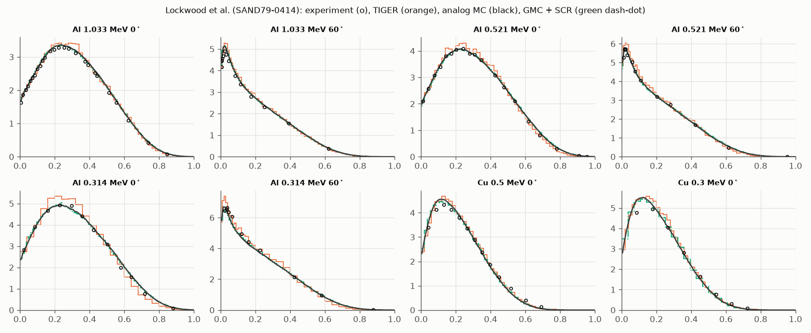
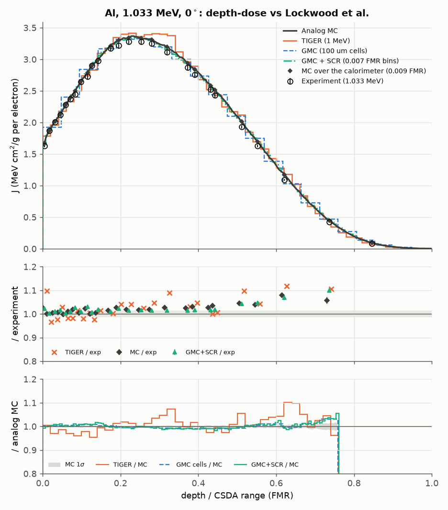
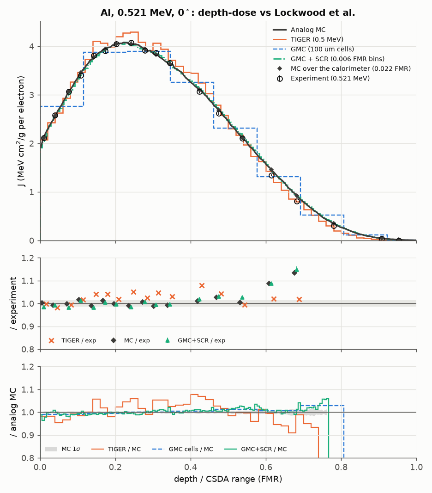
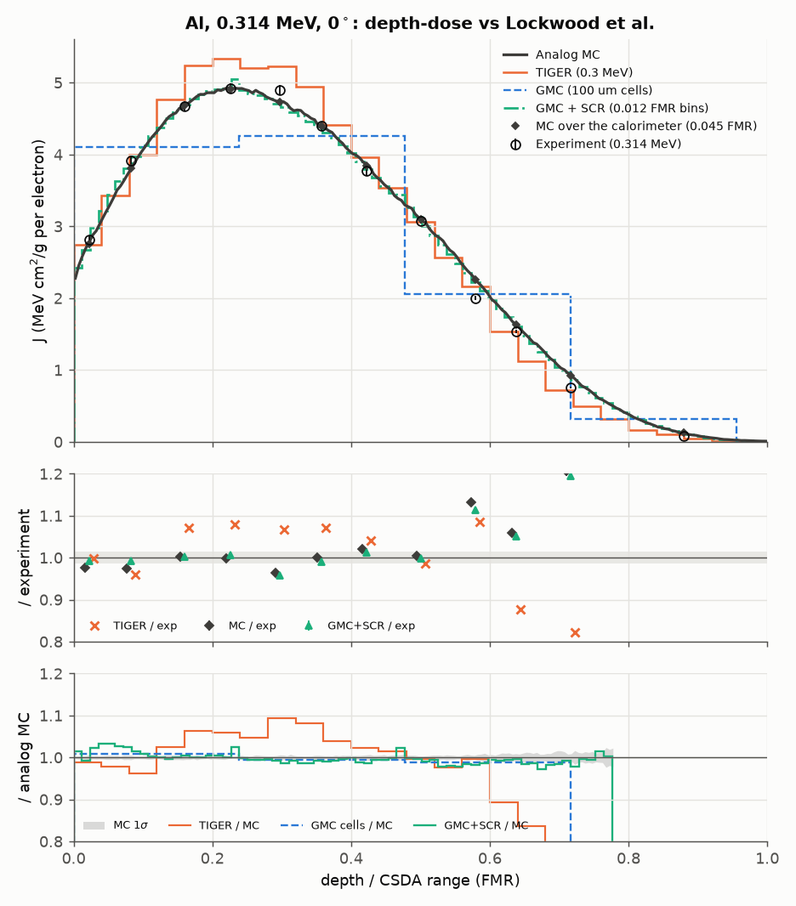
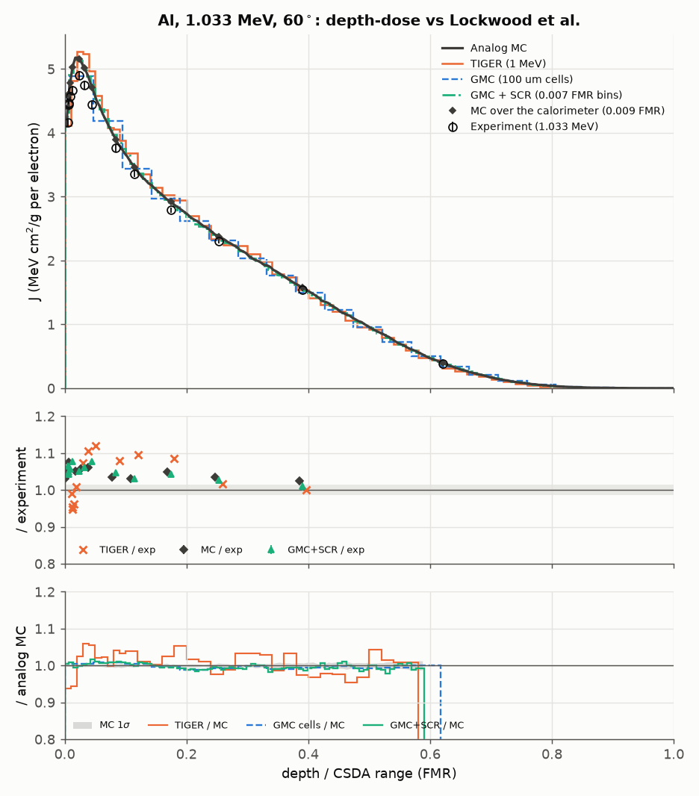
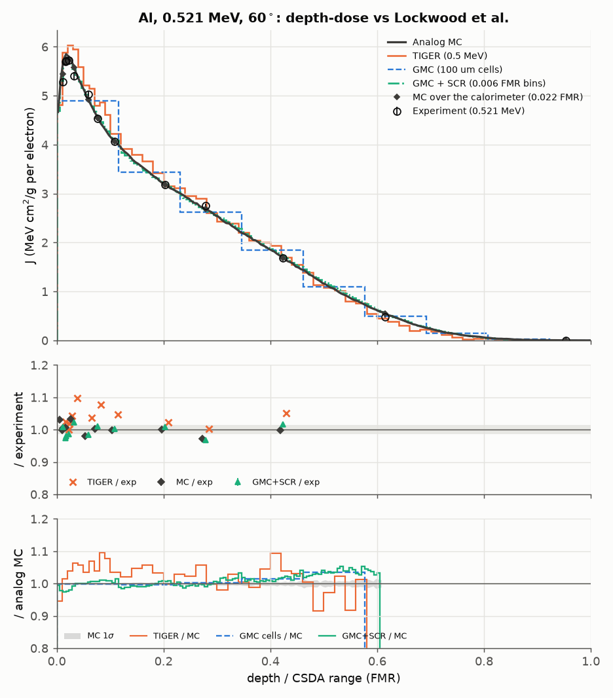
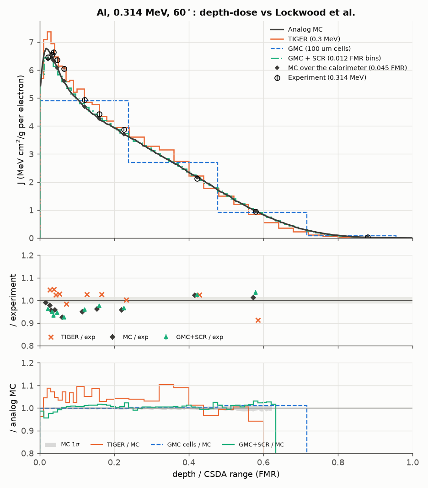
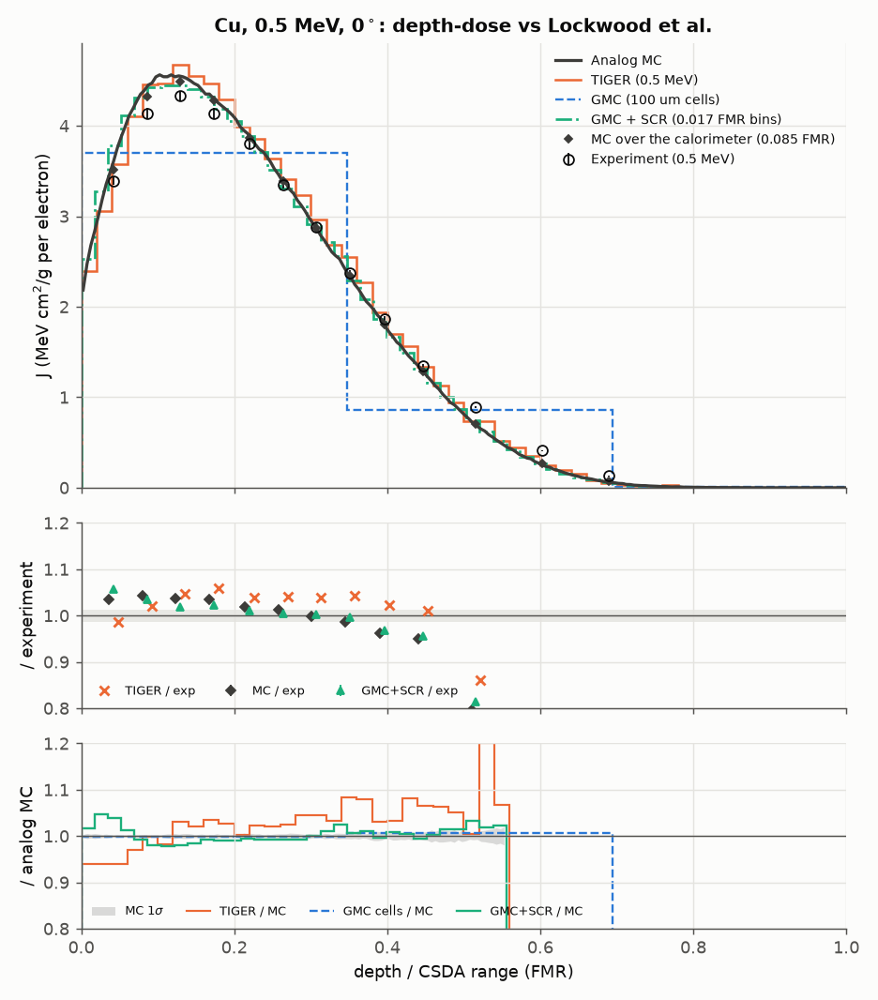
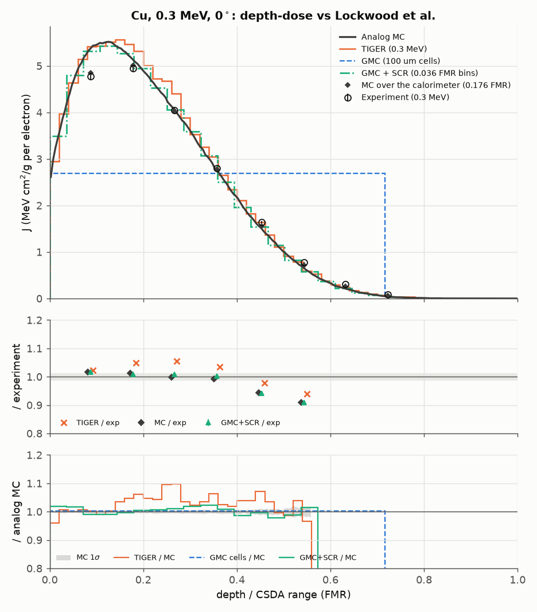

# Lockwood et al. calorimetric depth-dose in Al and Cu (SAND79-0414)

G. J. Lockwood, L. E. Ruggles, G. H. Miller, J. A. Halbleib, "Calorimetric Measurement of Electron Energy Deposition in
Extended Media — Theory vs Experiment", Sandia report SAND79-0414 (1980, reprinted 1987). PDF: `papers/sandia_790414.pdf`.
Measured energy deposition vs depth in semi-infinite targets, with the paper's own TIGER (ITS) calculations.

- Script: `validation/lockwood_slab.py` (`mc` in the ElectronTransport venv, `gmc` and `plot` in the GMC venv).
- Data: `validation/results/lockwood_sandia/lockwood_tables.json` (transcribed Tables V.C.1–V.C.7, V.E.2, V.E.3).
- Figures, metrics: `validation/results/lockwood_sandia/` (`<case>.png`, `overview.png`, `metrics.json`).
- Run 2026-11-17, analog MC with the current physics (ELSEPA elastic, split ionization deflection, 1 keV cutoff).



All eight measured profiles: experiment (circles), TIGER (orange histogram), analog MC (black), GMC + SCR (green
dash-dot, on its own sub-bins). Depth in fractions of the CSDA range (FMR), J in MeV cm²/g per incident electron.
Per-case figures with ratio panels are in [Per-case figures](#per-case-figures).

## Cases and data

| Case | Beam (measured / TIGER) | Angle | CSDA range (paper) | Calorimeter |
|---|---|---|---|---|
| Al 1.0 | 1.033 / 1.0 MeV | 0°, 60° | 0.569 g/cm² | 5.05e-3 g/cm² (0.009 FMR) |
| Al 0.5 | 0.521 / 0.5 MeV | 0°, 60° | 0.234 | (0.022 FMR) |
| Al 0.3 | 0.314 / 0.3 MeV | 0°, 60° | 0.113 | (0.045 FMR) |
| Al 0.1, 0.05 | 0.109, 0.058 / 0.1, 0.05 MeV | 0° | 0.0203, 0.00663 | front calorimeter only |
| Cu 0.5 | 0.5 MeV | 0° | 0.258 | 2.194e-2 g/cm² (0.085 FMR) |
| Cu 0.3 | 0.3 MeV | 0° | 0.125 | (0.176 FMR) |

- **Cu 1.0 MeV is missing from this scan.** Fig./Table V.E.1 (printed pp. 72–73) were not scanned; PDF pp. 75–76 repeat
  V.E.3 instead. The MC was run anyway (`mc_cu_1.0_0_*`); add the data if another copy turns up (the MCNP6 validation
  report OSTI 1253497 or Basaglia et al. arXiv:1307.0933 may reproduce it).
- Experimental uncertainty: 1.4 % (Al), 1.3 % (Cu). TIGER: ≥ 5000 histories, one-sigma ≤ 5 % per bin (≤ 3 % before
  the depth marked in each table).
- Transcription check: integrating the TIGER histograms gives the paper's Cu totals exactly (0.417, 0.248 MeV).

## Conventions (all checked against the paper)

- **Depth** is the fraction of the CSDA range (FMR). Experimental FMR is the calorimeter *centre* (front foils + half
  the calorimeter, e.g. 0.01097 / 0.258 = 0.0425 for the first Cu 0.5 point). Each measured J is the energy in the
  calorimeter divided by its thickness, so the simulations are **averaged over the same window**. This matters for Cu:
  at 0.3 MeV the calorimeter spans 0.176 FMR, and a point-wise comparison would be ~10 % off near the surface.
- **Energies.** Al was measured a few % above nominal; its FMR uses the CSDA range at the actual energy, and TIGER ran
  at the nominal energy. Each Al case is run at both and each reference is compared with the matching run.
- **TIGER bins**: each tabulated FMR is the bin's upper edge (first bin starts at 0; checked against Figs. V.E.2/3).
  Its FMR axis uses the range R = total / ∫J dFMR (reproduces the paper's Cu ranges to 0.1 %): Al 1.0 / 0.5 / 0.3 MeV →
  0.550 / 0.224 / 0.1076 g/cm².
- **Geometry**: our 2D code (infinite z). Slab 1.25 ranges deep, 2.5 ranges tall, pencil beam at mid-height, tally summed
  over y = broad-beam depth-dose per electron. 60°: the beam is tilted into z (u = cos 60°, w = sin 60°).
- **Photons**: TIGER transports them. Ours are banked at birth; the MC curves are "photons escape". Depositing
  fluorescence locally changes totals by ≤ 0.4 % (Cu K x-ray yield is tiny here); all photons local by ≤ 1.7 %.

## Analog MC vs experiment and TIGER

Shape metrics over measured points with J > 10 % of the maximum, simulation averaged over the calorimeter window:

| Case | Deposited / E0: MC | exp | TIGER | MC vs exp: rms (mean) | TIGER vs exp: rms (mean) |
|---|---|---|---|---|---|
| Al 1.0, 0° | 0.949 | 0.939 | 0.954 | 2.9 % (+2.2) | 5.2 % (+2.9) |
| Al 1.0, 60° | 0.781 | 0.735 | 0.785 | 4.7 % (+4.5) | 6.8 % (+3.4) |
| Al 0.5, 0° | 0.934 | 0.919 | 0.942 | 4.1 % (+1.6) | 3.5 % (+2.5) |
| Al 0.5, 60° | 0.750 | 0.750 | 0.764 | 1.7 % (+0.2) | 4.8 % (+3.8) |
| Al 0.3, 0° | 0.925 | 0.908 | 0.933 | 7.8 % (+3.1) | 8.5 % (+0.5) |
| Al 0.3, 60° | 0.737 | 0.732 | 0.760 | 4.0 % (−2.9) | 4.0 % (+1.3) |
| Cu 0.5, 0° | 0.820 | 0.824 | 0.834 | 6.9 % (−1.2) | 5.5 % (+1.6) |
| Cu 0.3, 0° | 0.802 | 0.807 | 0.827 | 4.4 % (−2.1) | 4.3 % (+1.3) |

Front calorimeter only (J in MeV cm²/g): Al 0.109 MeV MC 7.33 vs exp 7.78 (0.942; TIGER 1.051); Al 0.058 MeV MC 9.99 vs
exp 9.65 (1.036; TIGER 0.945).

MC statistics: 200k histories per run, 1σ on the totals ≤ 0.1 %, ≤ 1 % per point. Cost 0.07–1.1 ms/primary.

**Findings**
- The analog MC agrees with the measurements about as well as TIGER does: lower rms deviation in 4 profiles, equal
  within 0.1 % in 2 (Al 0.3 60°, Cu 0.3), higher in 2 (Al 0.5 0°, Cu 0.5). Its total deposition is within 2 % of the
  measured one in all cases but one. (MC vs TIGER directly: 3–5 % rms, 10 % for Al 0.3 0°; part of that is TIGER's
  own 2–5 % per-bin noise.)
- **Al 1.0 MeV at 60° is the outlier**: the MC deposits 6 % more than measured (0.806 vs 0.759 MeV), uniformly at all
  depths, i.e. too little energy is backscattered (MC 21 %, implied by the measurement 26 %). TIGER shows the same sign
  (+3.4 % mean). At 0.5 and 0.3 MeV, 60°, the MC total is right (0.750 vs 0.750, 0.737 vs 0.732). Worth a look with the
  backscatter benchmark (Tabata) at oblique incidence.
- **Ranges.** Our tables' CSDA range (∫dE/S from 1 keV) is longer than the paper's / TIGER's for Al: +2.5–3 % at
  1 MeV, +4–5 % at 0.5 MeV, +5–7 % at 0.3 MeV (the larger number at the measured energy vs the paper's table), ~+6 %
  vs ESTAR at 0.1 MeV; Cu +2–3 %. This shows up as long tails in Al 0.3 MeV (MC / exp
  1.1–1.25 beyond 0.6 FMR) and is the likely cause of the 0.1 MeV surface deficit (−6 %). The README's "mean path to
  stop 0.99–1.05 × CSDA" was for Cu / water; Al's collision stopping power at 0.1–0.5 MeV should be checked against
  ESTAR.
- The paper's own observation, "theory higher near the peaks and lower near the tails", also holds for our MC in Cu
  (MC / exp < 1 beyond ~0.45 FMR, −10 % at 0.54 FMR in Cu 0.3).

## GMC and GMC + SCR

**Models** (trained 2026-11-17 on the ELSEPA sets `analog_{cu,al}_100um_1keV-10MeV_log_10M_42_elsepa[_subcell].npz`,
launchers in `logs_lockwood/`):
- `ml/models/secondary_gmc_{cu,al}_100um_elsepa_e40`: Phase F features (`--edge_feats --exit_scaled`) but a **shortened
  schedule** to fit the session: `--clf_epochs 20 --flow_epochs 40 --small_epochs 60`, no stop flow (Phase F water:
  30 / 120 / 120 + stop). 28 min each.
- `ml/models/subcell_kernel_{cu,al}_100um_elsepa_s20k`: 20k steps × 32768 (Phase F: 80k). 23 min each. Best val NLL
  Cu −2.945, Al −3.260 nats.
- These are **not** the full Phase F retrains of the 100 µm models; those are still to do (≈ 1.5 h GMC + 1.4 h SCR each).

**Setup** (`lockwood_slab.py gmc`): slab of 100 µm cells ≥ 1.4 ranges deep, odd number of rows ≥ 2.5 ranges, beam at
the centre of the middle row's left face, same source as the MC; 200k primaries × 2 seeds, 20 ODE steps, SCR on a
20 × 20 sub-grid (5 µm) with K = 64 Sobol samples per transit; photons leave (= MC "escape"). Command:

```
cd validation && ../.venv/bin/python lockwood_slab.py gmc \
  --model_cu ../ml/models/secondary_gmc_cu_100um_elsepa_e40/secondary_gmc.pth --kernel_cu ../ml/models/subcell_kernel_cu_100um_elsepa_s20k \
  --model_al ../ml/models/secondary_gmc_al_100um_elsepa_e40/secondary_gmc.pth --kernel_al ../ml/models/subcell_kernel_al_100um_elsepa_s20k
```

**Like-for-like vs the analog MC** (same energy, geometry, photon convention). GMC cells: dose per 100 µm cell vs the
MC averaged over the same cell. SCR: on its own sub-bins merged to ≥ 0.005 FMR (finer windows only resolve its
piecewise-constant 5 µm bins and show a sawtooth that is not a model error). rms over bins with dose > 10 % of max.

| Case | cells / range | Total GMC vs MC | GMC cells vs MC | GMC+SCR vs MC (mean) | SCR surface bin | MC noise |
|---|---|---|---|---|---|---|
| Al 1.0, 0° | 21 | 0.980 / 0.980 | 1.0 % | 1.2 % (+0.2) | −0.7 % | 0.6 % |
| Al 1.0, 60° | 21 | 0.806 / 0.806 | 0.6 % | 0.8 % (−0.3) | +0.5 % | 0.6 % |
| Al 0.5, 0° | 8.7 | 0.487 / 0.487 | 1.3 % | 1.5 % (+0.4) | −1.2 % | 0.6 % |
| Al 0.5, 60° | 8.7 | 0.393 / 0.391 | 1.7 % | 2.1 % (+1.1) | −0.5 % | 0.6 % |
| Al 0.3, 0° | 4.2 | 0.290 / 0.290 | 1.0 % | 1.4 % (−0.3) | +1.4 % | 0.6 % |
| Al 0.3, 60° | 4.2 | 0.232 / 0.231 | 0.6 % | 1.4 % (+0.5) | −1.3 % | 0.6 % |
| Cu 0.5, 0° | 2.9 | 0.410 / 0.410 | 0.5 % | 1.7 % (+0.4) | +1.7 % | 0.6 % |
| Cu 0.3, 0° | 1.4 | 0.242 / 0.241 | 0.3 % | 1.3 % (+0.3) | +1.8 % | 0.6 % |

Front calorimeter (range < 1 cell): Al 0.109 MeV SCR / MC 0.989, Al 0.058 MeV 0.982. Energy fraction backscattered: GMC
within 0.002 of the MC except Al 0.5 60° (0.242 vs 0.245) and Al 0.058 MeV (0.096 vs 0.091), e.g. Al 1.0 60° 0.211 vs
0.211, Cu 0.3 0.185 vs 0.187.

**vs experiment**, GMC + SCR averaged over the calorimeter: the same as the MC within the GMC error (e.g. Al 1.0 0°
3.1 % rms vs MC 2.9 %; Cu 0.3 4.5 % vs 4.4 %; Al 0.5 60° 1.8 % vs 1.7 %). The GMC inherits the MC's physics, including
the 60° backscatter deficit at 1 MeV and the long Al range.

**Findings**
- Total deposition is reproduced to ≤ 0.5 % in all 10 cases (plus Cu 1.0 MeV, no data: 0.849 vs 0.848), from 21
  cells per range down to a single cell (Al 0.05–0.1 MeV), including oblique incidence; backscattered energy to
  ≤ 0.005 of E0.
- The cell-level depth-dose is at 0.3–1.7 % of the MC. The shortened schedule shows mainly at 0.5 MeV 60°
  (+1.1 % mean, 1.7 % rms), the one case clearly above the noise.
- SCR resolves the sub-cell depth-dose where the GMC cells cannot (Cu: the whole profile in 1.4–2.9 cells): 0.8–2.1 %
  rms against the MC, with ±1–2 % in the first (surface) sub-bin. This is the regime SCR was built for, and the
  20k-step kernel already does it at the ~1–2 % level (the water Phase F sweep: 1.2 % at 20k, 0.7 % at 80k steps).
- Cost (indicative only: the MC runs shared the CPU with training, and Al 1.0 GMC shared the GPU with the Cu
  inference): GMC + SCR 0.11–0.31 ms/primary vs MC 0.28–0.57 ms for 0.3–0.5 MeV (1.8–2.7×). At Al 1 MeV both are
  ≈ 1.1 ms (0° ) / 0.56 vs 0.93 ms (60°). Half or more of the GMC cost is the SCR tally at n = 20, K = 64; the depth
  resolution needed here (≥ 0.005 FMR) would allow n = 8–10 with K = 32 at about a quarter of that.

## Per-case figures

Each figure has three panels:
- **Top**: depth-dose. Analog MC (black, 1σ band), TIGER at the nominal energy (orange histogram), GMC cell dose (blue
  dashed, one step per 100 µm cell), GMC + SCR (green dash-dot, its sub-bins merged to ≥ 0.005 FMR), experiment
  (circles, ±1.3–1.4 %) and the MC averaged over each calorimeter (black diamonds; this is what the circles measure).
- **Middle**: ratio to the experiment at the measured points with J > 10 % of the maximum (grey band = experimental
  uncertainty). MC and GMC + SCR are averaged over the calorimeter; TIGER is averaged over the same window on the
  universal FMR curve.
- **Bottom**: ratio to the analog MC (grey band = MC 1σ): GMC cells, GMC + SCR, and TIGER.

The surface-only cases (Al 0.109 and 0.058 MeV) have a single measured value each and no figure; numbers are in the
tables above.

### Aluminium, normal incidence



Al 1.033 MeV, 0°: 21 cells per range. MC 2.9 % rms from the data (TIGER 5.2 %); GMC cells 1.0 % and GMC + SCR 1.2 %
from the MC.



Al 0.521 MeV, 0°: MC 4.1 % rms (TIGER 3.5 %); GMC + SCR 1.5 % from the MC.



Al 0.314 MeV, 0°: the long MC tail beyond 0.6 FMR (MC / exp 1.1–1.25) is the longer Al range of our tables (+5–7 %);
TIGER shows the opposite sign. GMC + SCR 1.4 % from the MC.

### Aluminium, 60° incidence



Al 1.033 MeV, 60°: the outlier. MC and GMC + SCR sit 3–8 % above the data at all depths (too little
backscatter: 21 % vs 26 % of E0 implied by the measured total). GMC follows the MC to 0.6–0.8 %.



Al 0.521 MeV, 60°: MC 1.7 % rms from the data (TIGER 4.8 %). The largest GMC deviation of the set: cells 1.7 %,
GMC + SCR 2.1 % rms, +1.1 % mean, growing with depth to +3–5 % at 0.4–0.6 FMR (too much penetration at oblique
entry; a candidate for the full-schedule retrain to fix).



Al 0.314 MeV, 60°: MC 4.0 % rms (TIGER 4.0 %); GMC + SCR 1.4 % from the MC.

### Copper, normal incidence



Cu 0.5 MeV, 0°: the whole range is 2.9 cells, so the GMC cell dose is three steps; GMC + SCR resolves the profile at
0.017 FMR (5 µm) to 1.7 % rms from the MC. The calorimeter spans 0.085 FMR, so the MC line and the diamonds differ
visibly near the peak.



Cu 0.3 MeV, 0°: 1.4 cells per range (two GMC steps). GMC + SCR 1.3 % rms from the MC on 0.036-FMR sub-bins, surface
bin +1.8 %. The calorimeter spans 0.176 FMR, which is why the first measured points sit below the MC line but on the
MC diamonds.

## Next

- Full Phase F retrain of the Cu / Al 100 µm GMCs (120-epoch flows) and 80k-step SCR kernels, then rerun
  `lockwood_slab.py gmc` (expect the 0.5 MeV 60° cell bias to drop).
- Al stopping power at 0.1–0.5 MeV vs ESTAR (range 4–7 % long vs the paper / TIGER).
- MeV oblique-incidence backscatter (Al 1 MeV 60°: 21 % vs 26 % implied) — with the Tabata benchmark.
- Find the Cu 1.0 MeV table (V.E.1); the MC and GMC runs for it already exist.
