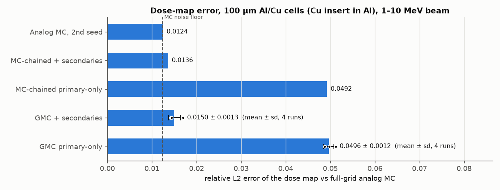
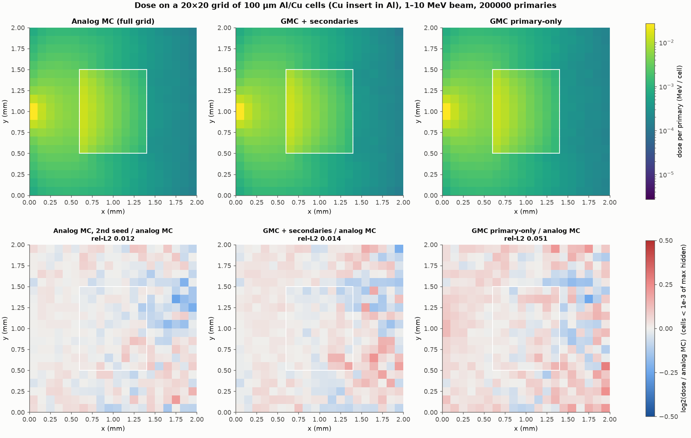
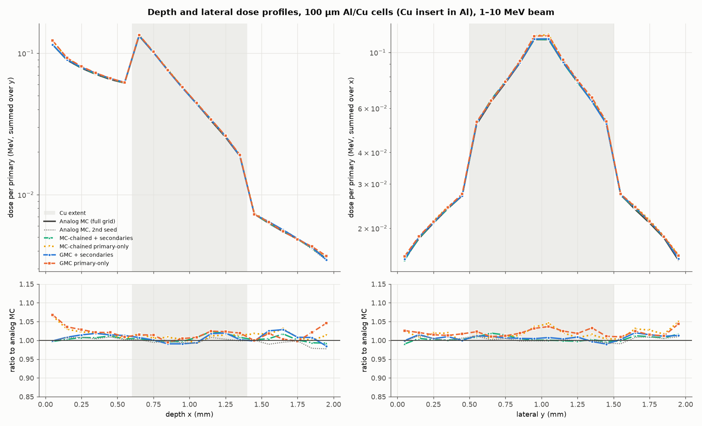
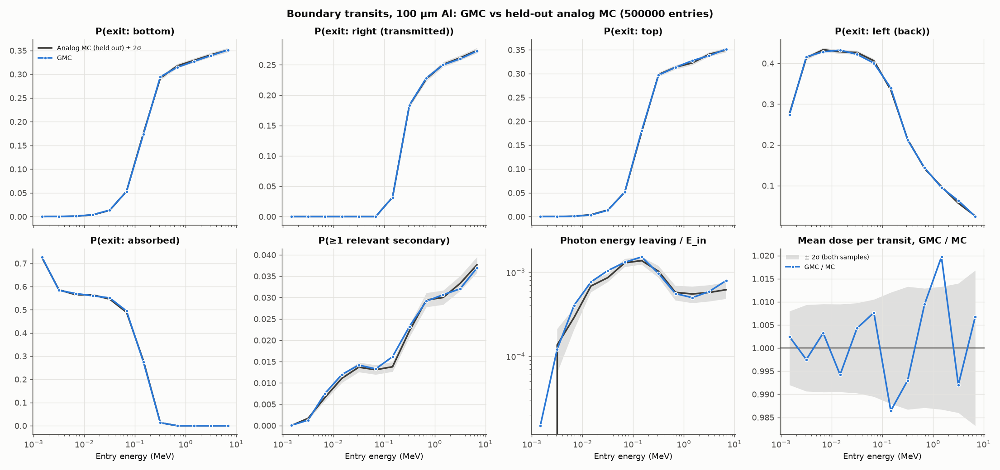

# Electron GMC with secondaries on a two-material field: 100 µm Al and Cu cells, 1 keV – 10 MeV

Generated 2026-11-05. Same scheme, cell size, energy range and network settings as the Cu model
([secondary_gmc_cu_100um.md](secondary_gmc_cu_100um.md)); read that page first for the definitions (relevant
secondaries, MC-chained, noise floor, rel-L2).

- **Al model:** `ml/models/secondary_gmc_al_100um/secondary_gmc.pth`. It was trained on 10M analog-MC primaries on
  one 100 µm Al cell, with log-uniform energies from 1 keV to 10 MeV and the inward hemisphere of directions
  (`ElectronTransport/analog_al_100um_1keV-10MeV_log_10M_42.npz`). The test set is an independent run of 2M
  primaries (seed 7).
- **Cu model:** unchanged (`ml/models/secondary_gmc_cu_100um/secondary_gmc.pth`).
- **Al physics:** EPICS 2023 (EEDL, EADL, EPDL for Z = 13) in `ElectronTransport/aluminum_mc_database.h5`,
  ρ = 2.699 g/cm³.

## Field

The field is a 20 × 20 grid of 100 µm cells (2 mm × 2 mm). It is Al everywhere except a **Cu block** in columns 6–13
and rows 5–14 (0.8 mm × 1.0 mm, outlined in white in the maps).
- The beam enters through the middle two cells of the left face. It crosses Al (0.6 mm), then Cu (0.8 mm), then
  Al (0.6 mm).
- Laterally scattered electrons cross the block's top and bottom faces.
- So every interface orientation is exercised, including backscatter from Cu into Al.

There are 200k primaries per beam, and every chain reuses the reference's source.

How the chain uses two models: each transit is sampled by the model of the material of the cell it is in.
- An electron crossing an interface is an ordinary entry of the neighbouring cell, so it uses that material's entry
  models.
- Relevant daughters stay in their birth cell, so they use the interior models of the material they were born in.
- Nothing else changes. The MC-chained rows use the analog MC of the right material in each cell, the same way.
  Code: `chain_secondaries(..., material_map=...)` with a list of kernels.

## Chained dose vs full-grid analog MC

The table gives the relative L2 error of the dose map, with the total-dose ratio in brackets. GMC rows are mean ± sd
over 4 independent GMC chain runs (seeds 11, 111, 211, 311); MC rows are single runs.

| | Al/Cu field, 1–10 MeV | Al/Cu field, 1 keV–10 MeV | Al only, 1–10 MeV |
|---|---|---|---|
| Analog MC, 2nd seed (noise floor) | 1.24 % (1.001) | 1.74 % (0.996) | 1.19 % (0.999) |
| MC-chained + secondaries (exact chain) | 1.36 % (1.004) | 1.76 % (0.999) | 1.16 % (1.000) |
| MC-chained primary-only | 4.92 % (1.020) | 3.32 % (1.011) | 6.14 % (1.021) |
| **GMC + secondaries** | **1.50 ± 0.13 % (1.006)** | **1.71 ± 0.10 % (1.001)** | **1.18 ± 0.08 % (1.003)** |
| GMC primary-only | 4.96 ± 0.12 % (1.022) | 3.72 ± 0.22 % (1.012) | 6.24 ± 0.17 % (1.024) |

Errors restricted to the cells of one material (Al/Cu field, GMC mean ± sd over 4 runs):

| | 1–10 MeV: Al cells | 1–10 MeV: Cu cells | 1 keV–10 MeV: Al cells | 1 keV–10 MeV: Cu cells |
|---|---|---|---|---|
| Analog MC, 2nd seed | 0.99 % | 1.50 % | 1.04 % | 3.61 % |
| MC-chained + secondaries | 0.95 % | 1.74 % | 0.99 % | 3.73 % |
| **GMC + secondaries** | **1.21 ± 0.04 %** | **1.79 ± 0.26 %** | **1.17 ± 0.09 %** | **3.30 ± 0.29 %** |
| GMC primary-only | 6.37 ± 0.20 % | 2.15 ± 0.19 % | 3.68 ± 0.26 % | 3.93 ± 0.33 % |

Per-run rel-L2 of the whole map, GMC + secondaries: 1.42, 1.70, 1.44, 1.44 % (1–10 MeV) and 1.57, 1.80, 1.78,
1.69 % (1 keV–10 MeV).

- **Two single-material models chained across interfaces reproduce the full two-material MC at the noise
  level.** This required no retraining and no interface-specific modelling. At 1–10 MeV the GMC is 0.26 % above
  the noise floor and 0.14 % above the exact MC chain, which is about one run-to-run sd. For the full spectrum it
  equals the noise floor.
- **Following secondaries matters more in Al than in Cu.** Primary-only errors are 6.2 % for Al alone against
  3.8 % for Cu alone (Cu page). In the mixed field the primary-only error is concentrated in the Al cells (6.4 %),
  while the Cu cells are at 2.2 %. Relevant secondaries carry 7.5 % of the mixed-field dose and 8.7 % of the
  Al-only dose, against about 6 % in Cu. Al's lower density means a knock-on travels further per cell, so more of
  them leave the cell they are born in.
- **The Al model is as good as the Cu model.** On the homogeneous Al field it is at the noise floor (1.18 ± 0.08 %
  vs 1.19 %). The Cu model on the Cu field scored 1.18 ± 0.10 % against 1.10 %.
- **The interfaces are right.** At 1–10 MeV the GMC depth profile is within ±2 % up to the back face of the block,
  and this holds through the doubling of the dose where the beam enters Cu. The Al cells just in front of the block,
  where Cu backscatter adds dose, match too. The largest deviation, +3 % at 0.1–0.3 mm behind the block, is in
  low-dose Al cells. The MC-chained run is +1.5 % there and the 2nd MC seed −1 %, so it is at most a 1–2 % effect.
  The ratio maps show no systematic pattern along the block outline.
- **The total dose is slightly high at 1–10 MeV:** 1.006 against 1.004 for the exact chain on the same source. The
  extra 0.2 % is within the spread of the noise-floor sample.
- **The Cu cells of the 1 keV–10 MeV beam are noisy for every method** (noise floor 3.6 %). Most of the
  low-energy beam stops in the first Al cells, so the block gets few counts. The GMC's 3.30 % there is not
  distinguishable from the MC's.





Full spectrum: [errors](secondary_chain_alcu_100um/errors_full.png),
[dose maps](secondary_chain_alcu_100um/dose_maps_full.png), [profiles](secondary_chain_alcu_100um/profiles_full.png).
Al-only field: [errors](secondary_chain_al_100um/errors_mev.png),
[dose maps](secondary_chain_al_100um/dose_maps_mev.png), [profiles](secondary_chain_al_100um/profiles_mev.png).
Numbers: `secondary_chain_alcu_100um/chain_metrics_*.json`, `secondary_chain_al_100um/chain_metrics_mev.json`.

## Al single cell vs held-out MC

These are entry transits of 500k held-out primaries and 37k held-out relevant secondaries
(`secondary_cell_al_100um/`).

**Entry transits**
- Total dose is ×1.0004, and the dose in every energy bin is within 2 %.
- The GMC makes 9237 relevant daughters against 9067 in the MC (+1.9 %).
- Exit-class fractions are within 2σ in 59 of 60 class × energy bins. The exception is backscatter at 2–5 MeV:
  the GMC gives 6.3 % against 5.7 % in the MC (3.7σ).
- P(≥ 1 relevant secondary) is within 2.8σ.

**Relevant-secondary transits**
- Total dose is ×1.0035.
- Their own relevant daughters number 269 against 271 in the MC.
- Exit classes are within 1.5σ.



[Exit distributions](secondary_cell_al_100um/boundary_exit_distributions.png),
[daughters](secondary_cell_al_100um/boundary_daughters.png),
[interior rates](secondary_cell_al_100um/interior_rates_vs_E.png). Numbers: `secondary_cell_al_100um/metrics.json`.

How Al differs from Cu in one 100 µm cell (analog MC, 2M primaries each): backscatter is 6 % against 18 % at
1–10 MeV and 23 % against 45 % at 0.1–1 MeV, and absorption is 10 % against 22 % at 0.1–1 MeV. Relevant daughters
are 0.018 against 0.020 per primary.

## Reproduce

```bash
# ElectronTransport venv, from ElectronTransport/
python NIST_EPICS_convert.py --element Al                  # -> aluminum_mc_database.h5 (about 10 s)
for s in "10000000 42 10M" "2000000 7 2M"; do set -- $s
  python generate_analog_batches.py --N $1 --seed $2 --out analog_al_100um_1keV-10MeV_log_$3_$2 \
      --E_low 1e-3 --E_high 10 --box 1e-2 --log_energy --photons_irrelevant --simulated_only --batch_size 500000 \
      --h5 aluminum_mc_database.h5 --Z 13
done
# GMC venv, from GMC/
python ml/secondary_gmc.py train --train_npz ../ElectronTransport/analog_al_100um_1keV-10MeV_log_10M_42.npz \
    --out ml/models/secondary_gmc_al_100um
python validation/secondary_cell_compare.py --test_npz ../ElectronTransport/analog_al_100um_1keV-10MeV_log_2M_7.npz \
    --model ml/models/secondary_gmc_al_100um/secondary_gmc.pth --out_dir validation/results/secondary_cell_al_100um
AL=ml/models/secondary_gmc_al_100um/secondary_gmc.pth; CU=ml/models/secondary_gmc_cu_100um/secondary_gmc.pth
for b in mev full; do
  ../ElectronTransport/.venv/bin/python validation/secondary_mc_refs.py --beam $b --materials Al,Cu --layout insert \
      --out validation/results/secondary_chain_alcu_100um/mc_ref_$b.npz          # ElectronTransport venv
  python validation/secondary_chain_compare.py --mc_ref validation/results/secondary_chain_alcu_100um/mc_ref_$b.npz \
      --model $AL $CU --n_seeds 4                                                 # one model per material, same order
done
../ElectronTransport/.venv/bin/python validation/secondary_mc_refs.py --beam mev --materials Al \
    --out validation/results/secondary_chain_al_100um/mc_ref_mev.npz
python validation/secondary_chain_compare.py --mc_ref validation/results/secondary_chain_al_100um/mc_ref_mev.npz \
    --model $AL --n_seeds 4
```

Timing:
- Al data: 4 min for 10M primaries (16 threads), about 3 times faster than Cu.
- Training: 5 min (RTX 5080).
- MC references: 2–9 min per beam.
- GMC chains: 2–5 min per run, with three comparisons sharing the GPU.
