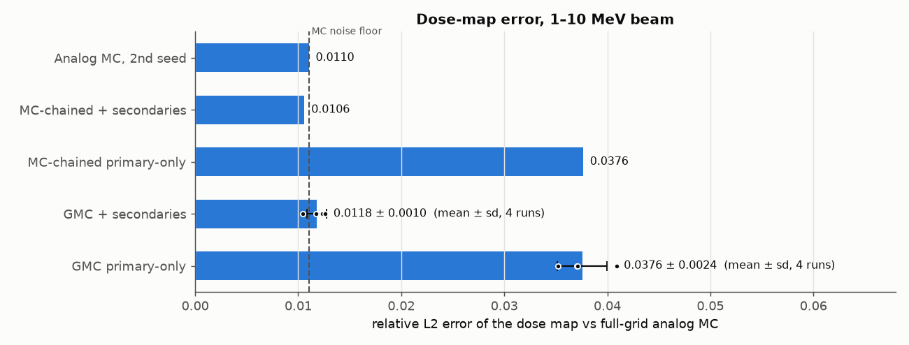
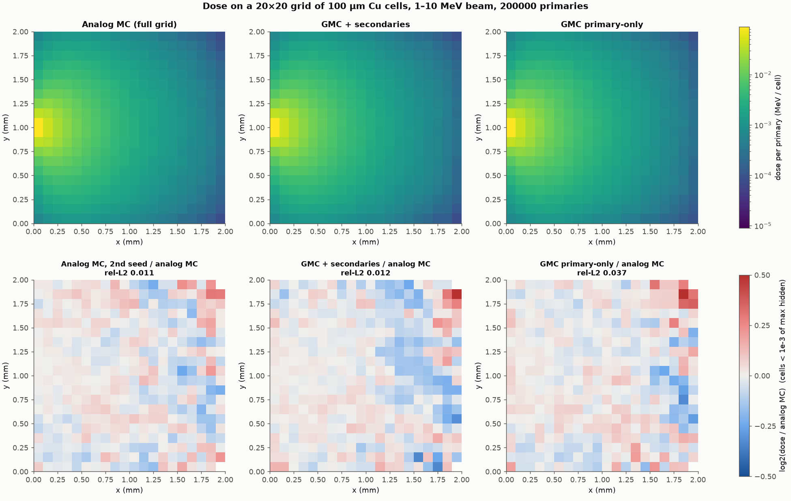
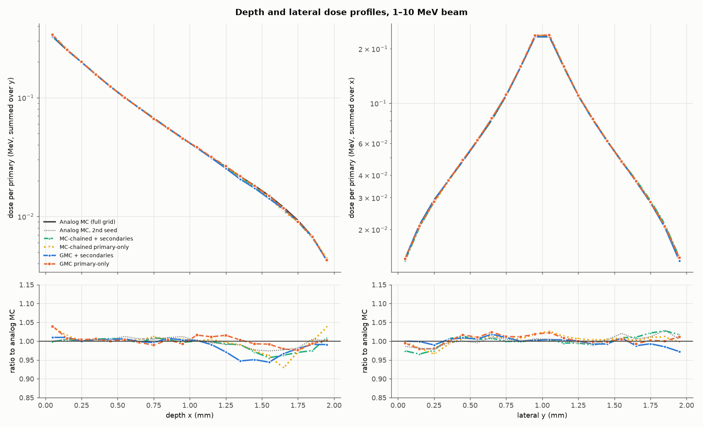
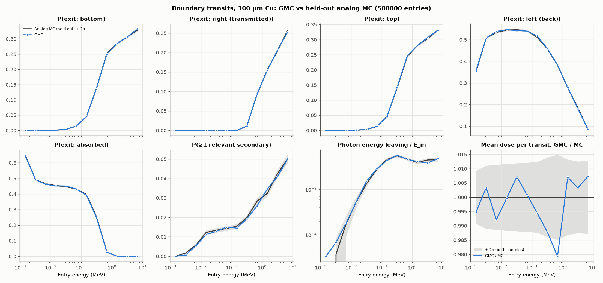
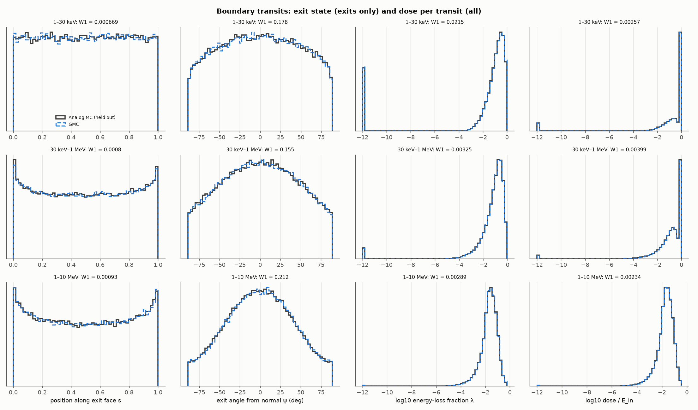
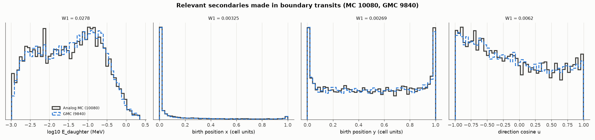

# Electron GMC with secondaries: 100 µm Cu cells, 1 keV – 10 MeV

Generated 2026-11-05. Models: `ml/models/secondary_gmc_cu_100um/secondary_gmc.pth` (`ml/secondary_gmc.py`).
Training data: 10M analog-MC primaries on one 100 µm Cu cell, log-uniform energies 1 keV – 10 MeV, inward
hemisphere of directions (`ElectronTransport/analog_cu_100um_1keV-10MeV_log_10M_42.npz`). Test data: an
independent 2M-primary run (seed 7).

## How to read this page

- **Analog MC** (`ElectronTransport/analog_stepper.py`) is the reference physics: every collision sampled from
  EPICS data. The geometry is 2D (x-y) and infinite in z. Photons are not transported.
- **GMC** = the learned cell models. A **chain** runs them cell by cell over a grid: an electron leaving one cell
  enters the neighbour.
- **Full-grid MC** = the analog MC on the whole grid: the true dose map. **MC-chained** = the analog MC used as the
  cell model in the same chain loop as the GMC. With secondaries passed on it must reproduce the full-grid MC, which
  checks the chain code. Primary-only, it is the best any GMC that ignores secondaries can do.
- **Noise floor** = a second, independent full-grid MC compared with the first. A perfect GMC with the same number of
  primaries scores about this, because both are comparisons of two statistically noisy samples.
- **rel-L2** = sqrt(Σ(d − d_MC)² / Σ d_MC²) over the 400 cells of the dose map. Lower is better.
- **Relevant secondary** = a secondary electron whose energy (directly or through its own secondaries) reaches
  another cell. Only these are followed. Everything else is dose where it is born.
- Glossary and design details: `docs/electron_gmc_workflow.txt`, sections 0 and 7b.

## Scheme

Relevance-based cell transits (`ElectronTransport/gmc_segments.py`). A secondary is *relevant* if its subtree
leaves the cell. Only relevant secondaries are followed; the rest is dose of the transit that made them. Photons
are not transported: their energy leaves, as in the analog MC. Each transit samples:

1. A joint classifier: exit face or absorbed × relevant daughters (0–3+) × photon energy leaving (yes/no).
2. An exit flow: position along the face, angle, |w| and the log energy-loss fraction.
3. A daughter flow: each relevant daughter's birth point, direction and share of the remaining energy.
4. A photon flow: the photon energy leaving.

The dose is whatever energy is left, so energy is conserved exactly in every transit. There are two model sets:
electrons entering through a face, and relevant secondaries starting inside the cell. Augmentation uses the
square's 8 symmetries.

## Chained dose on a 20 × 20 grid (2 mm × 2 mm), 200k primaries

Relative L2 error of the dose map against the full-grid analog MC, with the total-dose ratio in brackets. The GMC
rows are the mean ± standard deviation over 4 independent GMC chain runs (seeds 11, 111, 211, 311; same source
and models). The MC rows are single runs.

| | 1–10 MeV beam | 1 keV–10 MeV beam |
|---|---|---|
| Analog MC, 2nd seed (noise floor) | 1.10 % (1.002) | 1.79 % (1.004) |
| MC-chained + secondaries (exact chain) | 1.06 % (1.001) | 1.40 % (0.998) |
| MC-chained primary-only | 3.76 % (1.011) | 2.53 % (1.011) |
| **GMC + secondaries** | **1.18 ± 0.10 % (1.002)** | **1.54 ± 0.10 % (1.003)** |
| GMC primary-only | 3.76 ± 0.24 % (1.012) | 2.76 ± 0.22 % (1.010) |

Per-run values (rel-L2 map):

| | 1–10 MeV beam | 1 keV–10 MeV beam |
|---|---|---|
| GMC + secondaries | 1.23, 1.17, 1.26, 1.05 % | 1.61, 1.46, 1.46, 1.66 % |
| GMC primary-only | 3.71, 4.09, 3.71, 3.52 % | 2.82, 2.62, 3.04, 2.55 % |

- **The chain loop is exact.** MC-chained + secondaries matches the full-grid MC at noise level. This
  validates the chain loop itself.
- **Following secondaries cuts the GMC error by 3× at 1–10 MeV (3.76 → 1.18 %) and by 1.8× for the full
  spectrum (2.76 → 1.54 %).** The gap is 10 standard deviations of the run-to-run spread. Without secondaries,
  the GMC matches the best possible primary-only model (MC-chained primary-only). Secondaries carry about 6 % of
  the dose (MeV beam). Leaving them in the cell where they are born over-deposits 3–4 % at the entrance (see the
  depth profiles). It also raises the total dose by 1 %, which following them removes (1.002 vs 1.012).
- **The GMC with secondaries is at the MC noise floor.** An unbiased GMC with the same number of primaries would
  sit at the noise floor, since both comparisons are between two independent samples. At 1–10 MeV the GMC is
  0.08 % above it, about 0.4 % model error added in quadrature. For the full spectrum it is below this one
  noise-floor sample.
- **Run-to-run spread is about 0.1 % (with secondaries) to 0.2 % (primary-only).** Compare models with several
  runs, not one. The first, unseeded run of this model gave 1.45 % at 1–10 MeV, a high draw.
  `secondary_chain_compare.py --n_seeds` does this; the plots show the first run.





Full spectrum: [errors](secondary_chain_cu_100um/errors_full.png),
[dose maps](secondary_chain_cu_100um/dose_maps_full.png), [profiles](secondary_chain_cu_100um/profiles_full.png).
Numbers: `secondary_chain_cu_100um/chain_metrics_*.json`.

## Single cell vs held-out MC

These are entry transits of 500k held-out primaries and 40k held-out relevant secondaries.

**Entry transits**
- All exit-class fractions agree within 2σ in every energy bin.
- P(≥ 1 relevant secondary) agrees within 4.2σ; the worst bin is 10 MeV, where the GMC is 5 % low.
- Total dose is ×0.997, and the dose per energy bin is within 2 %.
- The GMC produces 9840 relevant daughters against 10080 in the MC (−2.4 %), carrying −2.6 % of their energy.

**Relevant-secondary transits**
- Exit classes agree within 1.9σ.
- Total dose is ×1.013. The 1–10 MeV bins are the weak spot, up to +14 %, because few secondaries are that
  energetic.
- Their own relevant daughters number 308 against 359 in the MC.





Relevant-secondary (interior) transits: [rates](secondary_cell_cu_100um/interior_rates_vs_E.png),
[exit distributions](secondary_cell_cu_100um/interior_exit_distributions.png),
[daughters](secondary_cell_cu_100um/interior_daughters.png). Numbers: `secondary_cell_cu_100um/metrics.json`.

## Reproduce

```bash
# ElectronTransport venv, from ElectronTransport/
python generate_analog_batches.py --N 10000000 --seed 42 --out analog_cu_100um_1keV-10MeV_log_10M_42 \
    --E_low 1e-3 --E_high 10 --box 1e-2 --log_energy --photons_irrelevant --simulated_only --batch_size 500000
python generate_analog_batches.py --N 2000000 --seed 7 --out analog_cu_100um_1keV-10MeV_log_2M_7 \
    --E_low 1e-3 --E_high 10 --box 1e-2 --log_energy --photons_irrelevant --simulated_only --batch_size 500000
# GMC venv, from GMC/
python ml/secondary_gmc.py train --train_npz ../ElectronTransport/analog_cu_100um_1keV-10MeV_log_10M_42.npz \
    --out ml/models/secondary_gmc_cu_100um
python validation/secondary_cell_compare.py --test_npz ../ElectronTransport/analog_cu_100um_1keV-10MeV_log_2M_7.npz \
    --model ml/models/secondary_gmc_cu_100um/secondary_gmc.pth --out_dir validation/results/secondary_cell_cu_100um
for b in mev full; do
  ../ElectronTransport/.venv/bin/python validation/secondary_mc_refs.py --beam $b \
      --out validation/results/secondary_chain_cu_100um/mc_ref_$b.npz          # ElectronTransport venv
  python validation/secondary_chain_compare.py --mc_ref validation/results/secondary_chain_cu_100um/mc_ref_$b.npz \
      --model ml/models/secondary_gmc_cu_100um/secondary_gmc.pth
done
```
Timing: data 11 min (16 threads), training about 25 min (RTX 5080), MC references 4 min per run, GMC chain
30–80 s per run. Restyle the chain plots without rerunning the chains: `secondary_chain_compare.py ... --replot`.
