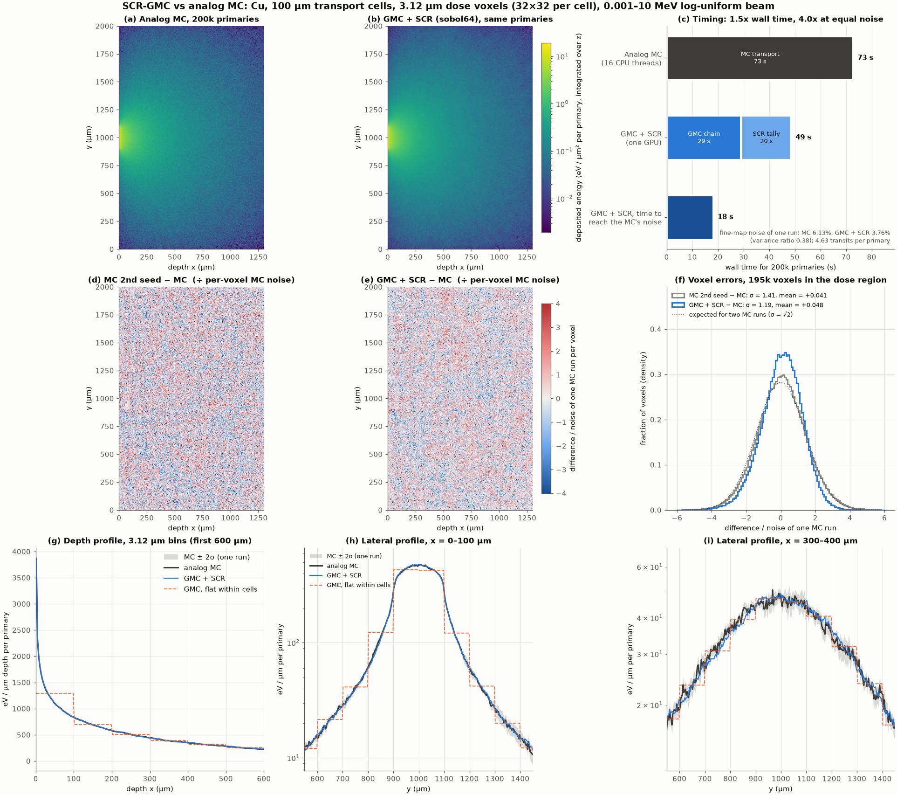
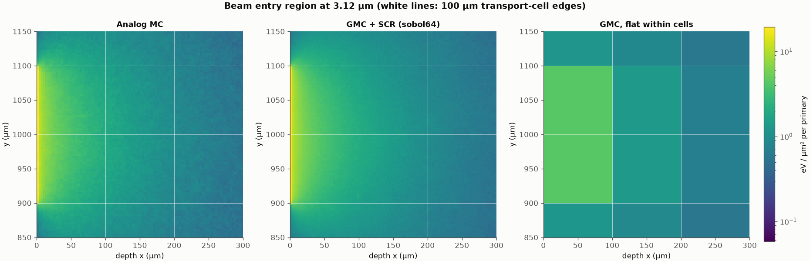
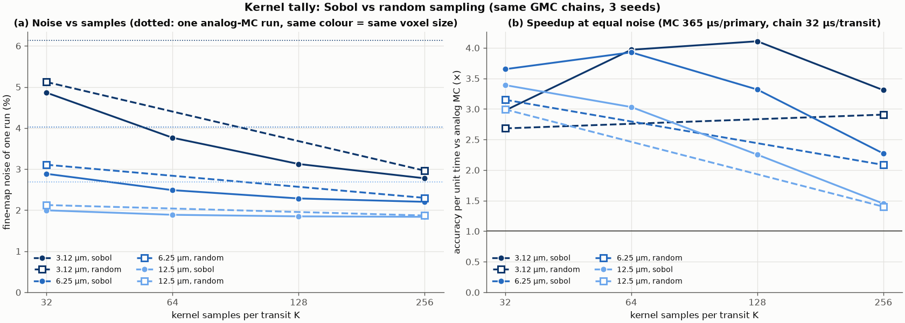

# SCR-GMC: sub-cell dose reconstruction, 100 µm Cu (updated 2026-11-11)

**Summary.** The GMC transports electrons cell to cell on 100 µm Cu cells. A learned kernel then places each transit's
dose inside its cell, so dose can be tallied after the run on a mesh much finer than the transport cells. Chained end
to end and compared with analog MC on 3.1 µm voxels (32×32 per cell), GMC + SCR:
- agrees with the MC within its noise (bias consistent with zero, ±1%);
- has **0.38×** the MC's per-voxel variance at the same number of primaries;
- runs **1.5×** faster in wall time, which makes it **4.0×** faster at equal noise.

Spreading each cell's dose evenly instead is off by 54%.

**The speedup depends on the dose resolution, not only on the block.** The analog MC tallies at any resolution for
free, while the SCR tally needs more samples the finer the grid is relative to the block. So for a given block there is
a finest dose voxel beyond which analog MC wins (§6). For a 1 mm water block: about 3× at 10 µm, break-even at about
1–2 µm, and nanometre voxels are out of reach (about 100× slower than MC). For 1 mm Cu: about 10× at 10 µm, break-even
at about 0.3–0.5 µm.



*(a, b) Energy deposited per µm² on 3.1 µm voxels, 1 keV–10 MeV log-uniform beam entering the middle of the left
face, 200k primaries. (c) Wall time for those 200k primaries. The last bar is the GMC + SCR time scaled to the MC's
noise level. (d, e) Per-voxel difference from the MC, divided by the noise of one MC run. (f) Distribution of those
differences: GMC + SCR minus MC has σ = 1.19, narrower than a second MC run (σ = √2), because GMC + SCR is less noisy
than the MC. (g–i) Depth and lateral profiles at 3.1 µm; dashed is the GMC without the kernel.*



---

## 1. Method

- **GMC** (`ml/secondary_gmc.py`): samples each cell transit: exit face, point, direction and energy, dose
  (E_dep_rel), relevant-daughter count and photon flag.
- **Kernel** (`ml/subcell_kernel.py`): a conditional rational-quadratic spline coupling flow on the unit square. It
  gives the density p(x, y | transit) of where that transit's dose lies inside the cell.
  - **Conditioning:** the whole transit (entry, sampled exit, dose, n_rel, flag), in the canonical frame (entry
    through the left face).
  - **Architecture:** 8 coupling layers, 32 spline bins, 2.0M parameters. Sampling is one forward pass (no ODE).
  - **Training data:** analog-MC deposit images, 64×64 per transit, scheme "rel" (each image sums to the GMC's
    dose).
- **Transit log** (`chain_secondaries(..., transit_log=True)`): one row per transit, holding the cell, entry face,
  the kernel's conditioning in the frame of the call, and the dose. Electrons entering a cell below the cutoff are
  logged as point deposits.
- **Tally** (`subcell_kernel.scr_tally`), run after transport, for each logged transit:
  1. draw K points from its density;
  2. map them to the cell with the entry-face symmetry;
  3. bin them on the fine mesh with weight dose/K.

  The fine field is Σᵢ doseᵢ·pᵢ. It can be re-tallied on any mesh from the saved log, with no new transport.
  - **Cell totals are exact:** summed back to transport cells, the tally reproduces the chain's cell doses within
    1e-14 in every run.

## 2. Kernel: moment-matched dequantization fixes the grid bias

The first kernel spread each training deposit uniformly within its 64×64 bin. Because those bin edges jump with the
entry point, the model learned 1.56 µm boxes, and it failed on any other grid. The stepper now records each bin's
energy-weighted mean offset and spread, and training draws points from a Beta distribution with those moments
(α, β ≥ 1). Model: `ml/models/subcell_kernel_cu_100um_mom`, 40k steps, best validation NLL −2.7102.

Entry-aligned profile errors (relL2 / MC noise). Test sets are independent histories: 2M_7 on 64×64 bins, and
400k_7_s256 on 256×256 bins, which the kernel never saw in training.

| Band | Grid | Uniform dequant: lateral | Moment: lateral | Uniform: depth | Moment: depth |
|---|---|---|---|---|---|
| 1–10 keV | 64 | 0.354 / 0.006 | **0.036 / 0.002** | 0.000 / 0.006 | 0.000 / 0.002 |
| 10–100 keV | 64 | 0.164 / 0.014 | **0.019 / 0.014** | 0.011 / 0.012 | 0.012 / 0.011 |
| 0.1–1 MeV | 64 | 0.034 / 0.018 | 0.020 / 0.018 | 0.021 / 0.016 | 0.020 / 0.016 |
| 1–10 MeV | 64 | 0.028 / 0.018 | 0.019 / 0.018 | 0.020 / 0.016 | 0.019 / 0.016 |
| 1–10 keV | 256 | 0.817 / 0.017 | **0.151 / 0.005** | 0.864 / 0.016 | **0.004 / 0.005** |
| 10–100 keV | 256 | 0.346 / 0.021 | **0.045 / 0.018** | 0.420 / 0.018 | **0.020 / 0.015** |
| 0.1–1 MeV | 256 | 0.056 / 0.026 | 0.038 / 0.023 | 0.059 / 0.024 | 0.033 / 0.021 |
| 1–10 MeV | 256 | 0.066 / 0.029 | 0.037 / 0.025 | 0.054 / 0.026 | 0.025 / 0.022 |

- **Brier skill on 256 bins at 1–10 keV:** 0.88, up from 0.08 for the uniform model and 0.06 for the
  grid-phase diagnostic `_phase`.
- **Still open:** a 15% lateral bias at 1–10 keV on 0.39 µm bins. The suspect is the minimum in-bin spread used in
  training (0.05 bin widths). This regime is meant for the low-energy analog-MC hybrid anyway.
- **In the chain:** the two kernels give the same dose on 12.5 µm voxels. On identical GMC chains they differ by
  0.3% on the fine map and ≤1.1% in the within-cell detail. They only diverge at 16 or more bins per cell.

## 3. Chained GMC + SCR vs fine-mesh analog MC

**Setup.** 20×20 cells of 100 µm Cu with the beam on the middle two rows of the left face, and 200k primaries reused
from the existing chain references. The truth is the analog MC on voxels refined n×n per cell
(`validation/scr_mc_ref.py`). Flights are re-sampled at every voxel face, which is exact, so finer voxels change only
the tally. The GMC runs at 50 ODE steps with 3 seeds; the tallies use the same chains. Errors are split into the
noise of one MC run, the noise of one GMC + SCR run (from seed pairs), and the remaining bias.

**Fine-map error of one run, full 1 keV–10 MeV beam, Sobol tally with K chosen automatically:**

| Dose voxels | MC noise | GMC + SCR noise | Bias | Within-cell detail: MC / GMC + SCR | Flat within cells |
|---|---|---|---|---|---|
| 12.5 µm (8×8, K = 32) | 2.69% | 2.00% | −0.6% | 5.13% / 3.56% | 49% off |
| 6.25 µm (16×16, K = 32) | 4.03% | 2.88% | −0.2% | 7.54% / 5.23% | 52% off |
| 3.1 µm (32×32, K = 64) | 6.13% | 3.76% | −0.7% | 11.2% / 6.73% | 54% off |

- **Bias** estimates are within ±1% and noise-limited with 3 seeds; negative values mean the estimated noise exceeded
  the total error.
- **The 1–10 MeV beam** (8×8, earlier run with random K = 256) gives the same picture: noise 1.47% against the MC's
  2.11%, bias 0.4%.
- **The gain comes from inside the cells.** At the whole-cell level the GMC is about as noisy as the MC (1.1% each).
  The kernel tallies each transit's expected deposit pattern, not one random set of deposits, so the noise inside a
  cell drops.
- **The gain grows with resolution.** With unlimited kernel samples, the GMC + SCR variance would be 0.46× the MC's at
  8×8 and 0.17× at 32×32. This is the reason to expect a larger gain in 3D.

## 4. The tally: speed and sampling

**Speed.** The tally costs about 0.33 µs per sample point, and almost all of it is the flow. The context embedding
(0.14 µs per transit) and the binning (0.01 µs) are negligible.

| Change | Effect |
|---|---|
| Fewer samples: K = 256 → 32 | 8× (the main lever) |
| `cumsum` over the 32 spline bins → triangular matmul, inference only, with a TF32-exact hi/lo split | 20× for that op; with the next row, K = 256 went 106 → 85 µs/transit |
| Skip the log-determinant when sampling | (in the row above) |
| TF32 matmuls | **Off** by default (`tf32=` flag): only 10–15% faster, and moves samples up to 1e-2 cell widths at sharp keV densities |
| `torch.compile` of the layer loop | 1.45× more (9 s compile); tested, **not integrated** |

**Sampling.** Each transit's K points are spread over its density in one of three ways (`subcell_kernel.base_points`).
All three are unbiased:
- `random`: independent points;
- `jitter`: a jittered grid;
- `sobol` (default): the first K Sobol points, with a random digital (XOR) shift per transit. That forms a
  (0, m, 2)-net, which puts exactly one point in each 1/K of the transit's dose, in any aspect ratio.



- **Noise scaling.** Random sampling adds variance ∝ (L/h)/K, where L/h is the number of sub-cells per side.
  - Predicted 0.52× MC at 32×32 with K = 32; measured 0.53×.
  - So K must grow with the sub-grid.
- **Sobol vs random.** Sobol needs about half the K for the same noise at fine sub-grids: Sobol at K = 128 matches
  random at K = 256.
  - The gain is large when a voxel is wider than K strata (compact keV transits: 0.05× the variance at K = 32).
  - It is small when a long MeV track spreads over more voxels than K (0.9×).
- **Auto K.** The default is K = max(32, 2n) for an n×n sub-grid, rounded up to a power of two (`auto_samples`):
  32 at n = 8 or 16, 64 at 32, 512 at 200.

**Speedup at equal noise against the analog MC** (365 µs per primary; chain 31.6 µs per transit, 4.62 transits per
primary):

| Dose voxels | Random K = 32 | Sobol K = 32 | Sobol K = 64 | Sobol K = 128 | Sobol K = 256 |
|---|---|---|---|---|---|
| 3.1 µm | 2.7× | 3.0× | **4.0×** | **4.1×** | 3.3× |
| 6.25 µm | 3.2× | 3.7× | **3.9×** | 3.3× | 2.3× |
| 12.5 µm | 3.0× | **3.4×** | 3.0× | 2.3× | 1.5× |

## 5. Cost and break-even

| Per transit (RTX 5080) | |
|---|---|
| GMC chain, 50 ODE steps (measured in these runs) | 31.6 µs |
| SCR tally, Sobol K = 32 / 64 / 128 / 256 | 10.7 / 21.3 / 42.5 / 84.9 µs |
| Analog MC (16 CPU threads), full beam | 365 µs per primary (this run), 310 (Nov 7 timing) |

- **The break-even is set by the transport blocks, not by the dose resolution.** The tally raises the cost per
  transit by about 35–70%, but its lower variance about cancels that. The Nov 7 threshold still holds for blocks:
  ρL ≳ 0.05–0.1 g/cm² at 50 ODE steps (Cu ≳ 100 µm, Al ≳ 300 µm, water ≳ 1 mm). The dose resolution is then
  limited only by the kernel's training bins and by statistics.
- **With a cheaper GMC** (10 ODE steps, about 5 µs), the tally becomes the main cost. Adding `torch.compile` and
  keeping K near 2n would bring the block threshold to about 0.02–0.03 g/cm². The 10-step GMC is not validated yet.
- **The block break-even is not the whole answer.** For a block above it, the dose resolution sets a second
  break-even; see §6.

## 6. How fine can the dose grid go? Two different break-evens

There are two separate questions, and the speedup claims only make sense with both answered:

1. **Block break-even: is the GMC worth it for transporting this block at all?** That depends on the block's mass
   thickness (§5): ρL ≳ 0.05–0.1 g/cm² with today's GMC.
2. **Resolution break-even: given that block, how fine can the dose grid be before tallying straight from the analog
   MC is cheaper?** The analog MC deposits at collision points, so its cost does not depend on the tally grid. The SCR
   tally's sampling noise grows as (L/h)/K, where L/h = n is the number of dose voxels per block side. So the samples
   needed per transit, and the tally cost, grow as the grid gets finer.

**Example:** dose on 1 µm voxels in a 1 mm water block. There are three options:
- **(a) Analog MC over the block,** tallying at 1 µm.
- **(b) GMC chained over 1 µm cells.** Hopeless: a GMC transit costs 20–30 µs whatever the cell size, while the MC
  crosses a 1 µm water cell in well under 1 µs, and the transit count rises about 1000×.
- **(c) GMC over the 1 mm block, then SCR at 1 µm.** This is the real comparison: (c) against (a).

**Cost model** (`validation/scr_cost_model.py`). The variance of GMC + SCR relative to one MC run is
V(K) = A + b·n/K, and its cost per transit is c + s·K. With K chosen optimally, the cost at equal noise is

  C(n) = ( √(c·A) + √(s·b·n) )²,  K* = √(b·n·c / (A·s)),  speedup = (MC cost per transit) / C(n)

- **Parameters:**
  - c: GMC chain cost per transit (measured);
  - s: about 0.33 µs per kernel sample (about 0.23 µs with `torch.compile`);
  - b: about 0.35, the Sobol sampling-noise constant;
  - A: about 0.17, the variance left with unlimited samples relative to MC. Measured at n = 32; it fell from 0.46 at
    n = 8, so 0.17 is conservative at larger n.
- **Check:** for the measured 100 µm Cu case at 3.1 µm (n = 32), the model predicts 4.4×; measured 4.0–4.1×.
- **Rule of thumb:** for large n the tally term dominates. GMC + SCR beats the MC while n ≲ (MC cost per transit) ÷
  (s·b) ≈ (MC µs per transit) ÷ 0.1 µs.

**1 mm blocks** (extrapolated). Speedup at equal noise against analog MC; MC cost per transit is 100 µs for water (from
the chain timings) and 330 µs for Cu (from the cell-size sweep):

| Dose voxel | n = L/h | K* | Water 1 mm | Water, compiled tally | Cu 1 mm | Cu, compiled tally |
|---|---|---|---|---|---|---|
| 10 µm | 100 | about 140 | 3.0× | 3.7× | 10× | 13× |
| 5 µm | 200 | about 200 | 1.9× | 2.4× | 6.6× | 8.4× |
| 2 µm | 500 | about 310 | 1.0× | 1.3× | 3.4× | 4.5× |
| 1 µm | 1,000 | about 440 | **0.6×** | 0.8× | 2.0× | 2.6× |
| 0.5 µm | 2,000 | about 620 | 0.3× | 0.4× | 1.1× | 1.5× |
| 100 nm | 10⁴ | about 1,400 | 0.08× | 0.1× | 0.25× | 0.35× |
| 10 nm | 10⁵ | about 4,400 | 0.01× | 0.01× | 0.03× | 0.04× |

- **Break-even voxel:** water 1 mm about **1.4–2 µm**; Cu 1 mm about **0.3–0.5 µm**. Cu goes finer because its MC is
  more expensive per transit (more collisions per mm), leaving more MC cost to beat.
- **Below the break-even, use the analog MC** for that block, or SCR on a coarser grid.

**Why nanometre voxels are out of reach.** Several independent limits, any one of which is enough:
1. **Cost.** At large n the tally cost grows about in proportion to L/h, while the MC cost stays fixed. At 10 nm in a
   1 mm block, GMC + SCR is about 100× slower than MC.
2. **Storage.** A 1 mm block at 10 nm is 10¹⁰ voxels in 2D (10¹⁵ in 3D), for either method. Only small regions of
   interest are feasible.
3. **Physics data.** The training data comes from the analog MC with a 1 keV cutoff: below it, the remaining energy
   is deposited at one point, and a 1 keV electron travels tens of nm in water. EPICS is free-atom data, with no
   condensed-phase effects. Nanometre dose needs track-structure physics (Geant4-DNA style, cutoffs around 10 eV),
   which this MC does not have.
4. **What the kernel represents.** The kernel predicts a transit's mean deposit density. At µm scale that is dose. At
   nm scale, what matters is the stochastic clustering of individual events (nanodosimetry), which the kernel averages
   away by design.
5. **Model capacity and training data.** One flow resolving structure at 10⁻⁵ of its domain would need a multiscale
   design, and training data recorded as raw points rather than images.

**Fine detail in a small region.** Change the tally, not the transport. For a small region of interest, evaluate the
density of each transit that overlaps it by quadrature, only inside that region. The cost then scales with the
region's voxel count, not with L/h, and there is no sampling noise. That makes sub-µm (not nm) zooms into a mm block
plausible. Not implemented.

**Samples per transit for large blocks.** The current `auto_samples` rule (K = 2n) matches the measured optimum for
n ≤ 32, but it overshoots badly for large n. With these constants the optimum is K* ≈ 14√n (n = 1000: K* ≈ 450, the
current rule gives 2048), which also reproduces the measured optimum at n = 8–32. The rule should switch to this form
before large blocks are run.

**Caveats.**
- The model rests on one measured case (100 µm Cu, n = 32, reproduced within 10%), with s, b and A assumed fixed as n
  grows.
- No water kernel exists yet. The water 1 mm GMC cost (33 µs per transit) is measured.
- The comparison is 16 CPU threads against one GPU.
- **Direct test:** train a kernel on 1 mm water data recorded at 256–512 bins with moments, and run it at 2, 5 and
  10 µm against a fine MC. The water 1 mm GMC already exists.

## 7. Corrections to earlier statements

- **MC timing:** the fine-voxel MC runs on Nov 10 were slowed by jobs running at the same time, not by voxel faces.
  The uncontended 32×32 run took 73 s, against 84 s for the 8×8 run. The speedups above use uncontended times.
- **"Ideal shape" baseline:** the first version of the comparison used the truth's own within-cell shape, which
  shares that run's noise and so is meaningless. It was then taken from the second MC seed, and is now dropped in
  favour of the noise/bias split.
- **Stratified sampling:** I first expected it to help most when K ≪ L/h. It is the reverse. It gives large gains when
  K ≳ L/h and small ones below that, so it lowers the K needed but does not remove the need for K ~ L/h.

## 8. Reproduce (GMC venv unless noted)

```bash
# fine-mesh MC references (ElectronTransport venv; ~75 s per run at 200k primaries, 2 runs)
../ElectronTransport/.venv/bin/python validation/scr_mc_ref.py \
    --mc_ref validation/results/secondary_chain_cu_100um/mc_ref_full.npz --n 32
# kernel evaluation
python ml/subcell_kernel.py eval --model ml/models/subcell_kernel_cu_100um_mom \
    --test_npz ../ElectronTransport/analog_cu_100um_1keV-10MeV_log_400k_7_s256.npz
# chained GMC + SCR, several tallies on the same chains, scored at 32, 16 and 8 bins per cell (~12 min)
python validation/scr_chain_compare.py \
    --fine_ref validation/results/secondary_chain_cu_100um/mc_ref_full_fine32.npz \
    --mc_ref validation/results/secondary_chain_cu_100um/mc_ref_full.npz \
    --model ml/models/secondary_gmc_cu_100um/secondary_gmc.pth \
    --kernel ml/models/subcell_kernel_cu_100um_mom --n_seeds 3 \
    --tallies sobol:32,random:32,sobol:64,sobol:128,random:256,sobol:256 --eval_n 32,16,8 --tag _strat
# resolution break-even tables of §6 (or --gmc_us --mc_us --block_um --h_um for another block)
python validation/scr_cost_model.py
# figures on this page (from the saved run, no transport)
python validation/scr_figures.py \
    --run validation/results/secondary_chain_cu_100um/scr_doses_full_fine32_strat.npz --tally sobol64
```

Outputs are in `validation/results/secondary_chain_cu_100um/`:
- `mc_ref_{mev,full}_fine{8,32}.npz` (fine MC references);
- `scr_metrics_*.json` and `scr_doses_*.npz` (all runs);
- `scr_mc_vs_gmc_*`, `scr_entry_zoom_*` and `scr_samples_*` (figures).

## 9. Next

1. **Test the resolution break-even on 1 mm water** (§6): record kernel training data at 256–512 bins with moments,
   train, and run at 2, 5 and 10 µm against a fine MC. Switch `auto_samples` to K ≈ 14√n first.
2. **Unstructured target meshes.** Accumulate into a per-cell reference grid, then do a conservative polygon remap
   at the end. The tally is unchanged; only the final step is new.
3. **Functional-expansion accumulator** (Legendre per cell), for compact storage (needed in 3D) and smoother
   fields. Sharp keV deposits go to the low-energy hybrid.
4. **`torch.compile` in the tally** (1.45×), once the tally dominates (10-step GMC or large K).
5. **1 mm Cu:** a GMC model plus kernel data at about 256 bins with moments, to test the 5 µm extrapolation.
6. **Low-energy hybrid:** analog MC for entries below about 30–100 keV, with exact deposit positions.
7. **Polygon transport cells** in the analog stepper, then a kernel conditioned on cell shape.
