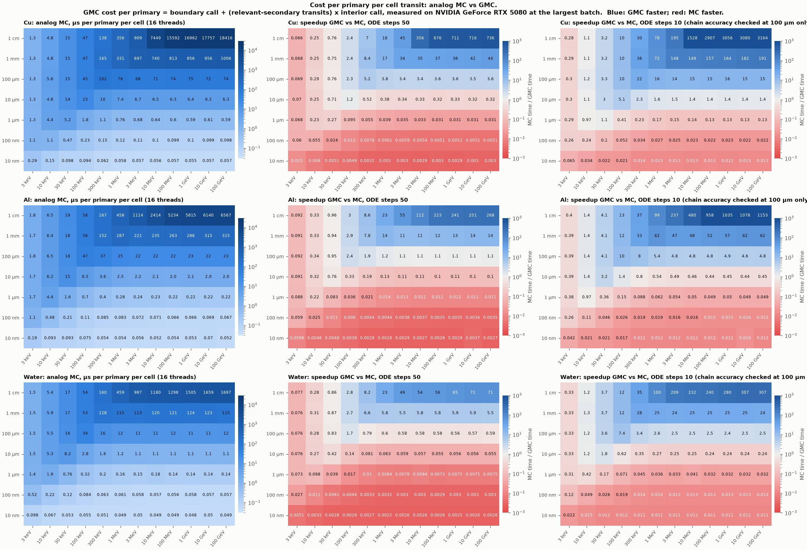
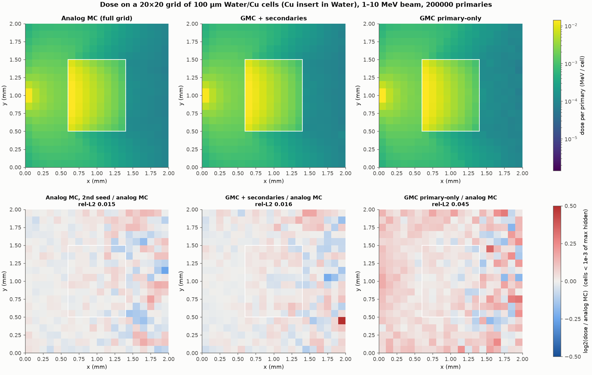
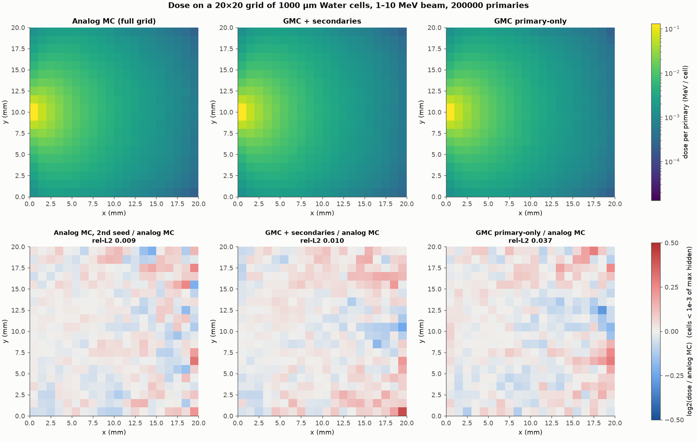
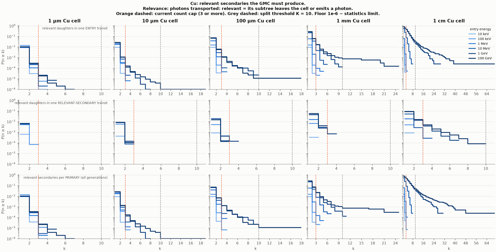
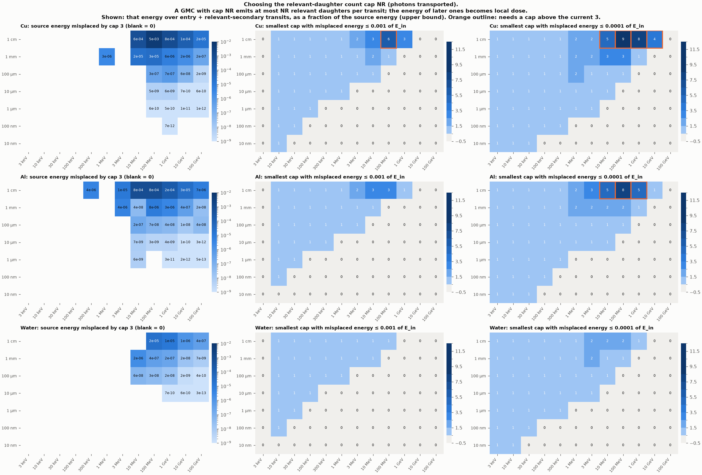

# Cost vs cell size and energy, water, and the relevant-secondary cap

Generated 2026-11-07. Three questions:

1. What do the GMC and the analog MC cost for different cell sizes and energies?
2. Can we do water, and is it just a cell trained on summed H and O EPICS data?
3. What does the distribution of relevant secondaries look like for different cells and energies, and what should
   the cap be?

Data: `ElectronTransport/sweep_cell_size_energy.py` over 7 cell sizes (10 nm – 1 cm) × 12 entry energies
(3 keV – 100 GeV) for Cu, Al and water. Each point is one square cell hit on one face by an inward hemisphere of
directions (the GMC training source). Each point used 4k–1M primaries, adapted to a 10 s budget. Numbers:
`sweep/sweep_summary.json` and `ElectronTransport/figures/sweep_{cu,al,water}.json`. Hardware: 16 CPU threads for
the MC, one RTX 5080 for the GMC.

## 1. Cost

**One GMC call costs the same for every cell size, energy and material. The MC cost grows with the mass
thickness of the cell (ρL) and with energy. The GMC pays off once a cell holds roughly 0.03–0.1 g/cm², and then
the speedup grows with ρL.**

GMC cost per transit (`gmc_timing.py`, batch ≥ 10⁵ particles, averaged over entry energies):

| ODE steps | entering electron | relevant secondary |
|---|---|---|
| 50 (validated default) | 19 µs | 24 µs |
| 10 | 4.5 µs | 5.4 µs |
| 5 | 2.1 µs | 2.6 µs |

- The cost is proportional to the number of ODE steps: each step evaluates the flow network twice (midpoint
  rule).
- The GMC must be batched. At 100 particles per call the cost is 500–800 µs per transit at 50 steps, so a chain
  needs about 10⁴ or more particles in flight per step.
- The MC cost per primary per cell (left column of the figure) ranges from 0.05 µs (10 nm) to 18 ms (1 cm Cu at
  100 GeV).

Projected speedup = MC time per primary per cell ÷ (one entry call + relevant-secondary calls), at 50 ODE steps:

| ρL | example cells | speedup at ≥ 1 MeV |
|---|---|---|
| ≤ 0.01 g/cm² | ≤ 10 µm Cu, ≤ 100 µm water | 0.003–0.6: **MC is faster** |
| ~0.03 g/cm² | 100 µm Al | ~1 |
| ~0.1 g/cm² | 100 µm Cu, 1 mm water | 3–6 |
| ~0.3–1 g/cm² | 1 mm Al, 1 mm Cu, 1 cm water | 11–70 |
| ~3–9 g/cm² | 1 cm Al, 1 cm Cu | 100–740 (photons not transported; see below) |

Below about 30 keV the GMC is slower at every cell size, because the electron stops after a handful of
collisions and the MC needs about 1–15 µs for that.



**Measured end to end** (`chain_timing.py`): a 20 × 20 grid of 100 µm cells, beam on the central two rows of the
left face, 100k primaries. Cells are 100 µm unless marked 1 mm. "Floor" is a second independent MC run, so a perfect GMC scores about the floor.

| material, beam | MC | GMC, 50 steps | speedup | rel-L2 (floor) | GMC, 10 steps | speedup | rel-L2 |
|---|---|---|---|---|---|---|---|
| Cu 100 keV | 4.6 s | 2.5 s | 1.8 | 0.32 % (0.43 %) | 0.6 s | 8.2 | 0.46 % |
| Cu 1 MeV | 35 s | 11 s | 3.2 | 0.77 % (0.71 %) | 2.6 s | 13 | 1.16 % |
| Cu 10 MeV | 363 s | 74 s | 4.9 | 2.09 % (1.49 %) | 17.5 s | 21 | 2.81 % |
| Cu 1 keV–10 MeV | 31 s | 19 s | 1.7 | 2.34 % (1.88 %) | 4.5 s | 6.9 | 2.44 % |
| Al 100 keV | 5.3 s | 2.6 s | 2.1 | 0.76 % (0.21 %) | 0.6 s | 8.2 | 0.42 % |
| Al 1 MeV | 41 s | 36 s | 1.2 | 1.76 % (1.42 %) | 8.6 s | 4.8 | 1.70 % |
| Al 10 MeV | 49 s | 62 s | **0.8** | 2.33 % (1.37 %) | 14.7 s | 3.3 | 2.15 % |
| Al 1 keV–10 MeV | 18 s | 27 s | **0.7** | 1.84 % (1.88 %) | 6.0 s | 3.0 | 2.15 % |
| Water 100 keV | 5.3 s | 3.2 s | 1.6 | 0.35 % (0.34 %) | 0.8 s | 6.8 | 0.43 % |
| Water 1 MeV | 26 s | 55 s | **0.5** | 1.69 % (1.76 %) | 13.1 s | 2.0 | 2.15 % |
| Water 10 MeV | 25 s | 60 s | **0.4** | 2.49 % (1.57 %) | 14.0 s | 1.8 | 2.54 % |
| Water 1 keV–10 MeV | 11 s | 25 s | **0.4** | 1.73 % (1.69 %) | 6.1 s | 1.8 | 2.01 % |
| Water **1 mm** 100 keV | 5.7 s | 1.5 s | 3.9 | 0.26 % (0.17 %) | 0.4 s | 16 | 0.15 % |
| Water **1 mm** 1 MeV | 49 s | 8.8 s | 5.5 | 0.83 % (0.88 %) | 2.1 s | 23 | 1.51 % |
| Water **1 mm** 10 MeV | 248 s | 63 s | 3.9 | 1.82 % (1.28 %) | 15.0 s | 17 | 2.40 % |
| Water **1 mm** 1 keV–10 MeV | 43 s | 14 s | 3.0 | 1.63 % (1.81 %) | 3.4 s | 13 | 1.84 % |

- **The projection matches the measured chains within about 1.5×.** Water at 1 mm and 1 MeV is projected at 5.8
  and measured at 5.5. Cu 100 µm at 1 MeV is projected at 3.8 and
  measured at 3.2. At 10 MeV it is projected at 3.4 and measured at 4.9. Al 10 MeV is projected at 1.1 and
  measured at 0.8.
- **10 ODE steps is about 4× faster.** Its accuracy cost is within noise at 100 keV and up to about 0.5 % rel-L2
  at 1–10 MeV in Cu. The 10 MeV rows were already above the floor at 50 steps, with dose 1.4 % low in Cu: 10 MeV
  is the top edge of the training range. Fewer steps need a proper check (several seeds) before we use them.
- **Caveats.**
  - The comparison is 16 CPU threads against one GPU.
  - The MC banks photons without transporting them. Above about 1 cm and 100 MeV, photons carry 34–46 % of the
    energy, so a full MC there would cost more than this.
  - Training data costs the MC time per primary times about 10M primaries: 4–11 min at 100 µm.

### How the speedup scales, and whether smaller models help in thin cells

**The MC cost is linear in the number of collisions per crossing, so the speedup is a power law in ρL with exponent
about 1, not an exponential.** It flattens once the cell is thicker than the electron range. The data fit MC time per
primary per cell ≈ 50 ns + (30–45 ns) × L/λ, where λ is the total mean free path (from `material_data`) and the
numbers come from `figures/sweep_{cu,al,water}.json`. Local log-log slopes d ln(MC time)/d ln(ρL):

| regime | slope | example, 1 MeV |
|---|---|---|
| L ≲ 10 λ (≤ 0.1–1 µm): the fixed per-primary cost dominates | 0.1–0.5 | Cu 10 nm → 1 µm: 0.06 → 0.76 µs |
| 10 λ ≲ L ≲ electron range | **1.00 ± 0.07** (all three materials, 0.1 MeV – 1 GeV) | Cu 1 µm → 100 µm: 0.76 → 76 µs |
| L ≳ range: the electron stops inside the cell | ≈ 0 | Cu 1 mm → 1 cm: 331 → 356 µs |
| 1 cm cells at ≥ 100 MeV: showers add particles | 1.1–1.3 | Cu 1 mm → 1 cm at 1 GeV: 0.86 → 17 ms |

- A 10× thicker cell gives a 10× larger speedup until the plateau. The heatmaps only look exponential because both
  axes are logarithmic.
- Energy matters mainly by moving the plateau out (the range grows). Above about 1 MeV, λ hardly changes, so the
  cost at fixed L is nearly energy independent.
- At 30–45 ns per collision, the current GMC (about 20 µs per transit) breaks even at about 500 collisions per
  crossing.

**Smaller networks and fewer ODE steps** (`gmc_size_timing.py`; `gmc_timing/gmc_size_timing.json`). Every network in
the kernel is swapped for an untrained one of the given size with the same inputs and outputs, and a full
entry-transit call is timed at 1 MeV. Speed does not depend on the weights. Untrained classifiers draw random daughter
counts, so the swapped rows are slightly pessimistic. Accuracy is **not** tested.

µs per transit, batch 10⁵ (batch 10⁴ in brackets):

| network (hidden × depth, exit-flow parameters) | 50 steps | 10 steps | 4 steps | 1 step |
|---|---|---|---|---|
| 256 × 6, 3.3M (current, trained) | 25.0 (26.6) | 5.7 (6.3) | 2.7 (3.1) | 1.16 (1.32) |
| 128 × 4, 573k | 13.0 (16.6) | 3.4 (4.3) | 1.6 (2.1) | 0.74 (1.03) |
| 64 × 3, 114k | 4.7 (10.1) | 1.27 (2.7) | 0.74 (1.45) | 0.48 (0.84) |
| 32 × 2, 22k | 2.2 (8.2) | 0.74 (2.3) | 0.52 (1.3) | 0.35 (0.74) |
| floor: 8 × 1 network | | | | **0.32** (0.69) |

- **There is a floor of about 0.3 µs per transit, and it is not the network.** It is the kernel's numpy
  bookkeeping and the CPU ↔ GPU copies. A fused GPU kernel could lower it, but that is not tried here.
- **ODE steps and network size both matter.** 64 × 3 at 10 steps costs about 1.3 µs, which equals about 40 MC
  collisions. This moves the break-even point down about one decade in ρL:
  - Cu 10 µm: from 0.3× to about 5×;
  - water 100 µm: from 0.6× to about 9×;
  - Al 10 µm: about 1.6×.
- **Cells ≤ 1 µm cannot be won back.** There the MC costs 0.05–0.8 µs per primary, which is at or below the floor,
  with fewer than about 20 collisions per crossing.
- **Small networks need large batches.** At 10⁴ particles per call, kernel launches dominate: 64 × 3 at 50 steps
  costs 10.1 µs against 4.7 µs at 10⁵.
- **Suggested route:**
  - A small, few-step model for 1–100 µm cells, whose accuracy still has to be shown by training it.
  - The analog MC itself (`MCCellKernel`, exact) for the thinnest cells and for electrons below about 30 keV, which
    stop within a few collisions anyway. This needs a per-cell MC-or-GMC choice in `chain_secondaries` by ρL and E;
    that does not exist yet.

## 2. Water

**Yes, and it was already supported.** It is not quite "summing the H and O data", but close.
`material_data.build_library` treats a compound as independent atoms (Bragg additivity):

- Each element keeps its own channels: elastic, brems, excitation and each subshell's ionization.
- Each channel is weighted by that element's **number density**: 2 H atoms per O atom, at 1.0 g/cm³. Mass
  fractions or plain sums of the two cross sections would be wrong.
- A collision first picks a channel, and so an atom. The vacancy then relaxes with **that atom's** EADL data.
- There is no molecular or condensed-phase binding. The elements already lack it: EEDL is free-atom data.

So water is a new material entry, not a new code path (`material_data.NAMED_MATERIALS["Water"]`). The GMC
pipeline is unchanged; only `--material Water` is added. As with Cu and Al, it is **one model per material**:
composition does not scale like density does.

Data: H and O are **EPICS2017** from the NNDC all-element tapes (`NIST_EPICS_convert.py --element H|O
--from_tape_dir`). The EPICS2023 per-element files are behind a browser check on the IAEA site. This does not
matter for this physics: Cu built from EPICS2017 and from 2023 gives identical electron tables, and only EADL
transition energies differ, by ≤ 44 eV, far below the 1 keV cutoff. One format difference was handled: EEDL2017
labels the bremsstrahlung photon with ZAP = 11 instead of 0.

Physics checks against NIST ESTAR liquid water (I = 75 eV):

| E (MeV) | 0.01 | 0.03 | 0.1 | 0.3 | 1 | 3 | 10 | 30 | 100 |
|---|---|---|---|---|---|---|---|---|---|
| water: S_col / ESTAR | 0.947 | 0.947 | 0.983 | 0.965 | 0.997 | 1.029 | 1.013 | 1.018 | 0.986 |
| Cu: S_col / ESTAR | 0.951 | 0.954 | 0.965 | 1.002 | 1.030 | 1.043 | 1.036 | 1.041 | 1.010 |
| water: S_rad / ESTAR | 0.989 | 1.047 | 1.051 | 1.007 | 1.015 | 1.033 | 0.997 | 0.926 | 0.888 |

- The mean path of a stopping electron is 1.048, 1.038, 1.032 and 0.988 × the ESTAR CSDA range at 10 keV,
  100 keV, 1 MeV and 10 MeV. Cu gives 1.041–0.962.
- Water from free-atom EEDL agrees with ESTAR as well as Cu does. The deviations are 5 % low at 10 keV, then
  within 3 % up to 100 MeV.
- The 5 % deficit at 10–30 keV is the same in water and Cu, so it comes from EEDL, not from the mixing.
- Liquid-water effects that free atoms miss (I = 75 eV vs about 66 eV from free-atom Bragg additivity,
  molecular binding) matter mainly below 1 keV, the current cutoff.
- The comparison uses ESTAR's density-effect-corrected stopping power, which the tables follow closely in both
  materials. They do so although EEDL is free-atom data. This is noted, not explained.

### Water GMC (100 µm cells, 1 keV – 10 MeV)

This is the same pipeline and settings as Cu and Al (`--material Water`): 10M training and 2M test primaries
(3.5 min of MC), 4 min of training. Model: `ml/models/secondary_gmc_water_100um`.

- **Single cell vs held-out MC** (`secondary_cell_water_100um/`):
  - Entry transits: dose GMC/MC 1.003, and 6928 relevant daughters against 6931 in the MC.
  - Relevant-secondary transits: dose 1.002.
  - Exit classes agree within 2σ in every energy bin.
- **Chained, 20 × 20 grid, 200k primaries** (4 GMC seeds):

| | 1–10 MeV beam | 1 keV–10 MeV beam | Cu insert in water, 1–10 MeV |
|---|---|---|---|
| Analog MC, 2nd seed (noise floor) | 1.09 % | 1.07 % | 1.55 % |
| MC-chained + secondaries (exact chain) | 1.13 % | 1.17 % | 1.51 % |
| MC-chained primary-only | 8.81 % | 4.23 % | 4.36 % |
| **GMC + secondaries** | **1.22 ± 0.08 %** | **1.14 ± 0.09 %** | **1.64 ± 0.20 %** |
| GMC primary-only | 9.25 ± 0.14 % | 4.06 ± 0.04 % | 4.45 ± 0.07 % |

- **Water GMC with secondaries is at the MC noise floor**, alone and next to Cu (water model + Cu model, one per
  material).
- Following relevant secondaries matters more in water than in Cu. Ignoring them costs 9 % at 1–10 MeV, against
  3.8 % in Cu: knock-ons travel further than the 100 µm cell in low-density water.
- **But 100 µm is the wrong cell size for speed in water.** The chain is 2–2.5× slower than the MC at ≥ 1 MeV,
  because a 100 µm water cell is only 0.01 g/cm² (see the cost section).



Water alone: [dose maps](secondary_chain_water_100um/dose_maps_mev.png),
[profiles](secondary_chain_water_100um/profiles_mev.png), [full spectrum](secondary_chain_water_100um/dose_maps_full.png).
Single cell: [rates](secondary_cell_water_100um/boundary_rates_vs_E.png),
[exit distributions](secondary_cell_water_100um/boundary_exit_distributions.png),
[daughters](secondary_cell_water_100um/boundary_daughters.png).

### Water GMC at 1 mm (its natural voxel scale)

The same pipeline with `--box 1e-1`: 10M training and 2M test primaries (13 min of MC), 4 min of training. Model:
`ml/models/secondary_gmc_water_1mm`.

- **Single cell vs held-out MC** (`secondary_cell_water_1mm/`):
  - Entry transits: dose GMC/MC 1.001, and 10126 relevant daughters against 10253 in the MC (−1.2 %).
  - Relevant-secondary transits: dose 1.002.
  - Exit classes agree within 1.9σ.
- **Chained, 20 × 20 grid of 1 mm cells (2 cm × 2 cm)**, 200k primaries, 4 GMC seeds:

| | 1–10 MeV beam | 1 keV–10 MeV beam |
|---|---|---|
| Analog MC, 2nd seed (noise floor) | 0.90 % | 1.20 % |
| MC-chained + secondaries (exact chain) | 0.97 % | 1.26 % |
| MC-chained primary-only | 3.83 % | 2.93 % |
| **GMC + secondaries** | **0.94 ± 0.04 %** | **1.34 ± 0.13 %** |
| GMC primary-only | 3.64 ± 0.05 % | 2.78 ± 0.05 % |
| time: full-grid MC / GMC chain | 295 s / 67 s (**4.4×**) | 85 s / 23 s (**3.7×**) |

- **At the noise floor and faster than the MC.** This is the cell size to use for water.



[Profiles](secondary_chain_water_1mm/profiles_mev.png), [full spectrum](secondary_chain_water_1mm/dose_maps_full.png),
[single cell](secondary_cell_water_1mm/boundary_rates_vs_E.png).

## 3. Relevant-secondary distribution and the cap

The current GMC classifier caps the relevant daughters of one transit at **NR = 3**: its top class is "3 or
more", and it emits at most 3. Segments are split at K = 10. What matters for the cap is the count **per
transit**: one model call. The sweep measures it uncut, with no splitting.

Figures: `sweep/sweep_relevant_<material>_<scheme>.png`. For cells of 1 µm – 1 cm, each shows P(n ≥ k) for entry
transits, for relevant-secondary transits, and for the total per primary. They come in two relevance schemes:
`irr` (current GMC, photons not transported) and `phot` (photons transported, so a subtree that emits a photon
is also relevant).



**Recommendation: keep NR = 3 for every cell ≤ 1 mm, every energy and all three materials. Raise it to about 8–10
only for 1 cm cells at 10 MeV – 10 GeV once photons are transported.**

- **Counts are small.** Relevant secondaries per primary are 0.001–0.15 (≤ 1 mm, photons not transported) and up
  to 0.4 with photons transported (1 mm Cu, 100 GeV). P(n ≥ 4) per entry transit is 0 below 100 MeV for every
  cell ≤ 1 mm, and ≤ 2×10⁻³ (6×10⁻³ with photons) above.
- **Rare high counts carry little energy.** The cap's real cost is the energy of daughters beyond the NR-th, which
  the GMC turns into local dose. With NR = 3 it is ≤ 2×10⁻⁶ of the source energy for every material, energy and
  cell ≤ 1 mm in the current scheme, and ≤ 3×10⁻⁵ with photons transported. A cap of 2 meets 10⁻⁴ everywhere
  ≤ 1 mm.
- **1 cm with photons transported is the exception.** NR = 3 misplaces up to 5×10⁻³ (Cu, 100 MeV) and
  8×10⁻⁴ (Al). Meeting 10⁻⁴ needs NR = 9 (Cu) or 8 (Al), shown with orange outlines in the cap figure. Water stays
  at ≤ 2. At this size, photon transport is needed anyway (above).
- **The tail is mostly a 2D artefact.** Transits with ≥ 10 relevant daughters (1 mm Cu, 100 GeV) are electrons
  moving almost along z: median |w₀| = 0.9997 and median path 49 × L. The cells are infinite in z, so such a
  track runs a long way inside one cell. In 3D cells the path is bounded by about √3 L, and this tail would
  largely disappear.
- **The current 100 µm, ≤ 10 MeV models never see more than 3.** The maximum per entry transit was 3 in about 1M
  primaries per energy point.



Current scheme (photons not transported): [cap](sweep/sweep_cap_irr.png). Per-material distributions:
[Cu](sweep/sweep_relevant_cu_irr.png), [Al](sweep/sweep_relevant_al_irr.png),
[water](sweep/sweep_relevant_water_irr.png); with photons [Cu](sweep/sweep_relevant_cu_phot.png),
[Al](sweep/sweep_relevant_al_phot.png), [water](sweep/sweep_relevant_water_phot.png).

## Reproduce

```bash
# ElectronTransport venv, from ElectronTransport/
python NIST_EPICS_convert.py --element H --from_tape_dir <dir>   # EEDL/EADL/EPDL2017.ALL from
python NIST_EPICS_convert.py --element O --from_tape_dir <dir>   # https://www.nndc.bnl.gov/endf/epics/ENDF2017/
for m in Cu Al Water; do                                         # 11-18 min each
  python sweep_cell_size_energy.py run --material $m --out figures/sweep_$(echo $m | tr A-Z a-z).json \
      --budget 10 --N_min 4000 --N_max 1000000
done
# GMC venv, from GMC/
python validation/gmc_timing.py --model ml/models/secondary_gmc_cu_100um/secondary_gmc.pth \
    --out validation/results/gmc_timing/gmc_timing.json
for m in cu al; do
  ../ElectronTransport/.venv/bin/python validation/chain_timing.py mc --material ${m^} \
      --out validation/results/gmc_timing/chain_timing_$m.npz
  python validation/chain_timing.py gmc --mc validation/results/gmc_timing/chain_timing_$m.npz \
      --model ml/models/secondary_gmc_${m}_100um/secondary_gmc.pth
done
python validation/gmc_size_timing.py --out validation/results/gmc_timing/gmc_size_timing.json   # network size x ODE steps
# ElectronTransport venv: figures
python sweep_cell_size_energy.py plot --json figures/sweep_cu.json figures/sweep_al.json figures/sweep_water.json \
    --gmc_bench ../GMC/validation/results/gmc_timing/gmc_timing.json --out_dir figures
# Water GMC (ElectronTransport venv for data and MC references, GMC venv for the rest); 1 mm: --box 1e-1, --cell_size 0.1
for s in "10000000 42 10M" "2000000 7 2M"; do set -- $s
  (cd ../ElectronTransport && .venv/bin/python generate_analog_batches.py --N $1 --seed $2 \
      --out analog_water_100um_1keV-10MeV_log_$3_$2 --E_low 1e-3 --E_high 10 --box 1e-2 --log_energy \
      --photons_irrelevant --simulated_only --batch_size 500000 --material Water)
done
python ml/secondary_gmc.py train --train_npz ../ElectronTransport/analog_water_100um_1keV-10MeV_log_10M_42.npz \
    --out ml/models/secondary_gmc_water_100um
python validation/secondary_cell_compare.py --test_npz ../ElectronTransport/analog_water_100um_1keV-10MeV_log_2M_7.npz \
    --model ml/models/secondary_gmc_water_100um/secondary_gmc.pth --out_dir validation/results/secondary_cell_water_100um
W=ml/models/secondary_gmc_water_100um/secondary_gmc.pth; CU=ml/models/secondary_gmc_cu_100um/secondary_gmc.pth
for b in mev full; do
  ../ElectronTransport/.venv/bin/python validation/secondary_mc_refs.py --beam $b --materials Water \
      --out validation/results/secondary_chain_water_100um/mc_ref_$b.npz
  python validation/secondary_chain_compare.py --mc_ref validation/results/secondary_chain_water_100um/mc_ref_$b.npz \
      --model $W --n_seeds 4
done
../ElectronTransport/.venv/bin/python validation/secondary_mc_refs.py --beam mev --materials Water,Cu --layout insert \
    --out validation/results/secondary_chain_watercu_100um/mc_ref_mev.npz
python validation/secondary_chain_compare.py --mc_ref validation/results/secondary_chain_watercu_100um/mc_ref_mev.npz \
    --model $W $CU --n_seeds 4
```
